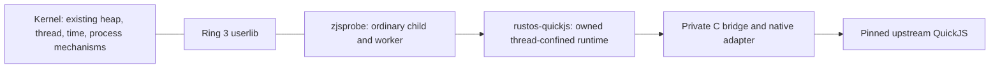

# P0: native engine feasibility and architecture decision

Status: implementation ready for review, 2026-11-05. Baseline is `07784cd`
(main after browser PR #40). This is the first PR of the
[browser roadmap](browser-support-plan.md). Subsequent phase PRs should be based
on this branch until it merges, then retargeted without combining phases.

Decision: use pinned QuickJS as the incremental native ECMAScript foundation for
P1/P3. Its restricted runtime now executes in an ordinary Ring 3 child, inside an
existing 256 KiB worker stack. Keep the engine behind an opaque, owned adapter;
keep trusted browser UI, navigation, resource policy and eventual DOM bindings in
userspace. No kernel mechanism, syscall number, SDK interface, compiler version
or existing browser behavior changes in P0.

This establishes native language-engine feasibility. It does **not** establish a
complete browser, Google results, a secure renderer sandbox or full ECMAScript
conformance. The existing browser still uses its prototype evaluator. Replace
that evaluator when the upstream adapter has real document bindings and lifecycle
tests; avoid a permanent per-site choice between two language runtimes.

## Architecture and ownership

[`rustos-quickjs`](../crates/quickjs/src/lib.rs) owns one context/runtime, frees it
on its creating thread and exposes only copied UTF-8 results, explicit errors and
scalar metrics. It is neither `Send` nor `Sync`. JSValue representations, GC
references and foreign strings stay in C. No DOM or OS object is exposed to page
code. Construction failure destroys partial contexts; every return frees engine
values. Interruption also covers user code invoked while stringifying a result.

The native allocator uses Rust's global allocator with an aligned private header,
checked size arithmetic and exact-layout deallocation. C realloc failure retains
the original block. Engine quotas account for payloads, conservatively including
both blocks during realloc; they exclude allocator headers, bridge state and Rust
input/output buffers. Initial runtime bookkeeping is allocated before the engine
limit is installed; a too-small limit rejects subsequent context initialization.
These are **engine quotas**, not process/frame/RSS quotas. Guest heap exhaustion
outside those limits can still terminate the process through the current SDK.

The default profile allows 4 MiB engine payload, 64 KiB engine stack, 100 interrupt
callbacks per evaluation, 1 MiB source and 8192 result bytes. Validation bounds
configuration and rejects embedded NUL. Interrupt polls are not exact instruction
counts or wall-clock deadlines. Stack checks remain enabled. No JIT or executable
allocation is introduced. The native proof covers the default stack budget;
other workloads/budgets need their own measurements.

`Date`, blocking `Atomics`, host modules, filesystem/process APIs, module loading
and page bytecode loading are absent. Promise objects exist but no job pump is
exposed yet; a resolved promise object is not an asynchronous-browser pass.
`Math.random` uses UTC seconds for a non-cryptographic seed. It must never be used
as security entropy. Date/time zones, task scheduling and secure randomness have
separate requirements in P1/P3.

## Upstream and build decision

QuickJS 2026-06-04 is selected for modern syntax and its embedding, allocator,
stack and interrupt interfaces. Selected upstream files remain byte-identical;
[VENDOR.json](../third_party/quickjs/VENDOR.json) pins release/archive and file
hashes. QuickJS is MIT; nanoprintf is pinned to
`bebaecbeaf430e36a2d30d31a2fed4e098388c93` using its 0BSD option; libm is pinned
to 0.2.16 (MIT). See the [vendor/update procedure](../third_party/quickjs/README.md).

The [build script](../crates/quickjs/build.rs) supports the pinned custom target
and x86-64 Linux host tests. It uses GCC (or `CC`) and `ar`, GNU system headers for
C ABI declarations, SSE2, no red zone and no host libc linkage in the guest.
The headers are a deliberate P0 host assumption, **not** a general POSIX SDK.
Only a configured output copy changes: blocking Atomics is disabled and private
allocator macros are reconciled with the upstream allocator guard. Date is
excluded by context construction; its unavailable platform functions are removed
by section GC. Adding an intrinsic requires a fresh dependency/symbol audit.

The final guest ELF has no undefined symbols, dynamic section or interpreter.
This proves that the exercised binary does not borrow a host libc. Language tests
run once with libc and once with the exact native allocation/math/format adapter.
The native probe also checks alignment, calloc zeroing, realloc failure retention,
format widths/precision/truncation, math and cleanup.

MicroQuickJS was considered but its documented stricter ES5-like subset is a poor
fit for the modern syntax fixtures (classes/private fields, arrows, promises).
No MicroQuickJS guest port was attempted. See its
[upstream subset description](https://github.com/bellard/mquickjs#javascript-subset-reference).

## Full web-engine investigation and revised route

Servo was inspected at **`b88af263d11e12288ff3eca0848aaa675d6a52f0`**. Its
[workspace manifest](https://github.com/servo/servo/blob/b88af263d11e12288ff3eca0848aaa675d6a52f0/Cargo.toml)
requires Rust 1.88; its
[toolchain](https://github.com/servo/servo/blob/b88af263d11e12288ff3eca0848aaa675d6a52f0/rust-toolchain.toml)
selects 1.99.1. This repository remains on 1.86.0-nightly. The manifest includes
SpiderMonkey, libc, async networking, fonts, graphics and optional media stacks.
The [embedding API](https://github.com/servo/servo/blob/b88af263d11e12288ff3eca0848aaa675d6a52f0/components/servo/lib.rs)
requires event-loop waking, rendering/presentation and input forwarding; the
implementation uses `std`. A Rust engine is not automatically a `no_std` port.

A full shallow checkout and bounded, offline custom-target check were attempted.
The check stopped at unavailable pinned Stylo Git dependencies **before compiling
Servo**. This is a dependency-resolution failure, not a demonstrated compiler or
runtime failure. Source hashes, exact command and output are in the
[investigation record](browser-p0/servo-investigation.txt). No toolchain upgrade,
`std` port, SpiderMonkey port, dependency builds, guest execution, memory estimate
or pixel comparison was completed for Servo. A native full-web-engine port remains
an unresolved feasibility project.

WebKit/WPE and Blink were compared at the platform/build-inventory level only.
[WPE's current CMake configuration](https://github.com/WebKit/WebKit/blob/main/Source/cmake/OptionsWPE.cmake)
requires GLib, ICU/HarfBuzz, Soup, graphics/image libraries, SQLite and threads.
[WebKitGTK](https://github.com/WebKit/WebKit/blob/main/Source/cmake/OptionsGTK.cmake)
also integrates Cairo and GTK/display backends.
[Chromium's Linux build guide](https://chromium.googlesource.com/chromium/src/+/main/docs/linux/build_instructions.md)
requires its C++ toolchain, depot_tools and GN build ecosystem. These host stacks
are not implemented by our native surface API. Neither was built or run here;
no performance/compatibility ranking is claimed. References checked 2026-11-05.

Revise the route explicitly: proceed with a real native JS engine and general
browser interfaces in P1–P4, while retaining the full-engine option for broad
compatibility. P0 does not justify a promise that our small renderer will reach
Facebook/YouTube parity cheaply. Before committing to P5–P8, require a separately
reviewed full-engine platform/toolchain proposal or a costed decision to maintain
HTML/CSS/DOM/media ourselves. Do not expand the kernel to emulate an entire host
platform simply to make an upstream build succeed.

## Existing / adapt / new platform matrix

| Need | Existing evidence / P0 adapter | Still required |
| --- | --- | --- |
| Allocation and memory | Growable Ring 3 heap; recoverable engine payload limits; aligned C adapter | Recoverable outer allocations, process/page budgets, measured physical reclamation (P1) |
| Threads/stacks/synchronization | Existing native threads; runtime stays on one 256 KiB worker; 64 KiB engine limit exercised | Navigation cancellation, worker crash containment, safe service ownership (P1) |
| TLS (thread-local storage) | Compiler/SDK support exists; QuickJS realm is thread-confined | Audit each future dependency's C TLS/destructors; no pthread ABI supplied |
| Clocks/readiness | UTC syscall seeds Math.random; ticks measure guest work | Monotonic deadlines, task/microtask/timer jobs, event-loop waking (P1/P3) |
| C/math/format | Private allocation/string/format functions, libm, compiler builtins; no host dynamic linkage | Broader libc/POSIX facilities only if measured; Date/time-zone and future intrinsic audit |
| Network/TLS security | Existing typed sockets and verified HTTPS remain userspace | Streaming methods, POST, metadata, compression, cancellation, sessions/cache (P3) |
| DOM/CSS/layout | Existing browser renderer and prototype bindings unchanged | Standards tree/cascade/layout, real Web IDL ownership/events and invalidation (P2/P3) |
| Surface/input/fonts/images | Existing private surfaces, keyboard/pointer toolkit and bitmap text | Resize, selection/IME, shaping/fonts, image decode, reference rendering (P2) |
| Origins/IPC/storage | Processes/files exist; page engine has no host modules | Principals, least-privilege handles/IPC, origin rules, cookie/profile isolation (P1/P3) |
| Media/audio | No new adapter or proof | Audio mechanism, codecs, media elements/MSE, A/V sync and guest sound (P6/P7) |
| Maintained full engine | Pinned Servo inventory; no native build | Reviewed toolchain + `std`/C/C++/graphics/service port; separate acceptance proof |

These rows are requirements, not authorization to add speculative syscalls. P0
needed none. Every later ABI extension must include kernel validation, typed SDK
wrappers, consumers, docs and rejection/lifecycle tests in its phase PR.

## Frozen baseline and evidence

The fixed local [fixtures](../crates/quickjs/fixtures) compare the existing script
prototype to the native adapter on the host. The
[JSONL capture](browser-p0/comparison.jsonl) records source length, outcomes,
engine allocation metrics, interrupt polls and **host-only** elapsed time:

| Fixture | Prototype | Restricted QuickJS |
| --- | --- | --- |
| Classes/closures/arrays/RegExp/typed arrays/Unicode | Unsupported | Evaluated |
| DOM query | Unsupported | Exception: no `document` binding |
| Promise object | Unsupported | Object returned, pending jobs unserviced |
| Infinite loop | Unsupported | Interrupted at 100 polls |
| 10 MiB string | Syntax rejection | Memory limit, recoverable |

The [guest serial captures](browser-p0/guest-1cpu.log) and
[8-CPU capture](browser-p0/guest-8cpu.log) demonstrate real language evaluation,
math, exceptions, recursion limit, bounded evaluation/result conversion, OOM
recovery, output/input validation, absent ambient capabilities and 20 lifecycle
iterations with zero live native blocks after each. Parent PID 0 only launches
and waits; PID 1 performs the assertions in its worker and exits successfully.
The runner verifies that ordinary child was spawned and every assertion marker
was reached. Engine peak is 172157 payload bytes for this tiny language/error
sequence, 158216 for the quota case. This is not a modern page working set, total
process memory, kernel frame recovery or a performance guarantee.

The existing loader/renderer have no complete resource/layout/decode trace or
whole-page memory profiler. P0 records that observability gap rather than
inventing site traces. Existing fixture requests, CSS pixels and decoding/parser
unit tests remain the available baseline; P2/P3 must add structured bounded
resource/layout diagnostics before claiming real-site API coverage.

Validation commands, red results, current failures and manual limits are in the
[validation record](browser-p0-validation.md). The Google-results rejection stays
strict. A browser homepage or a new language engine cannot satisfy that gate.
