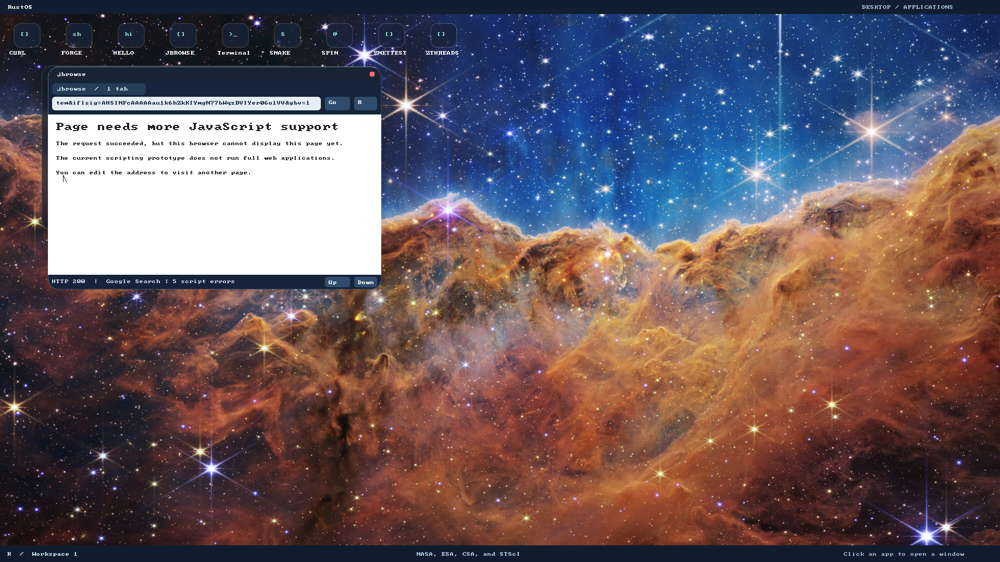

# Browser P0 validation

Executed 2026-11-05 in `/home/jay/personal/os/jbrowse`, branch
`feat/jbrowse-p0-engine-feasibility`, based on main `07784cd`. Text captures normalize trailing whitespace only; no assertions/results were
removed. These checks were
run for this change; older browser documentation is inherited history. See the
[engine decision](browser-engine-p0.md) for architecture, limits and revised route.

Requested behavior: establish a real native engine and freeze the baseline before
later browser phases. The new code runs entirely in Ring 3. No syscall or kernel
source changes were needed. Acceptance is language evaluation, bounded errors and
interruption, native ABI operation and repeated cleanup in an ordinary user child,
plus an explicit engine/platform decision. Google search remains a separate gate.

## Red → green

1. Added host language/error/budget/lifecycle tests first. The stub adapter returned
   `Unavailable`; all four tests failed before the upstream engine was connected.
2. Added the Ring 3 probe/runner with a failing engine stub, rebuilt user programs
   and `target/browser-p0.img`, then ran:
   `RUSTOS_TEST_DISK=target/browser-p0.img python3 -B e2e/browser_p0.py`.
   It failed with `upstream engine not connected to Ring 3 probe`. The
   [captured red output](browser-p0/guest-red.log) includes the guest panic/exit.
3. Connected the vendored engine and private native adapter. Both host profiles and
   the ordinary-child guest tests now pass. Native format/allocator self-tests
   caught a mistaken expected formatter length during implementation; correcting
   that fixture expectation followed inspection of the actual formatted string.
4. Added a result-conversion regression: an object whose `toString` loops returned
   `Exception` instead of `Interrupted`. The [red assertion](browser-p0/conversion-red.log)
   shows both values. Preserve the interrupt classification during conversion;
   rerun host and guest checks, then verify subsequent evaluations still work.
5. The first rerun exposed stale serial output in the new runner. Added a
   [failing log-isolation regression](browser-p0/runner-red.log), reserved unique
   serial files per VM, and passed the regression. Old PASS/panic output cannot
   satisfy or fail a new VM run. Vendor checker tests likewise preceded the
   implementation and rejected tampered, missing and escaping inputs.
6. Formatted local Rust/C code while retaining green checks. Upstream source bytes
   were never formatted or edited. Final probe binary and metadata were regenerated
   together with `tools/build-user.sh`.

## Green checks actually run

| Check | Result and scope |
| --- | --- |
| QuickJS libc host profile | [4 integration tests passed](browser-p0/libc-host-tests.log) |
| QuickJS native-adapter host profile | [5 integration tests passed](browser-p0/native-host-tests.log): language/errors plus native ABI and 20 lifecycle iterations |
| Vendor/runner/documentation/tool host suite | [41 tests passed](browser-p0/tool-tests.log) |
| Existing browser host tests | 12 passed (7 engine + 5 form/encoding tests); optional scripting feature suite was not selected |
| Existing script prototype | 3 passed |
| Userspace and disk builds | `./tools/build-user.sh`, final `./tools/build-user.sh zjsprobe`, then `./tools/build-grub-disk.sh target/browser-p0-final.img` succeeded; build success alone is not a runtime pass |
| Final Ring 3 probe, 1 CPU | [Guest assertions passed](browser-p0/guest-1cpu.log), ordinary PID 1 child, 256 KiB worker |
| Final Ring 3 probe, 8 CPUs | [Guest assertions passed](browser-p0/guest-8cpu.log), same cases and zero remaining native blocks |
| Existing desktop integration | [Passed](browser-p0/desktop.log): independent compositor/DE, commands, applications, focus/drag/close and DE-exit isolation |
| Native executable audit | [Static ELF record](browser-p0/native-build.txt): no unresolved symbols, interpreter or dynamic section; binary and target hashes recorded |
| Fixed comparison | [JSONL captured](browser-p0/comparison.jsonl): host timing/engine counters, explicit DOM/job gaps |

Guest checks assert actual return values, failures and recovery, not just successful
linking or boot. They exercise classes/private fields, closures, array callbacks,
RegExp, typed arrays, Unicode normalization, math, thrown exceptions, infinite
loops, looping result conversion, recursion, memory quota and subsequent reuse,
output limits, NUL rejection, absent ambient modules and fresh globals across 20
new realms. Native block counts return to zero after every realm. Physical frame
recovery, whole-process quota and desktop responsiveness during page execution
remain P1 work; the guest probe temporarily replaces WM on its **private copy**.

Reproduce from this worktree:

```bash
./tools/build-user.sh
./tools/build-grub-disk.sh target/browser-p0-final.img
RUSTOS_TEST_DISK=target/browser-p0-final.img RUSTOS_CPUS=1 python3 -B e2e/browser_p0.py
RUSTOS_TEST_DISK=target/browser-p0-final.img RUSTOS_CPUS=8 python3 -B e2e/browser_p0.py
RUSTOS_TEST_DISK=target/browser-p0-final.img python3 -B e2e/desktop.py
python3 -B -m unittest discover -s tools/tests -p 'test_*.py'
python3 -B tools/check_docs.py
git diff --check
```

Each VM boots a disposable copy and is terminated/reaped. The probe uses unique
logs under `target/browser-p0/cpus-N/`. `.test-only` keeps it out of normal disk
installation/application discovery; it is built through the standard SDK runtime,
not a special kernel entry point. Toolchain, compiler, QEMU version and ELF details
are in the native build record. Host tests must avoid root bare-metal Cargo config:

```bash
browser_repo="$PWD"
cd /tmp
cargo +nightly-2025-01-30 test --manifest-path "$browser_repo/crates/quickjs/Cargo.toml" --target x86_64-unknown-linux-gnu --target-dir "$browser_repo/target/browser-p0-host"
cargo +nightly-2025-01-30 test --manifest-path "$browser_repo/crates/quickjs/Cargo.toml" --target x86_64-unknown-linux-gnu --target-dir "$browser_repo/target/browser-p0-host" --features freestanding
cargo +nightly-2025-01-30 run --manifest-path "$browser_repo/crates/quickjs/Cargo.toml" --target x86_64-unknown-linux-gnu --target-dir "$browser_repo/target/browser-p0-host" --features freestanding --example compare
```

An initial comparison run from the repository failed with duplicate `core` lang
items because it inherited the kernel's `build-std` configuration. It passed when
run from `/tmp` as above; no compiler/config change was made to hide the error.

## Preserved failures and remaining verification

- **Google results fail**. Command:
  `RUSTOS_TEST_DISK=target/browser-p0-final.img RUSTOS_JBROWSE_REQUIRE_GOOGLE_RESULTS=1 python3 -B e2e/jbrowse.py`.
  [Actual failure](browser-p0/google.log): `Google results remain blocked by unsupported JavaScript`.
  Anonymous default Google homepage loaded; submitted public query was
  `rust operating system`. Response reached HTTP 200 with five script errors and
  the browser's unsupported-page fallback. Region was not measured; the run used
  QEMU user networking through this host, a fresh disposable disk and no signed-in
  account or persistent browser profile. No results/navigation task passed.
- **Existing local browser navigation fails**. Command:
  `RUSTOS_TEST_DISK=target/browser-p0-final.img python3 -B e2e/jbrowse.py`.
  [First run](browser-p0/browser-first.log) and an independent
  [standalone reproduction](browser-p0/browser-standalone.log) both missed
  `loaded: Second page`. The URL log concatenates the redirect destination and
  newly typed address. This reproduces on unchanged main browser/SDK binaries;
  P0's new engine is not linked into jbrowse. CSS fixture pixels passed before
  this failure; later forms/scroll/relaunch checks were **not reached**. No timeout,
  assertion or existing implementation was changed to suppress it. Diagnose and
  regress this navigation/input lifecycle in the following browser phase.
- **Servo is unproven**. Its bounded offline check failed dependency resolution
  before compilation; see the [exact record](browser-p0/servo-investigation.txt).
  WebKit/Blink were inventory comparisons, not builds or guest tests.
- No Test262/WPT conformance run, DOM/event-loop binding, Google compatibility fix,
  Facebook/account workflow, media/audio or full-engine port was completed.
- No manual host GUI/input/backend check was performed. QMP assertions and native
  serial tests do not establish human desktop behavior. Later browser phases need
  desktop responsiveness and real host interaction checks.

The following screenshot was captured and inspected from this turn's tested
build. It freezes the **existing Google failure**, not the new engine's execution
or a usable search result. New engine correctness is demonstrated by the guest
assertions/serial logs, since the feasibility probe has no UI.


