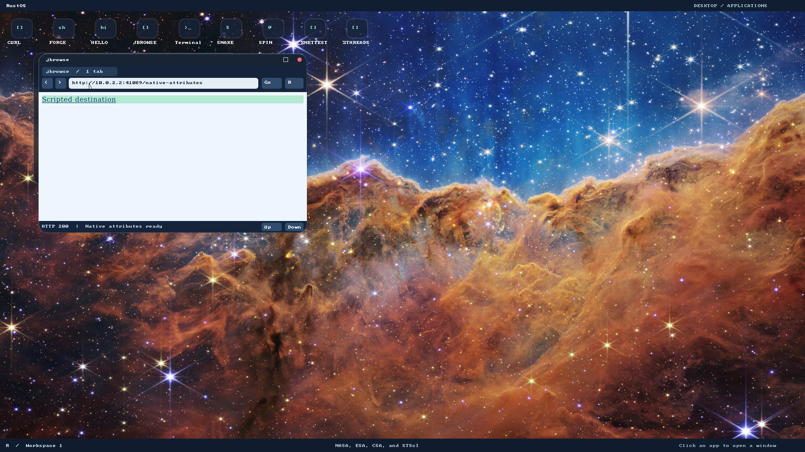

# P4 increment evidence

Executed2026-11-06 in the jbrowse worktree, on the resize stack. These are local
native/host results, not a completed Google or general website milestone.

- [Host red](host-red.log): three new tests failed with one script failure each;
  attribute methods and base64 globals were absent. Existing four tests passed.
- [Native red](native-red.log): the previous native image loaded `Before attributes`
  and the unsupported-script fallback; the required mutated title never appeared.
- [DOM green](dom-green.log): seven tests, including live attributes/forms/links,
  binary-string base64, invalid-input recovery and existing CPU/effect quotas.
- [Freestanding green](freestanding-green.log): same seven tests through the
  freestanding QuickJS C/platform adapter on the host, not a guest substitute.
- [Browser green](browser-green.log): default-feature parser/layout/form/effect
  suites, including bounded attribute wire round-trip and whole-batch rollback.
  The optional prototype scripting host suite was not run for this P4 increment.
- [Worker protocol](protocol-green.log): framed IPC validation/cleanup regressions.

The first native pixel probe intersected an antialiased glyph rather than a blank
background. [Observed failure](pixel-observation-red.log). It now checks the same
exact expected class background at a blank point on that row; no tolerance,
expected color or timeout changed. Scripted-link navigation remains separately
asserted against the independent server's captured destination.

Reproduction (fresh builds; private writable VM copies):

```bash
./tools/build-user.sh
./tools/build-grub-disk.sh target/jbrowse-p4.img
RUSTOS_TEST_DISK=target/jbrowse-p4.img RUSTOS_CPUS=8 RUSTOS_JBROWSE_P4=1 RUSTOS_JBROWSE_NATIVE_SCRIPTS=1 RUSTOS_JBROWSE_RESIZE=1 python3 -u -B e2e/jbrowse.py
RUSTOS_TEST_DISK=target/jbrowse-p4.img RUSTOS_CPUS=8 python3 -u -B e2e/desktop.py
RUSTOS_TEST_DISK=target/jbrowse-p4.img RUSTOS_CPUS=8 RUSTOS_JBROWSE_REQUIRE_GOOGLE_RESULTS=1 python3 -u -B e2e/jbrowse.py
```

Run host Cargo tests from `/tmp`, with pinned nightly2025-01-30, explicit
`--target x86_64-unknown-linux-gnu` and the absolute crate manifest path. Native
worker privileges and quotas are inherited from P3; no kernel change in this PR.
No manual host display/input check, full WPT run, authenticated account flow or
Google three-query acceptance is established by these fixtures.

[Desktop green](desktop.log) verifies the full DE/compositor/application interaction
suite. [Tooling green](tooling.log) records45 host tooling tests. The strict
[live Google run](google.log) failed with `Google results remain blocked by
unsupported JavaScript`; homepage load and query submission are not results.



The screenshot shows the independent native fixture with a script-assigned class,
removed `display:none`, decoded href and title. The test separately asserts exact
colors, no script errors and the server's real link destination.

[Native green](native-green.log) passed on8 CPUs: existing native scripts/quotas,
new attributes/base64/scripted navigation, expand/restore/edge resize, GET forms,
links/scrolling/error recovery, terminal survival and browser relaunch. All apps
and metadata were rebuilt together; generated metadata values did not change.
The build retained the existing bootloader `rustc-abi` warning. Kernel suites were
not rerun for this userspace-only increment; their older P3/resize evidence is
separate from the commands executed here.
