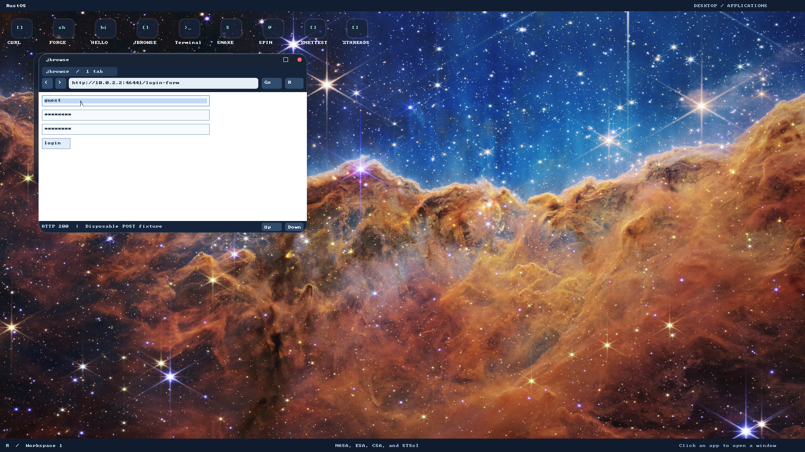
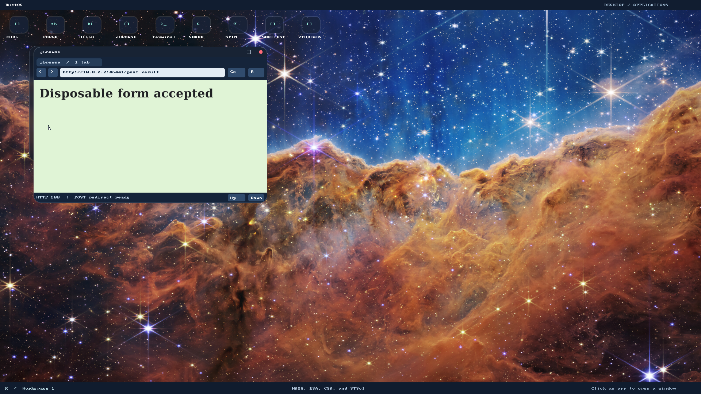
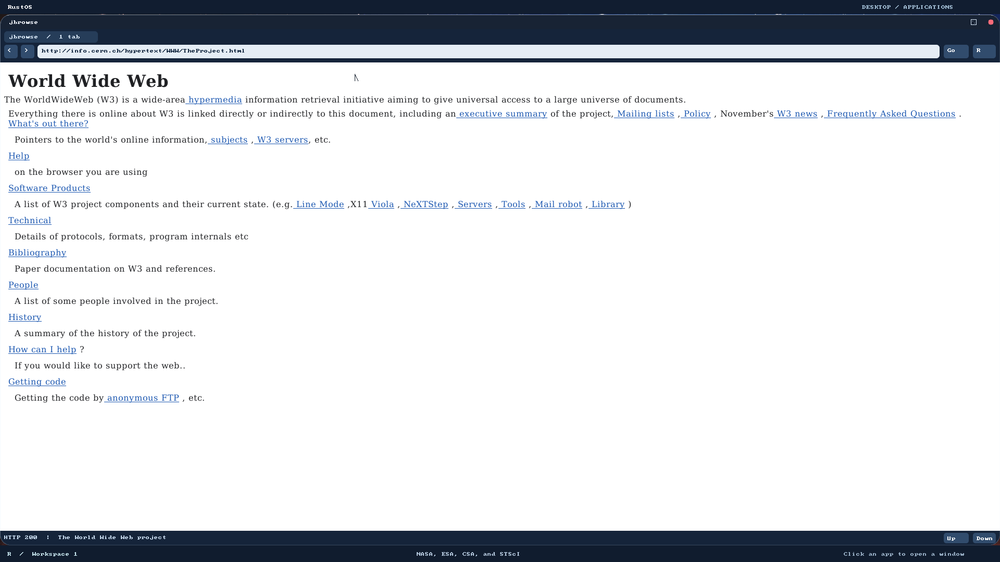

# P5 increment evidence

Executed2026-11-06 on top of P4/resize in the jbrowse worktree. Native runs boot
private writable copies of a fresh GRUB disk. No real credentials are used.

Red evidence:

- [Form API red](forms-api-red.log): compilation identifies the absent typed
  submission, password display and editable-control APIs. This is missing-API
  evidence, not a runtime test pass/failure.
- [HTTP API red](http-api-red.log): absent request type/function and replay error.
- [Native password red](native-red.log): the previous P4 image lacks a password
  field; clicking it never produces the required focused-control border.
- [Verified POST red](tls-red.log): the full previous-image TLS suite completed,
  then the independent host assertion failed because no POST requests arrived.

Reproduce:

```bash
./tools/build-user.sh
./tools/build-grub-disk.sh target/jbrowse-p5.img
RUSTOS_TEST_DISK=target/jbrowse-p5.img RUSTOS_CPUS=8 RUSTOS_JBROWSE_P5=1 RUSTOS_JBROWSE_P4=1 RUSTOS_JBROWSE_NATIVE_SCRIPTS=1 RUSTOS_JBROWSE_RESIZE=1 RUSTOS_JBROWSE_LIFECYCLE=1 RUSTOS_JBROWSE_PUBLIC=1 python3 -u -B e2e/jbrowse.py
RUSTOS_TEST_DISK=target/jbrowse-p5.img RUSTOS_CPUS=8 python3 -u -B e2e/tls.py
RUSTOS_TEST_DISK=target/jbrowse-p5.img RUSTOS_CPUS=8 python3 -u -B e2e/http.py
RUSTOS_TEST_DISK=target/jbrowse-p5.img RUSTOS_CPUS=8 python3 -u -B e2e/desktop.py
```

Host Cargo commands run from `/tmp` with pinned nightly2025-01-30, explicit
`--target x86_64-unknown-linux-gnu` and absolute manifest paths for `crates/browser`,
`crates/http` and `crates/browser-dom` (the latter with `--features freestanding`).
The mask test compares the typed password's actual pixel rectangle with a native
readonly field containing eight asterisks, and asserts it is nonblank. The host
server separately asserts method, URL, content type and exact disposable body.
A 303 response must produce a GET; reload must not send another POST. These are
observable results, not command-echo or HTTP-status-only checks.

The body never enters URL/history/serial output. Tests are not an exhaustive proof
of secrets removal: heap buffers are not zeroized, and parsed page attributes can
retain server-provided initial values. Cookies, persistent sessions, full HTML
form semantics and Facebook workflows remain unimplemented. Manual host desktop
input and authenticated account tests were not performed.

Green checks actually run for this increment:

- [Browser all-feature host tests](browser-all-green.log):27 tests (12 layout,
 3 effects,8 forms,4 optional prototype scripts); the separate
  [default-feature run](browser-default-green.log) has23. Password layout/masking,
  redacted diagnostics, Unicode/control encoding and POST bounds are included.
- [HTTP host tests](http-host-green.log):2 unit and27 integration tests. Covers
  fragmented/short writes, exact headers/body, zero/16KiB/oversized input,
  cancellation and send failure during upload, all redirect method cases,
  cross-origin replay/downgrade rejection and existing GET/framing limits.
- [Freestanding DOM host tests](dom-green.log):7 cases preserve native P4 APIs,
  form refresh, effect limits and script/microtask recovery.
- [Navigation/editor](navigation.log):4 host cases preserve address drafts/history.
- [Native browser](native-green.log),8 CPUs: masked typed password pixels and
  successful exact POST/303/GET/reload; P3/P4 scripts, resize/restore/large pointer
  coordinates, ordinary GET search, images/fonts, HTTP/TLS cancellation and real
  CERN page rendering. Existing close/relaunch/terminal survival checks pass.
- [Verified TLS](tls-green.log),8 CPUs: two independently asserted HTTPS POST
  requests with exact body, plus existing certificate hostname/date/trust/RSA,
  streaming/redirect/limits and allocation/socket cleanup. The final PASS follows
  the host's explicit two-POST assertion; its legacy summary text is unchanged.
- [Native HTTP](http-native.log): real Portal curl, standalone CURL and repeated
  Ring3 DNS/HTTP framing/error/streaming/socket cleanup.
- [Desktop](desktop.log): complete DE/compositor/application interactions.
- [Tooling](tooling.log):45 host tests; documentation checker and diff whitespace
  checks passed. All apps/metadata and a fresh GRUB image were built. No kernel ABI
  changed; kernel suites/host GUI checks were not rerun or claimed in this phase.
  The existing bootloader `rustc-abi` warning and known debug heap stress timeout
  remain inherited limitations, not repaired by this change.





A real public page to try is
[the CERN World Wide Web project](http://info.cern.ch/hypertext/WWW/TheProject.html).
The following image was captured during this increment's native full run; the
suite also asserts changed document pixels, follows normal fixture links and
checks expand/restore behavior. This is not a screenshot reused from P4/resize.



[Native restricted worker regression](worker-native.log) and its
[serial assertions](worker-serial.log),8 CPUs, pass repeated physical-frame
recovery, sealed-capability rejection, nested owned worker IPC, DOM/engine quotas,
crash/deadline/malformed-message cleanup and cancellation using the rebuilt worker.
The footprint remains within the existing8192-frame budget; no threshold changed.

The [current strict Google run](google.log) still fails with `Google results remain
blocked by unsupported JavaScript`. It loaded the default homepage and submitted
the query, but this is not readable search results. This failure was reproduced on
the P5 build, separately from P4's older evidence. No tests were weakened, skipped
or given higher timeouts to hide it. P4/P5 stay draft and their full gates stay open.
