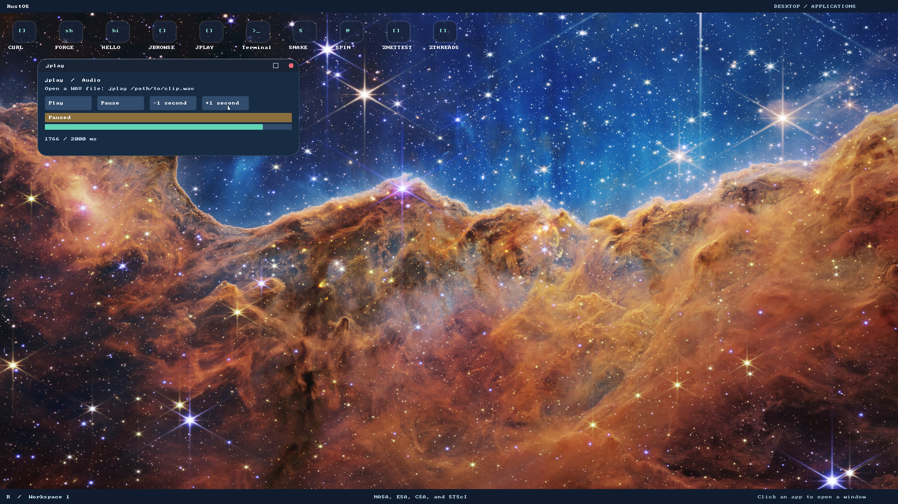

# P6 executed evidence

Executed2026-11-06 in the jbrowse worktree; native tests boot private writable
images. Generated user binaries/metadata were rebuilt together, with the pinned
toolchain/targets retained. No host device or mounted image was used as a fixture.

- [Native red](native-red.log): the old kernel's unknown audio syscall made a
  valid Ring3 Stream::open fail. [Ring API red](ring-api-red.log),
  [pause API red](pause-api-red.log) and [WAV API red](wav-api-red.log) record absent
  mechanisms/interfaces, not runtime passes.
- [Restart red](restart-red.log): native streaming after a drained queue failed;
  repeated RUN writes advanced prefetched indices. The corrected driver preserves
  partial pauses and only starts a stopped/rebased engine.
- [BAR overflow red](bar-overflow-red.log): malformed high I/O BAR arithmetic
  panicked. Checked full-aperture validation [passes](bar-green.log).
- [ABI](abi-green.log), [ring accounting](ring-green.log) and [WAV](wav-green.log)
  host suites pass layout/error separation, bounded queue wrap/backpressure,
  invalid cursors, partial rebase, sample-preserving seek and malformed RIFF cases.
- Native [1 CPU](native-1cpu.log), [8 CPUs](native-8cpu.log),
  [32 CPUs](native-32cpu.log): process ownership, stale/foreign handles, malformed
  complete mappings, pause before/during playback, backpressure, positions, further
  writes after drain, close/exit/kill and three rounds of exact frame recovery.
  Independent captures have exactly36864 nonzero stereo PCM frames at48kHz and
  approximately984Hz (the fixture repeats a48-frame square pattern in1024-frame
  blocks). [1-CPU capture](capture-1cpu.json), [32-CPU capture](capture-32cpu.json).
- [Missing hardware](missing-device.log) returns typed NoDevice. The rebuilt
  [restricted worker regression](worker.log) passes including new audio syscall
  rejection; scripts gain no audio authority.
- [Player red](player-red.log): the old image has no JPLAY launcher. The actual
  [desktop player](player-green.log) passes file load, controls, frozen paused
  progress, seek change, resumed completion, close and independent captured sound.
- [Kernel unit](kernel-unit.log):91 cases.
  [Kernel integration](kernel-integration.log): stdio, display_mapping and native
  thread/process lifecycle cases pass. [Default build](default-build.log),
  [GRUB build](grub-build.log), release GRUB image build and
  [all test compilation](test-build.log) completed. Compilation is separate from
  those executed assertions. The existing bootloader rustc-abi warning remains.
- [Host tooling](tooling.log):49 tests, including PCM capture validation. The
  documentation checker and diff whitespace checks pass.

The new test harness had two observation errors, corrected without loosening
expected values/timeouts: connected output packets have at most three bytes,
so its holding marker must accumulate across packets; the first
[player coordinate](player-observation.log) assumed console rather than native
placement. Native placement is80,154 and was confirmed against source/readback.

The capture backend leaves zero RIFF/data lengths on termination:
[observed parser failure](capture-observation.log). Host validation preserves the
original capture and finalizes only those two lengths after validating the exact
PCM format/alignment. Every audio byte remains unchanged; exact active-frame
assertions still detect loss/replay. Per-CPU output directories avoid artifact
races between independent VMs. QEMU's unsupported input-voice warnings are retained;
no microphone support is claimed.




[Recorded native player PCM](player.wav) is a generated owned tone, captured from
this tested build. It supplements automated channel/non-silence/frame checks.
No human host-speaker listening, manual GUI/input integration, video/A/V sync,
compressed-codec, Google results or authenticated Facebook acceptance was performed.

Reproduce:

```bash
./tools/build-grub-disk.sh target/jbrowse-p6-player.img
RUSTOS_TEST_DISK=target/jbrowse-p6-player.img RUSTOS_CPUS=1 python3 -u -B e2e/audio.py
RUSTOS_TEST_DISK=target/jbrowse-p6-player.img RUSTOS_CPUS=8 python3 -u -B e2e/audio.py
RUSTOS_TEST_DISK=target/jbrowse-p6-player.img RUSTOS_CPUS=32 python3 -u -B e2e/audio.py
RUSTOS_TEST_DISK=target/jbrowse-p6-player.img RUSTOS_CPUS=8 python3 -u -B e2e/audio.py --missing
RUSTOS_TEST_DISK=target/jbrowse-p6-player.img RUSTOS_CPUS=8 python3 -u -B e2e/media.py
```

The rebuilt [full browser](browser.log) and [desktop](desktop.log) regressions pass
with the new app catalog/SDK/kernel. Browser checks include native scripts, POST,
real CERN, fonts/PNG, resizing, GET search and close/relaunch. These are distinct
from the earlier performance-only build's evidence.

After the audio/kernel/player changes, the isolated [browser timing gate](performance.log)
passes with the same1s/2s/1s limits across three fresh browser processes.
[Actual measurements](performance.json) retain all trials; no competing VM ran
in this measurement. This checks the integrated stack rather than reusing the
performance-only PR's numbers.
