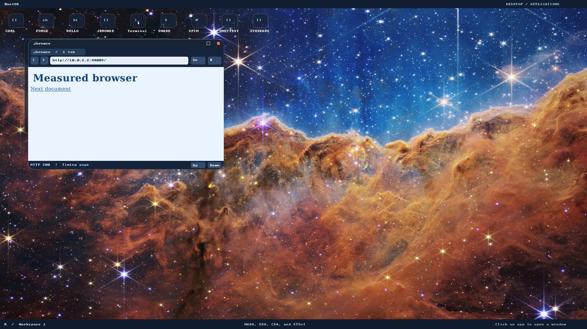

# Browser startup and navigation performance

The native browser now opens its first window within one second in the measured
8-CPU QEMU TCG profile. This is a measured local-workload result, not a network-wide
or host-desktop guarantee. Google/Facebook/YouTube compatibility gates remain open.

## Fixed acceptance and measured results

Budgets were declared before measuring the old image: visible browser window1s,
first local styled-page paint2s, subsequent local navigation1s. Every one of three
fresh browser processes must pass; a slow trial cannot disappear in an average.
Timing starts before Enter launches the actual program, includes image loading,
font construction and painting, and ends after exact framebuffer colors appear.
Navigation timing includes QMP click injection. Boot and command typing are outside
these browser timings. No competing VM was run during the successful timing run.

| Measured maximum | Before | After | Fixed budget |
| --- | --- | --- | --- |
| Window visible |37.639s |0.950s |1.000s |
| Local HTML/CSS painted |38.089s |1.411s |2.000s |
| Follow local link |0.830s |0.810s |1.000s |

[Raw before](browser-performance/native-red.log),
[raw after](browser-performance/native-green.log),
[before JSON](browser-performance/red-metrics.json),
[after JSON](browser-performance/metrics.json). Profile:1GiB RAM,8 emulated CPUs,
1920×1080 framebuffer, same private disk layout and independent local HTTP/CSS
server. Fresh process does not mean flushed host/disk caches. Public network and
TLS latency are not bounded by this deterministic local fixture. The test fails
on overruns; budgets and watchdogs were not raised to obtain green.

## Font change and ownership

The initial [allocation regression](browser-performance/font-red.log) observed
296,713,176 cumulative requested bytes during six-face font construction before
a glyph was requested. This is cumulative allocator traffic, **not peak/live RAM**.
The new initialization satisfies a128KiB cumulative budget.

The same pinned fontdue0.9.3 source is [vendored with provenance](../third_party/fontdue/RUSTOS.md).
Its small on-demand face API borrows trusted embedded bytes, parses tables once,
reads metrics without compiling every outline, and compiles only requested glyphs.
The existing per-painter512-glyph/1MiB coverage cache remains bounded. There is no
process-global mutable cache, new syscall, dependency upgrade, reduced alphabet
or substituted bitmap font. Static font bytes remain valid across layout and
painter threads; FontSet's asset-loading API now requires static byte slices.

The original eager font API remains a parity oracle. Tests compare exact coverage,
dimensions, advances and family line metrics across six faces, five sizes and
nine Unicode/space/combining/missing-glyph cases. Existing font tests and startup
allocation regression [pass](browser-performance/font-green.log). Shaping,
bidirectional text and untrusted webfonts remain separate work.

Two test-observation mistakes are preserved: the initial
[link click](browser-performance/link-observation.log) hit above the anchor; its
inspected frame established the actual y292 point. The first
[parity oracle](browser-performance/parity-observation.log) incorrectly used a
missing-character fallback face for family line metrics; the original API uses
its family face's M metrics. The test was corrected to that existing behavior,
not to a new renderer result. Neither mistake changed timing/color budgets.

## Reproduce and evidence

```bash
./tools/build-grub-disk.sh target/jbrowse-perf.img
RUSTOS_TEST_DISK=target/jbrowse-perf.img RUSTOS_CPUS=8 python3 -u -B e2e/browser_perf.py
```

The runner uses a private image, actual socket-served HTML/CSS, real Ring3
navigation and pixel assertions, closes/relaunches three browsers, and always
terminates/reaps QEMU. Output is `target/browser-perf/metrics.json` plus screenshots
and serial logs after a completed run. The host metrics validator rejects missing,
nonfinite, negative, boolean and insufficient samples. [Tooling tests](browser-performance/tooling.log)
and [browser layout/form/script tests](browser-performance/layout.log) passed.



A screenshot supplements the timing and semantic/pixel assertions. Host GUI/input
backend behavior was not manually tested. The bootloader's existing rustc-abi
warning remains. Kernel behavior was unchanged; older kernel evidence is not a
claim of new kernel tests in this increment.

The rebuilt-font [full native browser regression](browser-performance/browser.log)
and [desktop regression](browser-performance/desktop.log) also passed on8 CPUs.
They preserve password/POST/303, P3/P4 scripts, images/fonts, real CERN rendering,
resize/restore, ordinary GET forms/links/error recovery, close/relaunch and the
DE/compositor interaction suite. These runtime checks ran after, separately from,
the isolated performance measurement.
