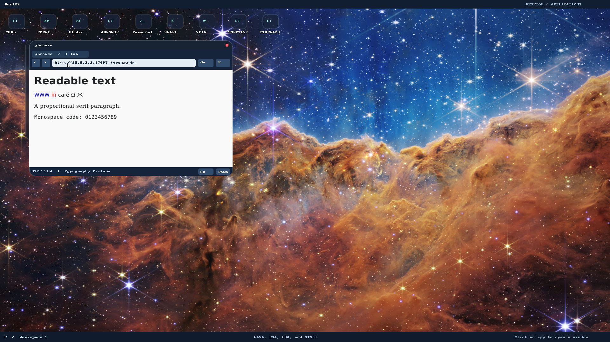

# P2: native presentation and classic navigation

P2 is **in progress**. This change delivers a bounded presentation foundation;
it does not satisfy the entire [classic browsing exit gate](browser-support-plan.md).
The browser remains an ordinary Ring 3 application. There is no kernel, syscall,
target, compiler, window geometry or privilege change in this phase.

## Architecture and supported behavior

- [`rustos-text`](../crates/text/src/lib.rs) shares font styles/metrics between
  layout and painting. Its optional TrueType backend pins fontdue 0.9.3 and
  ttf-parser 0.21.1, without std, SIMD or parallel features. Six unchanged
  [DejaVu 2.37 faces and notices](../third_party/fonts/README.md) provide Sans,
  Serif and Monospace, regular and bold. The default document face is Serif16.
  Glyph advances, wrapping, line height and link boxes use the same metrics.
- The optional SDK `fonts` feature supplies a thread-owned
  [`Painter`](../user_programs/userlib/src/ui/font.rs) with immutable shared faces
  and a coverage cache bounded to 512 glyphs/1 MiB. Fonts load once per browser.
  Grayscale antialias masks and RGBA images use checked, stride-aware, clipped
  Canvas operations. Page fragments cannot paint across the URL bar boundary.
- [`rustos-web-image`](../crates/web-image/src/lib.rs) decodes **static PNG** into
  owned RGBA, using pinned no_std zune-png 0.4.10/zune-core 0.4.12. Original chunk
  lengths/CRCs are checked before backend decoding; dimensions are at most4096
  and total pixels at most1,048,576. Compressed input is at most1 MiB. ICC/text
  metadata is discarded without expansion: the decoder's ICC path otherwise
  inflated unbounded metadata. APNG, unknown critical chunks and trailing bytes
  are rejected. Color management is not implemented.
- Decoded assets belong to the document, shared into its display list by Arc.
  At most16 images/16 MiB decoded RGBA belong to one document. Invalid association
  or replacement leaves existing resources intact. Layout honors intrinsic size,
  integer width/height and aspect ratio, fits the available width and emits image
  link hit boxes. Failed images retain readable alt text. No decoder fetches URLs.
- The application loader owns HTTP(S), cancellation and resource policy. It tries
  at most16 image sources, one at a time; failures appear in the status count.
  Font assets are trusted embedded files, not downloaded page fonts. Native
  allocation failure can still terminate the app; these limits are not a complete
  browser working-set quota or a production decoder sandbox.
- CSS author sheets now follow their actual HTML source order. `!important`,
  specificity, source order and declaration order determine supported properties.
  Inheritance includes family, weight and integer pixel size. Embedded styles
  retain their positions relative to linked sheets; fetch failures preserve the
  remaining cascade. CSS syntax/layout still cover a small subset.
- Back/Forward store at most32 destinations per direction and commit only after
  successful loads. They refetch documents; they do not restore scroll/forms or
  implement a back-forward cache. Reload preserves the forward list. New successful
  navigation clears it. Stop cancels both initial and subsequent requests, drops
  pending work and invalidates late results. Only one tab exists.

## Red tests and validation

Evidence is retained in [browser-p2](browser-p2/README.md). Before implementation,
real glyph tests failed on missing font support, proportional layout used equal
fixed cells, CSS source order painted red instead of blue, and history had no
implementation. P1's native build failed the new antialias and image-pixel checks.
The new Stop interaction reproduced a first-navigation bug: no committed URL meant
the button could not cancel. Additional regressions reproduced black text
stretching the previous image from120 to160 pixels, and an anchor underline
painting black over its PNG pixels. Each was corrected after its observed red.

Host checks cover real font outlines/Unicode/metrics/bold faces, font limits,
PNG alpha/malformed input/CRC/dimensions/all truncations/oversized metadata,
image association/count/decoded-byte budgets and failed replacement, proportional
layout/link geometry, stylesheet cascade, forms, existing scripting and SDK
stride/clipping/blending behavior. Native checks exercise actual QMP input,
framebuffer pixels, remote socket closure, history destination changes, broken
image fallback and independent Terminal survival. The desktop regression is
required because the shared SDK changed. Default/GRUB/release builds, test compilation and native display mapping/cleanup
were also rerun for SDK integration. Unrelated P1 kernel suites are not claimed
as new evidence.

Run from outside the repository's bare-metal Cargo configuration:

```bash
cd /tmp
cargo +nightly-2025-01-30 test --manifest-path /path/to/jbrowse/crates/text/Cargo.toml --target x86_64-unknown-linux-gnu --features truetype
cargo +nightly-2025-01-30 test --manifest-path /path/to/jbrowse/crates/web-image/Cargo.toml --target x86_64-unknown-linux-gnu
cargo +nightly-2025-01-30 test --manifest-path /path/to/jbrowse/crates/browser/Cargo.toml --target x86_64-unknown-linux-gnu --features javascript
```

From the worktree, rebuild all applications, then a disposable template:

```bash
./tools/build-user.sh
./tools/build-grub-disk.sh target/browser-p2.img
RUSTOS_TEST_DISK=target/browser-p2.img RUSTOS_JBROWSE_STOP_STARTUP=1 RUSTOS_JBROWSE_IMAGES=1 RUSTOS_JBROWSE_TYPOGRAPHY=1 RUSTOS_JBROWSE_SCRIPTS=1 RUSTOS_JBROWSE_LIFECYCLE=1 RUSTOS_JBROWSE_PUBLIC=1 python3 -B e2e/jbrowse.py
RUSTOS_TEST_DISK=target/browser-p2.img python3 -B e2e/desktop.py
```

## Remaining P2 acceptance criteria

HTML5 tree construction/encoding/base URL behavior, complete CSS box model,
positioning/stacking/overflow, flex/grid/media queries/variables/units, baseline
alignment/kerning/shaping/bidi, downloadable fonts/fallback, JPEG/WebP/SVG and
animation, complete forms, focus/Tab/IME/selection/clipboard, upload/download,
fragments/zoom/borderless fullscreen and reference-browser comparisons remain open.
[Later compositor work](window-resize.md) adds edge resize/maximize/restore and
browser reflow; its evidence is recorded separately.
The current integer metrics are not a typography conformance claim. Chrome and
form editing still use the bitmap SDK text path. QMP injection does not verify
manual host GUI/input capture. Google results, Facebook and YouTube remain
unverified and are not made functional by fonts or PNG support alone.

The final combined native run and desktop regression passed. The live CERN URL
`http://info.cern.ch/hypertext/WWW/TheProject.html` loaded in the guest on
2026-11-06. Host checks passed:3 font cases,2 decoder cases,21 browser cases
(12 HTML/layout/cascade/image,5 forms,4 prototype scripts),25 SDK UI cases,
4 navigation/editor cases and44 tooling cases. Default/GRUB/release builds,
complete test compilation and `display_mapping` also completed successfully.
The pre-existing bootloader target `rustc-abi` warning remains visible.
The last strict Google-results failure is retained in [P1 evidence](browser-p1/google.log);
it was not rerun or claimed fixed by this phase.




