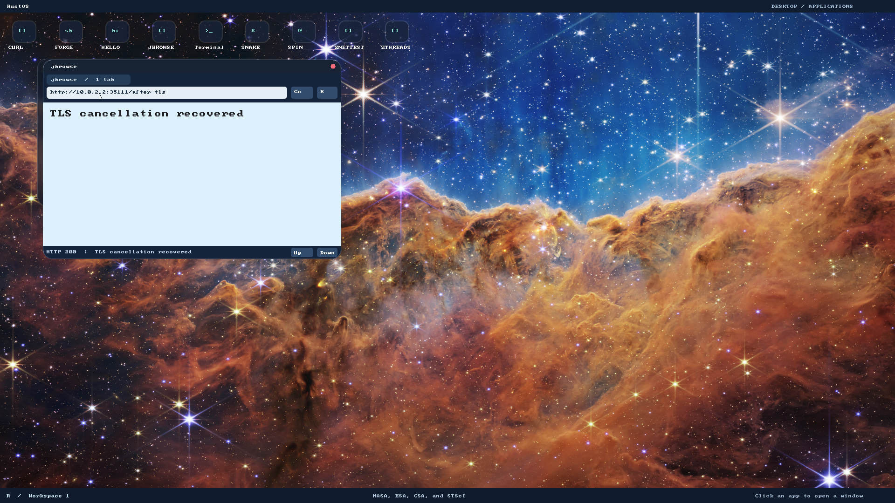

# P1: worker ownership, restrictions and navigation cancellation

Implemented on top of browser P0 (`f2ce464`), with execution evidence from
2026-11-05/06. The browser keeps its trusted URL editor responsive during loading;
a completed redirect cannot replace an active selection or partially typed URL.
Replacing a navigation cancels the previous DNS/TCP/TLS/HTTP operation. Closing
the browser cancels its active task; kernel process teardown still owns final
socket/thread/frame cleanup.

## Privilege boundary

[`JWORKER.SVC`](../user_programs/jworker/src/main.rs) is an ordinary SDK-based
Ring 3 ELF, installed in `/BIN` as a service rather than a desktop `.BIN` launcher.
It starts with an empty environment, drops ambient authority, creates QuickJS,
and only then announces readiness and accepts page bytes. P3 will bind browser
objects to this worker; P1 does not replace jbrowse's existing prototype DOM path.

New syscall 34, [`restrict_worker`](syscalls.md#restricted-worker-principal), is an
irreversible, process-wide profile transition. The kernel requires a non-display
owner, a connected child endpoint and exactly one thread. Invalid profiles,
reserved fields, budgets, a budget below the existing heap or any repeat attempt
leave the process unchanged. The entry gate and scheduler lock serialize the
transition and every later authority check, including on other CPUs.

The profile permits only exit, monotonic ticks/sleep, the existing private stdio
endpoint, budgeted brk, private FS-base operations, clocks/entropy, CPU identity/
yield and stdio-only readiness. Filesystem, sockets, spawn/kill/wait, new threads,
frame diagnostics, compositor messaging, keyboard, pointer, framebuffer and
unknown future calls are rejected **before user copying or side effects**.
Ordinary applications retain their previous rights. This is a mechanism for a
restricted worker, not an origin model or a general production browser sandbox.

The service selects 16 MiB of page-aligned heap, within the API's 64 KiB–64 MiB
range; QuickJS separately allows 4 MiB payload/64 KiB engine stack/100 interrupt
polls per evaluation. Initial executable, 4 MiB main stack, private display backing
and page tables already exist before restriction; they are not charged to the
brk budget. No new thread/mapping mechanism is allowed afterwards. The measured
ready service added **3342 physical frames** in the declared 1920×1080/1 GiB fixture,
including those initial mappings. This is a tiny-realm working set, not a modern
page benchmark. The guest test bounds it by the known image/stack/surface/heap
mapping envelope and proves the exact baseline frame count returns after teardown.

The SDK allocator can still terminate a worker on outer allocation failure; that
failure is confined to its process. The native engine reports its own quota
failure and remains reusable. No W^X/JIT claim is introduced. The bootstrap code
and executable are trusted; the startup handshake validates protocol, not a
cryptographic attestation of a worker's policy.

## IPC and lifecycle

[`rustos-browser-worker`](../crates/browser-worker/src/lib.rs) defines a 24-byte
little-endian header with magic/version, operation, status, sequence, length and
reserved fields. There are no native pointers, PIDs or transferable handles.
Source is bounded at 128 KiB, results at 8192 bytes. Unknown operations/versions,
reserved bytes, invalid lengths/status, stale sequence numbers and invalid result
UTF-8 fail closed. Error replies contain only a class, never exception text or
page contents. Requests execute serially in one thread-confined realm.

A session owns its connected `Child`. Cancellation, malformed output, EOF and a
180-monotonic-tick total bootstrap/request deadline immediately drop that endpoint,
which kills and reaps its process. This includes partial writes and backpressure;
no caller locks are held across IPC. Engine exceptions, interrupt and quota errors
are recoverable within the same realm. New sessions create fresh realms. Host
death uses the existing kernel-owned connected-child teardown path.

Clocks are separate: UTC remains certificate time; PIT ticks drive cancellation/
progress deadlines. The SDK's cloneable one-way cancellation token shares only an
atomic flag through an owned Arc (Release/Acquire publication), with no foreign
references or retained caller buffers. TLS checks the same token during handshake,
record reads and writes. Existing non-cancellable APIs keep their signatures.

The UI's one replaceable request/result slot remains bounded. Every new valid
navigation cancels the old token and increments its result generation. Stale
results are discarded; a completion updates the committed page without changing
an address being edited. Background HTML/CSS/prototype execution remains bounded
in the current trusted loader; moving the whole parser/resource service into
restricted processes is future work.

## TCP cancellation fix

The new GUI test exposed a pre-existing teardown bug: `abort()` queued a reset,
then socket removal discarded it before device dispatch. Close now attempts one
bounded egress pass before removal. Process cleanup aborts owned TCP endpoints,
drops other owned queues, attempts a single egress pass and releases all handles.
No allocation, unbounded polling or graceful-FIN/peer-ack wait was added. Under
device backpressure or packet loss, remote reset delivery is best effort; local
reclamation remains immediate. The test uses a ready device and independently
observes reset bytes and remote HTTP/TLS connection closure.

## Executed red → green evidence

- [Navigation red](browser-p1/navigation-red.log): a completion replaced selection,
  producing `http://fixture/redirectedn` instead of `n`. The standalone controller
  regression and the formerly failing full browser navigation now pass.
- [Restriction red](browser-p1/restriction-red.log): guest syscall 34 was unknown;
  the ordinary child failed to enter its restricted principal.
- [Protocol red](browser-p1/protocol-red.log), [packaging red](browser-p1/packaging-red.log),
  [token red](browser-p1/token-red.log) and [HTTP red](browser-p1/http-red.log)
  preceded their implementations.
- [TCP wire red](browser-p1/tcp-close-red.log) and
  [GUI remote-close red](browser-p1/remote-close-red.log) reproduced discarded
  TCP resets. [Wire assertions now pass](browser-p1/tcp-close-green.log).
- Initial resource accounting failed because the parent's **first allocation**
  mapped 16 heap pages plus two page-table frames. The
  [diagnosis](browser-p1/parent-bootstrap-diagnosis.log) records both breaks/counts.
  The fixture now initializes its own allocator before taking the baseline and
  asserts its break remains unchanged. No frame-recovery threshold was weakened.

Native evidence: [1 CPU](browser-p1/worker-1cpu.log),
[8 CPUs](browser-p1/worker-8cpu.log), [32 CPUs](browser-p1/worker-32cpu.log).
Each runs an ordinary connected child and verifies valid/invalid restrictions,
no relaxation, multi-thread/unconnected/display-owner rejection, loss of real
file/spawn/thread authority, heap boundary/rollback, repeated physical-frame
recovery, actual QuickJS evaluation, loop/quota recovery, cancellation, an isolated
`ud2` fault, an uncooperative CPU loop killed at its bootstrap deadline and malformed
IPC rejection. No runtime timeout or existing assertion was increased or skipped.

The test runner also exposed an observation bug: combining raw logs and decoded
console text shifted old messages past a saved observation mark. A
[red regression](browser-p1/observation-red.log) preceded an append-only decoded
console helper; cancellation now asserts distinct destination titles and pixels,
so an old page cannot satisfy recovery. The legacy network runner's hard-coded
icons launched jbrowse instead of Terminal after the earlier browser installation.
Its [reproduced failure](browser-p1/network-launcher-failure.log) and
[host regression](browser-p1/launcher-red.log) preceded resolving actual FAT
launcher order, including services filtered out of the desktop.

Other checks run: 90 kernel unit cases; `threads`, `stdio`, `display_mapping`;
5 release heap cases; default/GRUB/release builds and test compilation; all user
programs/metadata and fresh disks; 7 process-ABI host tests; 3 protocol host tests;
23 HTTP integration tests plus its unit cases; 6 network-stack tests; 3 standalone
navigation/editor tests; 1 cross-thread cancellation test; 44 host tooling tests.
The bootloader's existing unused `rustc-abi` target-field warning remains visible.
The known debug heap stress timeout was not rerun or claimed fixed.

The [desktop regression](browser-p1/desktop.log), the repaired real Ring 3
[network boundary/UDP/TCP/HTTP probe](browser-p1/network-green.log), and the
[OpenSSL-backed verified TLS suite](browser-p1/tls-green.log) also passed. TLS
retains hostname/date/trust rejection, RSA, redirects, streaming and cleanup.
The kernel integration output is [retained here](browser-p1/kernel-integration.log).

The full browser run passed links, CSS pixels, forms/Enter/button submission,
scrolling, error recovery, prototype scripting/fallback, close/relaunch, and the
new stalled HTTP **and TLS handshake** cancellation assertions. It uses real QMP
input and host connection observations:

```bash
./tools/build-grub-disk.sh target/browser-p1-closed.img
RUSTOS_TEST_DISK=target/browser-p1-closed.img RUSTOS_CPUS=1 python3 -B e2e/browser_p1.py
RUSTOS_TEST_DISK=target/browser-p1-closed.img RUSTOS_CPUS=8 python3 -B e2e/browser_p1.py
RUSTOS_TEST_DISK=target/browser-p1-closed.img RUSTOS_CPUS=32 python3 -B e2e/browser_p1.py
RUSTOS_TEST_DISK=target/browser-p1-closed.img RUSTOS_JBROWSE_SCRIPTS=1 RUSTOS_JBROWSE_LIFECYCLE=1 python3 -B e2e/jbrowse.py
```

[Browser output](browser-p1/browser-green.log). This inspected screenshot is the
successfully loaded fixture **after cancelling a stalled TLS handshake**, captured
from this tested build. It supplements assertions; it is not Google results or
proof of host desktop input capture.



The [strict live Google test](browser-p1/google.log) still fails with
`Google results remain blocked by unsupported JavaScript`. No results pass is
claimed. Google results, standards HTML/CSS/fonts/images, real engine DOM/event-loop
bindings, origin/storage/session enforcement and media remain later phase gates.
No manual host GUI/input-backend check was performed. Broader Test262/WPT runs,
full renderer process isolation and whole-browser memory budgets remain unverified.
