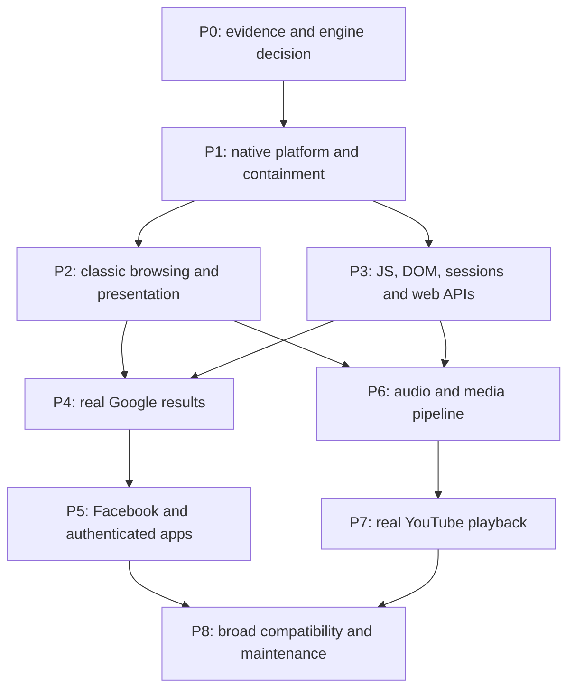

# jbrowse roadmap: everyday browsing and modern websites

Status: proposed implementation plan, 2026-11-05. Baseline: browser commit
`b44a83a`. This is a plan for missing capabilities, not a claim of new support.
See the [browser guide](jbrowse.md), [Google status](jbrowse-google.md), and
[JavaScript prototype](jbrowse-javascript.md) for current behavior and evidence.

The goal is a native Ring 3 browser that can read ordinary websites, search
Google and follow results, play ordinary YouTube videos with sound, and use
Facebook's authenticated interface. These are separate compatibility milestones.
Receiving HTTP 200 or displaying a site's title does not establish support.

## Definition of success

| Target | User-visible acceptance | Current baseline |
| --- | --- | --- |
| Classic browsing | Styled pages, images/fonts, working forms/links, back/forward, reload, selection, copy/paste and scrolling | Small HTML/CSS subset, GET forms, links, bitmap text; many features absent |
| Google Search | Default homepage, query entry, readable result titles/snippets, follow a result, Back and refine the query | Homepage/submission work; usable results fail on unsupported JavaScript |
| YouTube video | Real watch page; play a public unencrypted video with synchronized sound; pause/seek/volume/quality/fullscreen | No browser media pipeline or audio driver in the current driver tree |
| Facebook | Normal user login/verification, readable feed, scrolling/profile navigation, session persistence and logout | No verified support; full JS/DOM, sessions and storage are missing |
| Most ordinary websites | Pass a published representative corpus of tasks across documentation, news, forms, commerce and dynamic sites | No measured broad compatibility claim |

“Complete” means a maintained compatibility profile, not every API and website
forever. A Google homepage is not search results; a YouTube thumbnail is not
playback; a Facebook login form is not a usable feed. Protected video, calls,
device access and extensions require separately declared support.

## Starting point and constraints

Keep the useful interfaces and tests in the
[application](../user_programs/jbrowse/src/main.rs),
[browser library](../crates/browser/src/lib.rs),
[script prototype](../crates/script/src/lib.rs), and Ring 3 SDK. The OS already
provides sockets, verified HTTPS, threads, private surfaces, files and a growing
process heap. Missing foundations include standards-compatible HTML/CSS,
images/fonts, full ECMAScript and browser APIs, cookies, POST, cache, persistent
origin storage, media and a production browser security model.

Measure these constraints before selecting dependencies:

- The [window protocol](../user_programs/userlib/src/ui/protocol.rs) caps native
  content at 640 by 400 with fixed geometry. Larger windows, resize and fullscreen
  need coordinated SDK/WM and potentially surface-mapping changes.
- The browser caps HTML at 256 KiB/4096 nodes; the script prototype caps aggregate
  source at 32 KiB and tokens at 8192. These are prototype budgets, not practical
  modern-site capacity targets. Documents are currently buffered before layout.
- [Worker stacks](../crates/thread-abi/src/lib.rs) default to, and are capped at,
  256 KiB. Audit real engine recursion and stack requirements before running it.
- [Allocation failure](../user_programs/userlib/src/heap.rs) currently exits the
  app. Heap reuse does not prove memory returns to the OS after navigation.
- The [QEMU profile](../tools/qemu_platform.py) supplies 1 GiB RAM. Software
  framebuffer rendering and existing timer-driven paths do not establish smooth
  video. The [driver tree](../src/drivers/mod.rs) has no audio or hardware video/GPU
  acceleration driver.

Do not simply remove limits or extend timeouts. Introduce streaming, cancellation,
per-resource/page/process budgets, working-set measurement and exhaustion/rollback
tests. A larger RAM profile must be an explicit platform decision, with the
existing 1 GiB profile's results reported separately.

## Engine decision before broad implementation

Recommendation: evaluate a maintained web engine for broad compatibility rather
than expand the toy parser/evaluator into an independent implementation of the
entire web. This is an engineering recommendation, not evidence that an upstream
engine currently runs on this OS. Keep the small engine useful for fixtures.

| Route | Feasibility deliverable | Consequence |
| --- | --- | --- |
| Full JS engine plus current renderer | Port a pinned QuickJS revision; inventory C/math/allocation/time dependencies; execute guest language tests and interrupt an infinite loop | An incremental route to targeted JS pages; DOM, layout and media remain substantial projects |
| Maintained full web engine | Evaluate Servo first; compare WebKit/Blink embedding and platform requirements; inventory std/C/C++, threads, graphics, files, sockets and build tools | Preferred direction for the broad website goal if platform cost is acceptable |
| Custom engine alone | Estimate staffing and maintenance for HTML/CSS/DOM/JS/media/security/conformance from the actual backlog | A deliberate long-term engine project, not the shortest Google/YouTube/Facebook route |

[QuickJS](https://bellard.org/quickjs/quickjs.html) documents embedding, memory
limits and execution interrupts; these do not supply a browser DOM.
[Servo](https://github.com/servo/servo) documents an embeddable engine and its
development platforms. Rust implementation does not imply no_std compatibility.
Evaluate the smaller MicroQuickJS option against actual site syntax rather than
assuming its subset is sufficient.

Record an architecture decision after bounded feasibility investigations: upstream
revision, reproducible guest build, dependency/license inventory, required platform
symbols, measured memory, update strategy and an actual native demonstration.
Any toolchain change is separate reviewed work, not an incidental nightly upgrade.
Avoid two permanent engines without a clear compatibility reason. A host browser,
remote rendering proxy or upstream host test pass does not satisfy native support.

## Privilege and responsibility split

| Layer | Responsibilities |
| --- | --- |
| Kernel | Scheduling, protected memory, handle ownership, validated IPC/I/O, audio/GPU/device transport mechanisms |
| userlib/platform adapter | Typed syscalls, clocks/readiness, memory/thread adapters, streams, surfaces and input |
| Browser controller | Trusted URL/UI, navigation/history/tabs, profiles, permissions and resource policy |
| Web engine | HTML/DOM/CSS, JS host bindings, event loop, layout/painting and web security semantics |
| Resource/storage services | Requests/TLS, cache, cookies, origin storage, persistence and quotas |
| Media workers | Demux, codecs, buffering, synchronization and presentation through bounded interfaces |

Services may start as userspace modules. Later renderer/network/media process
separation requires capabilities, handle transfer, IPC validation and teardown.
Ring 3 currently has OS APIs that a restricted renderer must not inherit freely;
process separation alone is not a sandbox. Audit filesystem, spawn/kill and network
rights plus the PID 0/WM exceptions before claiming confinement.

No parser, script interpreter, site-specific policy or codec belongs in the
kernel. An upstream POSIX-like adapter may be necessary; Linux ABI compatibility
is not assumed. Every justified syscall extension must include validation, typed
SDK wrappers, callers, ABI docs and rejection/ownership/lifecycle tests together.

## Milestones and dependencies



Origin/security enforcement starts in P1/P3, before authenticated browsing.
Facebook and media can proceed independently after their prerequisites. Each
milestone contains multiple reviewable changes with red tests before behavior.

### P0 — Freeze the baseline and select the engine

Preserve the Google-results failure. Capture missing language/API calls, failed
resource requests, layout/decode errors and peak memory using local representative
fixtures. Diagnostics omit credentials, cookies and private page content. Execute
the engine investigations above and publish an existing/adapt/new-platform API
matrix. Start with one tab and anonymous HTTPS, then sessions and media.

Exit: a reviewed engine decision and reproducible Ring 3 proof, or an explicitly
failed feasibility result with a revised plan. A host-only build is insufficient.

### P1 — Native runtime, lifecycle and isolation

- Supply measured requirements for allocation, virtual memory, guarded stacks,
  threads, synchronization, TLS, clocks and event readiness. Distinguish wall-clock
  certificate time from monotonic scheduling/media time.
- Define FFI object/buffer ownership and cancellation for requests, timers and
  workers on navigation, document destruction and exit. Add recoverable allocation
  paths and measured process/page quotas.
- Keep trusted UI responsive when page code loops, blocks, crashes or exhausts
  its quota. Start with an interpreter; a JIT needs a separate W^X/executable-memory
  and containment design and is not a prerequisite for Google.
- Introduce principals and least-privilege renderer/service interfaces, with
  malformed IPC, foreign handles, cross-process memory and crash recovery tests.

Exit: guest engine exceptions, bounded interruption and allocation failure do not
take down the desktop. Repeated open/navigate/close and worker failures demonstrate
resource reuse/reclamation, not just successful first launch.

### P2 — Classic browsing

- Standards-based HTML tree construction, encoding detection, entities, URL/base
  handling and malformed-input recovery.
- Correct CSS stylesheet source order, cascade/inheritance, box model, units,
  positioning, overflow/stacking, flex/grid, responsive media queries, variables
  and incremental style/layout invalidation.
- Font loading/shaping/fallback, Unicode and bidirectional text; PNG/JPEG/WebP,
  then SVG/other formats according to measured need. Bound decoded dimensions
  and test malformed font/image inputs.
- Complete forms including password/select/checkbox/radio controls; editing,
  keyboard focus/Tab, Unicode input/IME, wheel input, selection and clipboard.
  Add safe uploads/downloads and file selection owned by the trusted browser.
- Back/forward, reload/stop, fragments, zoom, resize/fullscreen, then tabs/session
  restoration after stable one-tab lifecycle. Page painting must not spoof or
  capture the trusted URL/permission controls.

Exit: local references plus ordinary documentation/news/form pages are readable;
images/fonts render, forms round-trip values, and history restores the right page.
Compare layout, pixels and hit-testing with a reference browser, including input
under load and failure recovery.

### P3 — Real JavaScript and browser APIs

- Port a real ECMAScript parser/VM with objects/prototypes, functions/closures,
  exceptions, arrays/typed arrays, JSON, RegExp, promises, modules and GC. Track
  pinned Test262 results and ownership across JS GC and native DOM destruction.
- Bind DOM querying/mutation, attributes/properties, events/default actions,
  forms/focus, window/document/location/history, CSSOM and layout measurement.
  Generate/audit Web IDL bindings instead of adding site-specific object stubs.
- Supply common host primitives such as URL/URLSearchParams, TextEncoder/Decoder,
  Blob/File/FormData, streams and AbortController. Track Intl/Unicode-data needs
  explicitly; a JavaScript VM alone does not implement these browser facilities.
- Implement tasks/microtasks, timers, animation callbacks and parser/defer/async/
  module ordering. Add workers, observers, canvas and further APIs from standards
  tests and real site traces; executing scripts once after parsing is insufficient.
- Extend GET-only HTTP into streaming methods/bodies, request/response metadata,
  Fetch/XHR, negotiated gzip/Brotli decoding, caching/revalidation, concurrency, connection reuse
  and cancellation. Add HTTP/2/ALPN when negotiation/measurements require it;
  HTTP/3 is not a universal prerequisite for these websites.
- Add bounded cookies and persistent profiles, local/session storage, IndexedDB,
  quotas, clear-data behavior and crash recovery. Service workers/Cache API follow
  actual site/offline requirements.
- Enforce same-origin access, CORS/credentials, cookie domain/path/Secure/HttpOnly/
  SameSite behavior, TLS verification, mixed-content/CSP/frame boundaries, secure
  contexts and user-mediated permissions. Add WebSocket/SSE, WebCrypto and
  international URL behavior according to exercised requirements.

Exit: local apps demonstrate asynchronous rendering, modules, authenticated
requests, cross-origin rejection, persistence and teardown in Ring 3. Do not expose
embedded runtime filesystem/process modules to page scripts. Host language tests
alone do not verify the browser bindings or OS adapter.

### P4 — Google results as the first modern-site gate

Keep Google as the normal start page. Render the real query and consent UI where
served; submit both address-bar and page-form searches. Trace the current failing
response and implement missing general JS/DOM/network/session behavior using
independent fixtures. Do not hard-code Google's DOM, substitute a provider,
fabricate results or count a host-side renderer as success.

Exit: at least three queries produce readable result titles/snippets and real
destinations; a user follows a result, goes Back and refines the query. Record
date, region, consent/session state and outcome. The current strict rejection of
the fallback is only a minimum failure detector; extend it to assert actual result
content and navigation. CAPTCHA/rate limits/unsupported-client responses remain
visible non-passes; engine compatibility cannot guarantee service acceptance.

### P5 — Facebook and authenticated applications

Diagnose the current served resources with an authorized account. Do not assume a
fixed React build or transport/API list. Supply password/POST forms, secure cookie
and redirect sessions, dynamic DOM/events, image rendering, viewport/observers,
storage, history and request APIs. Add real-time transport if the workflow uses it.

Exit: a consenting user completes login/2FA/consent normally, reads and repeatedly
scrolls a feed, opens a profile, restarts with the chosen session policy, logs out
and confirms authenticated access ends. Test profile/origin isolation, expiry,
clear-data, failed login and reconnect without logging credentials or private feeds.
Write tests use explicitly authorized disposable contexts; feed viewing does not
authorize posting or messaging. Uploads, notifications, Messenger calls and video
are separate cases. Video depends on media milestones; calls additionally need
WebRTC/device permissions.

### P6 — Media and OS audio before YouTube

- Add an audio device mechanism with bounded PCM streams, clock/position,
  readiness, buffer ownership, underrun handling and close/kill recovery. Choose
  a documented QEMU device first; mixing/codecs/player policy stay in Ring 3.
- Integrate userspace demux/decoders and select tested WebM/MP4 plus video/audio
  pairs from real streams, for example VP9/Opus or H.264/AAC. Add AV1/other codecs
  according to need and CPU budget. Record versions, profiles and distribution
  constraints; no codec pair is assumed universal for every YouTube response.
- Implement HTML media elements, range requests/buffering, seek/pause/resume,
  playback/events, volume, captions and user-gesture autoplay policy. Add Media
  Source Extensions for script-fed adaptive streams: append/eviction/backpressure,
  discontinuities and separate audio/video tracks.
- Bound decoded queues; implement audio-clock-driven A/V sync, frame dropping,
  color conversion and surface presentation. Add efficient shared buffers and
  acceleration when measurements show software decode/composition insufficient.

Exit: an owned local clip plays, seeks and resumes with synchronized sound in the
guest. Broken/truncated streams, network interruptions and decoder failures
recover without wedging the desktop. Capture/inspect guest audio and perform a
manual listening check; framebuffer video alone does not establish host sound.

### P7 — Real YouTube video

Use a normal public unencrypted video and the real watch/player UI. Implement
missing general language, DOM, media, capability-reporting and request behavior
from actual playback. A thumbnail, saved stream in a host player or a blocked
client response is not a pass. Include the consent/advertising flows actually
served instead of assuming one fixed player implementation.

First proposed target: a pinned five-minute public video at 360p/30 where that
representation is available, with audible audio, pause, two seeks, volume,
captions when available, fullscreen and return to browsing. Measure startup,
rebuffering, dropped frames, A/V drift, CPU and memory. Proposed steady-state
gates are under 5% dropped frames and absolute drift below 100 ms on a declared
network/CPU profile. Ratify or revise budgets using platform measurements before
implementation, never after failure merely to obtain green. Higher resolutions
and live streams are later milestones.

Encrypted/premium content is separate. EME supplies an API, not a DRM system.
CDM availability/distribution, service acceptance and protected output need their
own feasibility decision. Do not promise Widevine/premium support as a consequence
of ordinary unencrypted playback.

### P8 — Measure broad compatibility and maintain it

Publish a versioned corpus before claiming “most”: proposed initial scope is 30
sites/tasks spanning static documentation, encyclopedia/news, responsive images,
commerce/forms and JS applications. Google, YouTube and Facebook are independent
mandatory targets; do not average away their failures with easier sites. Record
URLs, exact tasks, viewport, account/network requirements and reference outcomes.

Proposed release gate: at least 90% of the published ordinary-site tasks on three
scheduled runs, plus every explicitly advertised site milestone. This is a corpus
result, not “90% of the web.” Keep outages/challenges visible and do not silently
replace failing sites. Add regressions for each compatibility fix and publish
unsupported features. Maintain engine/dependency updates, roots/time behavior,
crash recovery, accessibility/keyboard access, profile controls and resource limits.
Extend WebAssembly, WebGL/WebGPU and additional APIs based on observed corpus
needs; none is automatically required by every ordinary page.

## Test and delivery contract

Everything above is planned unless identified as baseline evidence. Follow the
[repository TDD/testing contract](testing.md): failing observable behavior,
small implementation, green checks, then refactor. Never loosen site assertions
because the server returned a challenge, error or placeholder.

| Layer | Required evidence |
| --- | --- |
| Language | Pinned Test262 revision/features and exact pass/fail/unsupported counts; guest execution/interruption |
| Web platform | Pinned WPT HTML/DOM/CSS/Fetch/storage/media subsets, a browser harness and reference rendering |
| Local integration | Independent session/CORS/cache, async DOM, login/logout, media and failure/cancellation fixtures |
| OS | Actual Ring 3 ABI/ownership, private disposable disks, teardown/resource recovery and input/render/audio under load |
| Public sites | Dated full tasks with actual content/requests, screenshots and media metrics; never HTTP-200-only success |
| Manual | Host display/input backend, usable UI/IME, sound and authorized account workflows |

Preserve the existing Google gap reproduction:

```bash
./tools/build-grub-disk.sh target/jbrowse-google.img
RUSTOS_TEST_DISK=target/jbrowse-google.img RUSTOS_JBROWSE_REQUIRE_GOOGLE_RESULTS=1 python3 -B e2e/jbrowse.py
```

The recorded failure is `Google results remain blocked by unsupported JavaScript`.
The ordinary fixture runner's green result does not pass this goal. Future
conformance/media harnesses do not exist merely because this plan names them.
Deliver small subsystem changes with ABI/source docs, regenerated artifacts when
applicable, red/green evidence, relevant screenshots, failures and manual gaps.
Estimate platform/engine cost after P0; a credible fixed completion date is not
available before that decision. This is sustained browser/platform engineering,
not one extra syscall or a few additional script expressions.

## Primary references and research limits

Sources checked on 2026-11-05:

- [HTML](https://html.spec.whatwg.org/multipage/), [DOM](https://dom.spec.whatwg.org/)
  and [CSS Display](https://drafts.csswg.org/css-display/) are targets for document,
  event and formatting behavior, not claims of implemented APIs.
- [ECMAScript](https://tc39.es/ecma262/) and [Test262](https://github.com/tc39/test262)
  cover language conformance separately from browser bindings.
  [Web Platform Tests](https://web-platform-tests.org/) supplies cross-browser
  platform tests; upstream results are not our guest results.
- [Fetch](https://fetch.spec.whatwg.org/) and [Storage](https://storage.spec.whatwg.org/)
  provide request/origin and persistence reference models.
- [MSE](https://www.w3.org/TR/media-source-2/) defines script-fed media streams.
  [WebCodecs](https://w3c.github.io/webcodecs/) exposes codec interfaces but does
  not supply codecs or replace media elements/MSE.
  [EME](https://www.w3.org/TR/encrypted-media/) does not supply DRM. Pin chosen
  specification/test revisions; some references are drafts.
- [YouTube's requirements](https://support.google.com/youtube/answer/78358?hl=en)
  target current mainstream browsers, not a small guaranteed sufficient API list.
- The attempted [Facebook browser help page](https://www.facebook.com/help/210310575676558)
  redirected to a login/temporary-block response. No current Facebook matrix or
  authenticated workflow was verified. Its tasks above are proposed engineering
  acceptance criteria, to validate with an authorized user.

No new engine port, account action, media playback or runtime change was performed
to write this plan. Earlier browser execution is inherited baseline evidence.
This documentation change needs documentation checks, not invented runtime passes
or a reused screenshot presented as evidence of new site support.
