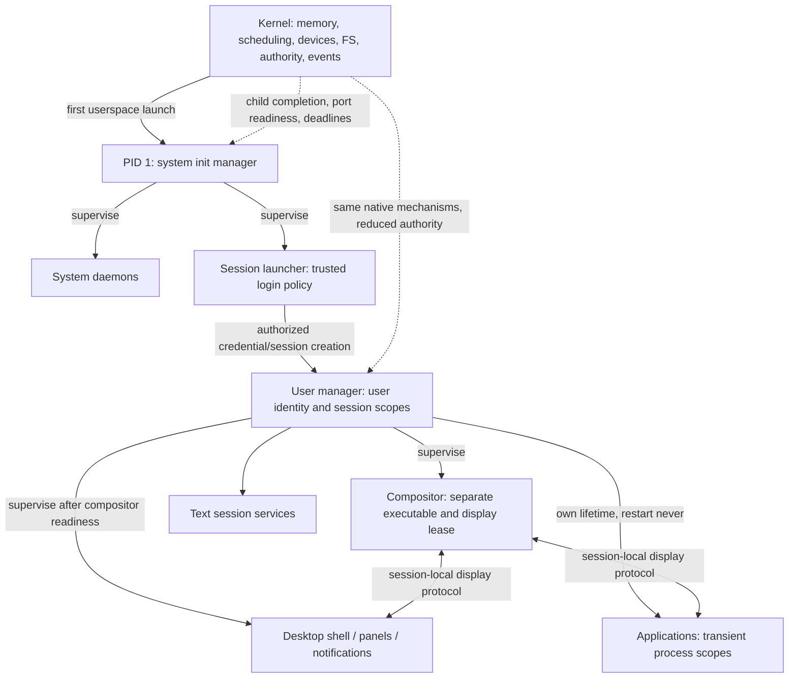
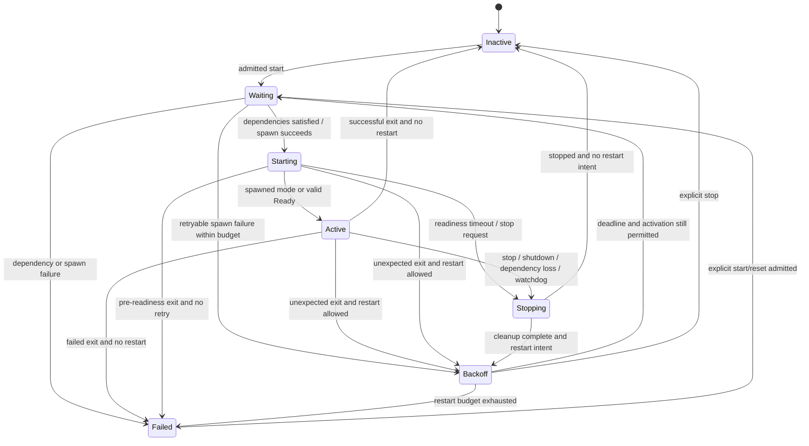

# Native init and service management plan

## Status, scope, and evidence

This is an implementation proposal, not an implemented interface. Inspection was
performed on 2026-11-08 at `167bde41e4752c185414f94d80e09e0f5b0a3007` on `main`,
including the working tree. No kernel, SDK, application, toolchain, or build
behavior is changed by this document. New paths, type names, and operations below
are proposed unless explicitly identified as existing.

Delivery update: M1 is implemented as an opt-in profile; see
[its validation and limits](initator-progress.md). Baseline findings below retain
the original inspection context. Implementation names are `Initator`
(`user_programs/initator`), future `Nest` (user manager) and future `Spark`
(control tool); illustrative `init`/`usermgr`/`initctl` paths below are design names.
M2–M7 remain future milestones.

The requested outcome is a native Ring 3 PID 1 that orchestrates boot and supervises
system services, followed by a separate user manager that supervises login sessions
and a compositor. The critical boundaries are kernel enforcement versus manager
policy, system versus user authority, and one session's display/process resources
versus another's. The first runnable result must supervise **two simultaneous
userspace services**, collect either one's completion without polling, restart a
failed service with a bound, and remain alive itself.

Evidence here is source inspection and documentation validation. Existing test
assertions and historical validation documents are useful evidence of intended
coverage; their runtime results were **not reproduced for this planning task**.
Statements marked implemented mean present in source, not newly certified secure
or correct. The existing working tree contained unrelated edits to
`docs/development.md`, `docs/threading.md`, `tools/qemu_platform.py`, and
`tools/tests/test_desktop_runner.py`, plus an untracked
`crates/exec-image/Cargo.lock`; preserve all of them.

### Reading map

- [Repository findings](#repository-findings) establishes the current mechanisms.
- [Architecture and delivery boundaries](#architecture-and-delivery-boundaries)
  separates the MVP from session and isolation work.
- [Core Rust interfaces](#core-rust-interfaces), [dependency and lifecycle semantics](#dependency-and-lifecycle-semantics),
  and [event delivery](#event-delivery) define observable behavior.
- [Kernel prerequisites](#kernel-prerequisites) maps each missing mechanism to
  source, an interface, ownership rules, dependencies, and independent tests.
- [Incremental roadmap](#incremental-roadmap) gives executable delivery gates.
- [Testing and development strategy](#testing-and-development-strategy) defines
  host/native backends, TDD, and QEMU evidence.

## Repository findings

### Kernel and boot

The OS is an x86-64 monolithic `no_std` kernel. Drivers and all of `src/`, including
`src/userspace/`, execute in Ring 0. Ring 3 programs are under `user_programs/`.
This is a privilege/responsibility split, not Linux or POSIX compatibility.

The actual desktop boot route is:

1. [Disk builder](../tools/build-grub-disk.sh) creates a disposable 128 MiB BIOS
   GRUB disk, an MBR, embedded GRUB image, and FAT32 partition beginning at LBA 2048.
2. [GRUB entry](../src/grub_boot.rs), `multiboot2_entry`, transitions from 32-bit
   protected mode to long mode. `grub_entry_rust` parses Multiboot2 metadata,
   reserves the kernel, maps RAM, validates a 32-bpp RGB framebuffer, and maps MMIO.
3. [Shared entry](../src/entry_point.rs), `run_kernel`, initializes the console,
   CPU tables/interrupts, heap, keyboard/mouse, optional network/audio, and root FS.
4. It initializes the scheduler, loads **`/bin/WM.BIN`**, creates the first process
   with **PID 0**, and calls `scheduler::start`. Interrupt/context setup is ordered
   so the timer cannot schedule an uninitialized process.
5. [WM session loop](../user_programs/wm/src/session.rs) starts `/BIN/DE.BIN` itself.
   [DE](../user_programs/de/src/main.rs) loads wallpaper and discovers applications.

There is no init executable, service-definition loader, user/session manager, or
shutdown coordinator in this route. Changing the filename alone would give init
display privileges and break clients' assumption that PID 0 is the WM.

The alternate `bootloader`/bootimage path is retained for kernel tests. Its legacy
framebuffer description is not the real GRUB desktop. Do not infer production boot
behavior from a bootimage constants test. See [architecture](architecture.md),
[GRUB boot](grub-boot.md), and [testing](testing.md).

### Processes, threads, scheduling, and completion

Implemented:

- [Process resources](../src/process/mod.rs): `Process`, `Thread`, `ProcessState`,
  `ThreadState`, and scalar `BlockReason`. Process resources are shared by native
  threads; execution contexts and guarded stacks are per thread.
- [Scheduler](../src/scheduler.rs): a shared ready queue, preemptive Ring 3 threads,
  sleep/wake, kill, exit, waitpid, process construction, and CPU selection.
  [Architecture](../src/arch/x86_64/mod.rs) includes per-CPU tables, AP startup,
  local timers and reschedule/TLB IPIs. The supported GRUB topology is 1–32 CPUs.
  The entry gate still serializes much kernel work; do not design as single-CPU.
- Up to 128 process records including construction/reclamation pressure; up to
  1024 scheduler thread slots, with 63 worker-stack slots per process. PIDs are
  monotonically allocated `u32` values. `ProcessTable` reuses **storage**, not PID
  values, and spawn refuses PID exhaustion. TIDs include a generation.
- `waitpid(pid)` blocks on one explicit PID, or immediately reaps its zombie.
  Waiter wakeup installs the exit result into the saved frame and retires the PCB.
  [Reclamation](../src/scheduler/reclaim.rs) defers frame/stack release until CPU,
  in-flight syscall, and TLB references are quiescent.
- Process exit/kill stops sibling threads, clears file descriptors, cleans up
  network/audio resources, stops owned connected descendants, and wakes waiters.
  [Fault dispatch](../src/arch/x86_64/entry.rs), `fault_dispatch`, stops user faults;
  supervisor faults remain fatal. The current result is a numeric exit value,
  including fault vector values and forced-kill value 9.

Partial or missing:

- No generic parent field, child list, orphan adoption, privileged init identity,
  child-completion subscription, general process handle, or service process scope.
  The `io_peer` ownership tree is specific to connected standard I/O.
- `waitpid` is not a working wait-for-any-child API. An internal wake predicate
  mentions `u32::MAX`, but entry first requires a concrete existing PCB. Its return
  also contains only a status, not an identity. Do not build supervision on it.
- `sys_kill`/`sys_waitpid` cast `u64` to `u32` and do not enforce general ancestry,
  identity ownership, or user credentials. Unrestricted processes can currently
  interfere with or reap other processes. Multiple waiters can observe completion;
  that is not exclusive supervisor ownership.
- A deliberate `exit(9)`, forced kill, and some fault results cannot be reliably
  distinguished by the current status alone. Restart-on-failure needs typed cause.
- There is no graceful termination protocol, signal facility, cgroup-like scope,
  or init-death policy. Do not add POSIX signals just to stop native services.

Relevant current assertions are in [threads](../tests/threads.rs),
[stdio](../tests/stdio.rs), and [display mapping](../tests/display_mapping.rs).
They include repeated reclamation, blocked returns, connected-tree teardown,
readiness, and foreign-wait behavior. Some assertions describe today's permissive
ABI; authorization changes require a deliberate migration, not silent test deletion.

### Executable loading and startup

[Executable parser](../crates/exec-image/src/lib.rs) validates bounded static
x86-64 ELF images and legacy flat images. It rejects interpreter/dynamic-segment
requirements rather than supporting a dynamic linker. ELF PT_LOAD file/memory
sizes, zero-filled BSS, entry address, page write permissions, and static PT_TLS
are handled by [kernel loading](../src/userspace/process.rs) and the scheduler.
This is **native ELF**, not Linux ELF application compatibility.

[Launch copying](../src/userspace/launch.rs) snapshots bounded argv/envp records
before disk I/O and creation. [Process ABI](../crates/process-abi/src/lib.rs) includes
legacy argument records and the newer environment-bearing request: up to 4096
entries per vector, with a combined 128 KiB string budget. `userlib` adds argv[0]
for its usual spawn helpers. Cwd is inherited; regular descriptors are newly
created rather than generally inherited. There is no fork/exec pair, shell
expansion, arbitrary descriptor transfer, or general spawn-time capability map.

[SDK runtime](../user_programs/userlib/src/rt.rs) receives argc/argv/envp in native
entry registers; [shared root](../user_programs/userlib/src/application.rs) bridges
ordinary `fn main`. Return exits the whole process with zero; panic reports then
exits with one. Panics abort, so PID 1 cannot rely on unwind recovery. Executable
search and command parsing already live in userspace.

### Syscalls and userspace ABI

The existing contract is `int 0x80`, number in RAX, three arguments in RDI/RSI/RDX,
result in RAX. [Dispatcher](../src/userspace/syscall.rs),
[SDK wrappers](../user_programs/userlib/src/sys.rs), and [ABI guide](syscalls.md)
are the integration points. Existing numbers must remain stable.

| Existing operations | Usefulness and limitation for init |
| --- | --- |
| 0 exit, 8/29/30 spawn variants, 9 kill, 10 waitpid | Can launch/terminate/wait one process; no secure supervision set |
| 3 ticks, 17 sleep | Coarse monotonic time/deadlines; sleep alone cannot multiplex exits |
| 20/21 display messages, 108 mailbox wait | Blocking mailbox readiness exists, but routing authority is tied to PID 0 |
| 22 connected child I/O | Bounded private duplex stream; not arbitrary multi-service IPC |
| 96–107 native threading/synchronization diagnostics | Threads exist but one waiter thread per service is unnecessary native overhead |
| 109 process-local readiness wait | Good event-loop base; no child-exit or arbitrary port readiness bits yet |
| 23–28 file/cwd operations, 33 full-name directory records | Sufficient to read bounded service config without a kernel parser |
| 31 brk, 32 FS base | Native allocator and static TLS support, not general resource limits |
| 34 restricted worker profile | Useful precedent for irreversible rights reduction; not general credentials |
| 64–70 network, 80/81 entropy/UTC, 82–85 PCM audio | Existing mechanisms; not daemon/socket activation or user permissions |

New records must be versioned, have explicit widths/layouts, and reject reserved
fields and unknown flags. [Usercopy](../src/userspace/usercopy.rs) checks effective
mapping permissions across every page and copies into owned storage without
retaining Rust user references. Extend that boundary instead of introducing raw
unchecked pointers. Existing sentinel return values must not collide with new
error encodings.

### Memory and isolation

[Process construction](../src/scheduler.rs), `spawn_process_inner`, creates private
page tables, copies only appropriate shared supervisor mappings, deep-copies the
low subtree, and maps private image/stack/heap/surface resources.
[Frame transactions](../src/memory/owned.rs) roll back unpublished allocations.
[Heap mapping](../src/scheduler/heap.rs) handles brk growth/shrink with ownership,
rollback, and remote invalidation. Stacks have guards; RAM is eagerly allocated.
There is no swap, demand paging, general anonymous mmap, or guaranteed W^X: loader
write permissions do not currently enforce NX on all non-code pages.

Every ordinary process currently receives a framebuffer-sized private surface;
the first receives physical display MMIO instead. At 1920×1080 and pitch 7680,
one private surface costs about 7.9 MiB before stacks/image/heap. Blindly starting
many daemons would waste memory. Removing automatic display mapping is required
for init; lazy surfaces for all headless services can follow the two-service MVP.

[Restricted principal](../crates/process-abi/src/isolation.rs) and
`scheduler::restrict_worker` enforce an irreversible syscall allowlist and brk
budget for a specific connected single-threaded worker topology. They do not
provide system/user identities, general object capabilities, filesystem ACLs,
total memory accounting, or resource revocation. Address-space separation alone
does not isolate services from process-control or filesystem interference.

### Filesystems and configuration

[Root FS](../src/fs.rs) mounts ATA-backed FAT32 through the MBR partition offset;
[FAT32](../src/fat32.rs) supports short aliases and VFAT long names.
[File handles](../src/fs/handles.rs) provide process-owned cwd, regular file
descriptors, offsets and bounded reads/writes. FS I/O uses owned buffers and its
service lock outside CPU entry; never wait on storage while holding scheduler locks.

`/BIN`, `/ETC`, `/HOME`, and `/TMP` are installed by the disk builder. Existing
configuration-like consumption includes the DE's wallpaper file and test markers;
there is no service parser or protected configuration store. FAT attributes and
directory conventions are not an access-control policy. Ordinary processes can
use broad file APIs; trusting `/ETC/INIT` requires future enforcement before
untrusted services/users are enabled. There is no journaling, fsync contract,
atomic multi-file update, or power-loss durability guarantee.

### IPC, notifications, clocks

[Mailbox implementation](../src/scheduler.rs), `send_message`/`receive_message`,
stores sixteen scalar messages per PCB. Kernel-assigned sender identity is useful,
but a nonzero PID can send only to PID 0; PID 0 can send to live processes. Receive
is nonblocking; queue-full returns backpressure without overwrite. There is no
general addressable authenticated service bus.

[Connected I/O](../src/scheduler/channels.rs) allocates private 4096-word FIFOs
fallibly, connects before execution, supports a selected owned child, and kills
connected descendants when the host dies. A child can host a connected descendant,
but a process cannot generally attach an arbitrary number of such children. This
cannot carry independent readiness/control/log streams for two or more daemons.
`userlib::process::Child` Drop kills and reaps; it is not a suitable implicit Drop
contract for a manager's durable service record.

[Readiness](../src/scheduler/events.rs) atomically checks and parks under the
scheduler lock. The [thread ABI](../crates/thread-abi/src/lib.rs) defines mailbox,
original connected-I/O read/write, keyboard and display-pointer bits. EOF is ready;
readiness does not consume data. Selected nested child I/O is not covered by all
the original-stream readiness bits. Timeouts are relative PIT ticks, zero means
indefinite, and overflowing/too-large durations fail. Public ticks advance on the
BSP, approximately every 54.9 ms; AP scheduling timers do not multiply time.
There is no exported high-resolution timebase or general timer object. UTC from
CMOS is wall time and must not drive restart/watchdog decisions.

The kernel still scans its bounded thread table to wake eligible waiters. An
event-driven userspace manager need not require a new kernel timer wheel or
per-CPU scheduler redesign.

### Graphics, display, input, and desktop lifecycle

- [Framebuffer driver](../src/drivers/video/framebuffer.rs) handles boot-provided
  linear display memory. There is no GPU command API, KMS/DRM, hotplug protocol,
  accelerated compositor, or display-server reconnection guarantee.
- [Surface mapper](../src/userspace/process.rs), `map_user_framebuffer`, grants
  the first process physical display access. Syscalls 14/15/19, mailbox routing,
  and pointer wait authorization explicitly check PID 0. `sys_mouse` itself is
  currently more broadly callable: audit raw input too, not just pointer waits.
- [WM](../user_programs/wm/src/session.rs) owns placement, focus, snapshots,
  stacking, caches, window-close behavior, and currently some foreign process
  kill/reap behavior. It authenticates the DE using the PID it spawned. It
  periodically checks surface death. Six application windows are supported.
- [UI SDK](../user_programs/userlib/src/ui/mod.rs) sends to PID 0 and requires
  sender 0. [Desktop protocol](../user_programs/userlib/src/ui/desktop_protocol.rs)
  embeds PIDs in scalar messages. This is a real migration surface, not a
  compositor command-line option.
- [DE discovery](../user_programs/de/src/applications.rs) scans `.BIN` applications,
  excluding WM/DE, and spawns applications directly. Desktop layout, panels,
  wallpaper, and launching already reside outside the kernel.
- [Installer](../tools/install_user_programs.py) excludes `.test-only` probes and
  installs a crate marked `.service` as an executable `.SVC`. The existing
  [JWORKER](../crates/browser-worker/src/native.rs) is privately launched by its
  application. This marker is **packaging**, not a service manager or a promise
  of persistence. Keep application-owned workers application-owned.
- [Portal](../user_programs/portal/src/main.rs) hosts the
  [Forge shell](../user_programs/forge/src/main.rs) over connected standard I/O.
  Portal close tears down its shell. Their nested lifecycle must survive migration.
- [AC97](../src/audio.rs) exposes an exclusive PCM stream, not an audio daemon or
  mixer. An eventual user audio service needs client transport/mixing policy and
  one delegated device lease; do not list it as an existing daemon.

### Build and tests

The [root manifest](../Cargo.toml) is a package, **not a Cargo workspace**. Applications
and reusable `crates/*` packages have separate manifests and local path dependencies.
Keep this convention; a workspace conversion is unrelated. The pinned
[nightly](../rust-toolchain.toml) is `nightly-2025-01-30`.
[Root Cargo configuration](../.cargo/config.toml) targets the custom kernel and
builds `core`/`alloc`; user applications have their own target/linker configuration.
Host crates must be tested outside inherited bare-metal Cargo configuration with
an explicit host target.

[Unified user builder](../tools/build-user.sh) produces compact static ELF `.bin`
files and `_meta.rs` together. These are tracked artifacts. The kernel loads disk
files at runtime; adding a daemon is not embedding it into the kernel.
[Desktop runner](../tools/run-desktop.sh) and
[QEMU platform helper](../tools/qemu_platform.py) select the real GRUB route.

Tests available to extend:

- Host `#[test]` crates such as process/thread/exec-image ABI and browser-worker
  protocol tests; host Python tooling regressions.
- QEMU `#[test_case]` kernel suites, RAM framebuffer fixtures, and explicit
  debug-exit success/failure. `tests/userspace.rs` does not execute Ring 3 code.
- [File-I/O runner](../e2e/file_io.py) replaces `WM.BIN` only in a private disk
  copy to run an actual Ring 3 probe. Several other runners share this convention;
  native-init boot needs a coordinated probe entry change.
- [Desktop](../e2e/desktop.py), [parallel desktop](../e2e/desktop_parallel.py),
  [SMP](../e2e/smp.py), network/audio/argument/capability E2E and screenshots.
- [Documentation checker](../tools/check_docs.py), its
  [tests](../tools/tests/test_check_docs.py), and documentation CI.

The [testing guide](testing.md#known-baseline-gaps) records debug heap-stress
timeouts, nonterminating `gfx_demo`, and obsolete E2E scripts. These are inherited
limitations, not failures reproduced or repaired here. Use focused suites; do not
report an unqualified `cargo test` pass.

### Capability summary

| Area | Present | Partial | Missing for the requested system |
| --- | --- | --- | --- |
| Boot | GRUB, FS mount, first Ring 3 image | Hardcoded WM/PID 0 | PID 1 bootstrap contract and fail-stop policy |
| Execution | Static ELF/flat, argv/envp, private address spaces, SMP threads | Coarse serialized kernel services; no complete W^X | Secure spawn grants and daemon presentation choice |
| Completion | Exit, kill, zombie, specific waitpid, deferred reclamation | Numeric causes and connected-child tree | Owned wait-any, orphan adoption, typed termination |
| Events | Atomic readiness+park, coarse deadlines | Fixed process-local sources | Child completion source; independent service ports |
| Storage | FAT32/VFAT, paths, fd/cwd operations | No crash consistency or user ACLs | Protected boot/config authority; bounded unit parser in userspace |
| Security | Page isolation, PID-owned resources, restricted worker | Ambient process/file/input permissions | Credentials, capabilities, scopes, enforced budgets |
| Desktop | Separate WM/DE, surfaces, focus/input | WM owns spawning/reaping; PID 0 protocol | Delegatable/revocable display, session identity, crash policy |
| Services | App-owned worker and executable packaging | No general supervision | PID 1, user manager, graph, readiness, restart, logging/shutdown |

## Architecture and delivery boundaries

### Proposed ownership



PID 0 becomes reserved kernel/idle terminology, not a userspace compositor. Native
boot creates PID 1 first, with an explicit non-inheritable system-manager authority.
PIDs never imply access rights. The kernel starts only init; the unit graph starts
everything else. Init is not a compositor, shell, login UI, or network stack.

Initially one user manager owns one session. Later one per-user manager can own
several `SessionId` namespaces, or one process per session can be selected if fault
separation proves more valuable. Keep `UserId` and `SessionId` separate now. Do not
implicitly share a compositor, display channel, or application registry across
same-user sessions. A text session has no compositor dependency.

| Kernel mechanisms | Userspace policy |
| --- | --- |
| Validating buffers and ABI records, page ownership, scheduling, blocking | Unit parsing, graph validation, targets and activation planning |
| Authentic process/peer identity, ownership, credential and capability checks | Which identity/capabilities a service is configured to request |
| Child status retention, orphan routing, exclusive reaping | Restart decisions, rate limiting, failure propagation |
| Bounded channels, readiness, monotonic ticks | Ready/watchdog protocol, deadline selection, user-visible status |
| Enforced resource accounting/scopes, termination, device revocation | Session policy, compositor crash recovery and application launch decisions |
| Filesystem access enforcement and hardware power transition | Configuration locations, log retention, ordered shutdown and grace periods |

The same service engine should drive system and user managers. A small context and
kernel-issued grants select what each may do; a userspace enum alone never grants
system authority. Keep policy modules out of `src/`.

### Delivery gates

**Immediate MVP (M1):** opt-in headless PID 1, two trusted foreground service
fixtures, compiled definitions, durable child completion, coarse timer-driven
backoff, capped restart, orphan cleanup, serial diagnostics, explicit fatal-init
behavior. No general IPC, login, authentication, desktop, dynamic reload, or claim
of hostile-service isolation is needed to demonstrate this.

**Useful system manager (M2–M4):** bounded on-disk configuration, dependency jobs,
readiness/control channels, structured volatile logging, and graceful shutdown.

**Isolation and sessions (M5):** kernel credentials, narrowed capabilities, process
scopes and protected storage before launching untrusted users/services.

**Graphical cutover (M6):** remove active PID 0 dependencies together, delegate
display to supervised WM, and explicitly handle compositor loss. Make native init
the normal boot only after desktop regressions pass. Until then retain the old
desktop profile as an explicitly permissive transition path, not a secure fallback.

Do not make full capability IPC, persistent journaling, a new scheduler, GPU work,
or complete login/authentication a prerequisite for the two-service experiment.
Conversely, do not deploy the experiment as an isolated multiuser system.

## Core Rust interfaces

### Crates and files

Follow the repository's separate-package layout. Introduce only packages needed
at the current milestone; future files in this tree are not a request to scaffold
them all at once.

```text
crates/service-core/             no_std + alloc; host-testable policy, no syscalls
  src/{lib,definition,state,supervisor,deadline}.rs             M1
  src/{config,graph,transaction,target}.rs                     M2
  src/{protocol,log}.rs                                        M3
  src/{shutdown,session}.rs                                    M4/M5
  tests/{supervision,graph,protocol,shutdown,session}.rs
crates/service-abi/              M3: small versioned manager wire protocol
crates/process-abi/              extend existing process/launch/status records
crates/thread-abi/               append readiness bits; preserve old numbers
crates/ipc-abi/                  M3: kernel channel/handle wire contract
user_programs/init/              native PID 1, shared userlib executable root
  src/{main,native,boot_config}.rs
user_programs/usermgr/           M5: same engine, narrower runtime context
user_programs/initctl/           M3: native management client
user_programs/svca/              M1 trusted long-lived test daemon (.service)
user_programs/svcb/              M1 exit/crash/restart test daemon (.service)
tools/service-host/             M1 deterministic driver, M3 real host adapter
config/init/system/             M2 installed default .UNIT definitions
config/init/user/               M5 session templates, later user-owned overlay
e2e/init.py                     new private-disk native boot/lifecycle runner
tests/process_supervision.rs    new RAM-backed kernel boundary suite
tests/ipc.rs                    M3 kernel channel suite
```

Keep `service-core` independent of `userlib`; `tools/service-host` may depend on
both the core and host `std`, while native binaries depend on core and userlib.
Wire-only ABI packages must not depend on the graph engine or parser. Add no
workspace conversion, Tokio, general plugin loader, or DI framework.

### Definitions, identity, and state

The following sketches show semantic ownership, not final wire layout or complete
compilable modules. Limits apply at parsing and construction; `Vec`/`String` here
do not mean unlimited allocation. Core allocations must be fallible.

```rust
struct UnitId(u16);                  // validated catalog index, not a global name
struct RunId(u64);                   // incremented for every service start attempt
struct UserId(u32);                  // M5: assigned/enforced by kernel
struct SessionId(u64);               // M5: independent of user and process IDs
struct ProcessKey { pid: u32, generation: u32 }
struct Tick(u64);
struct TickSpan(u64);                // checked <= i64::MAX; never wall-clock time

struct ExecSpec {
    path: String,                   // explicit absolute native executable path
    args: Vec<String>,              // no shell or expansion; argv[0] added by SDK
    environment: Vec<String>,       // explicit allowlist, not inherited manager env
    working_directory: String,
}
enum ReadyMode { Spawned, Notify { timeout: TickSpan } }
enum RestartWhen { Never, OnFailure, Always }
struct RestartPolicy {
    when: RestartWhen,
    initial_delay: TickSpan,
    maximum_delay: TickSpan,
    attempts_in_window: u16,
    window: TickSpan,
    reset_after_healthy: TickSpan,
}
struct ServiceDef {
    id: UnitId,
    exec: ExecSpec,
    ready: ReadyMode,
    restart: RestartPolicy,
    stop_timeout: TickSpan,
    watchdog: Option<TickSpan>,
    dependencies: Dependencies,
    security: SecurityRequest,       // validated against manager's authority
}
struct TargetDef { id: UnitId, members: Vec<UnitId>, after: Vec<UnitId> }
enum UnitDef { Service(ServiceDef), Target(TargetDef) }

enum ExitCause {
    Exited(u64),
    Forced { reason: u32 },
    Fault { vector: u16, code: u64 }, // no kernel addresses in public status
}
struct Completion { process: ProcessKey, cause: ExitCause }
enum Failure {
    Spawn, Exit(ExitCause), ReadinessTimeout, WatchdogTimeout,
    Dependency(UnitId), Protocol, ResourceLimit, RestartLimit,
}
enum StopIntent { Manual, Shutdown, DependencyLost, SessionLost, Restart }
enum State {
    Inactive,
    Waiting { transaction: u64 },
    Starting { run: RunId, process: ProcessKey, ready_by: Option<Tick> },
    Active { run: RunId, process: ProcessKey },
    Stopping { run: RunId, process: ProcessKey, intent: StopIntent, kill_at: Tick },
    Backoff { failed_run: RunId, retry_at: Tick },
    Failed(Failure),
}
struct ServiceInstance {
    definition: UnitId,
    state: State,
    desired_running: bool,
    last_completion: Option<Completion>,
    restart_window: RestartWindow,
}
enum ManagerScope { System, User { user: UserId, session: SessionId } }
struct Manager { scope: ManagerScope, /* catalog, jobs, instances, deadlines */ }
struct SystemManager { engine: Manager, /* native system authority */ }
struct UserManager { engine: Manager, /* native session authority */ }
```

`ProcessKey` is an identity, not permission. Initially keep monotonic non-reused
PIDs and use a documented initial generation; reject exhaustion rather than wrap.
Reserve/check the generation field from the first new ABI version so future PID
reuse cannot silently reinterpret old keys. Kernel handles introduced for IPC and
scopes have independent slot generations. Managers also need `RunId`: a stale
ready message or timeout for an earlier run must not affect a later one even when
the numeric PID differs. Host adapters must simulate PID reuse and reject stale
keys now, before the native kernel ever adopts reuse.

M1 uses only `ServiceDef`, start/exit/backoff state and a fixed catalog of two
services. Targets, graph jobs, notify, security configuration and watchdog fields
become active only in their milestones; reject unsupported config rather than
silently accepting unenforced fields.

### Runtime and side effects

Use an explicit single-threaded loop and a pure transition core. State produces
commands; runtime results return as events. Mark an attempt pending before issuing
spawn, associate its result with `RunId`, and serialize results through the loop.
Every successful spawn must be recorded or synchronously terminated/reaped on
bookkeeping failure. Never lose ownership because a later allocation failed.

```rust
enum Input {
    Spawned { unit: UnitId, run: RunId, result: Result<ProcessKey, SpawnError> },
    Exited(Completion),
    Adopted(ProcessKey),            // M1: live orphan, now owned by this manager
    PortMessage(ReceivedMessage),    // M3, authenticated by runtime
    Deadline { unit: UnitId, run: RunId, kind: DeadlineKind },
    Control(AuthorizedRequest),
}
enum Command {
    Spawn { unit: UnitId, run: RunId },
    SendStop { unit: UnitId, run: RunId },
    TerminateScope { unit: UnitId, run: RunId },
    Record(LogRecord),
}
trait Runtime {
    fn now(&self) -> Tick;
    fn spawn(&mut self, spec: &LaunchSpec) -> Result<ProcessKey, SpawnError>;
    fn terminate(&mut self, process: ProcessKey) -> Result<(), RuntimeError>;
    fn wait(&mut self, until: Option<Tick>, out: &mut [Input])
        -> Result<usize, RuntimeError>;
    fn log(&mut self, record: &LogRecord); // bounded, nonblocking, best effort
    // M3: channel operations; M5: scope/grant operations, added when needed.
}
impl Manager {
    fn handle(&mut self, input: Input, commands: &mut CommandBuffer)
        -> Result<(), ManagerError>;
    fn next_deadline(&self) -> Option<Tick>;
}
```

No trait object is needed in the kernel. A generic native adapter or one concrete
adapter in each binary suffices. `CommandBuffer`, event batches, catalogs and
deadline entries are bounded and reserved before boot activation. Keep one timer
entry per `(unit, run, kind)` and cancel/replace it, rather than accumulating stale
heap nodes on every watchdog heartbeat. Allocator failure in optional status/log
work must not kill PID 1 or leave a child unmanaged.

The current native spawn reads an executable synchronously and constructs its
address space before returning. M1 deliberately accepts that bounded startup
pause for two small trusted fixtures; the event-driven claim concerns waiting and
supervision, not asynchronous disk loading. Process completion remains durable
during that pause. Set an explicit manager executable-size/launch budget and
measure launch latency under storage/resource pressure before enabling watchdogs
whose deadlines could be missed by spawn. File-driven catalog loading is also
startup work, not an event-loop callback. If measurements require responsive
supervision during later launches, use one bounded launch worker thread in the
manager process, with queued results and kernel-backed wakeups, while the main
thread retains exclusive policy ownership. Threads share the same parent PID;
associate every worker result with its reserved run and cancel/clean up on scope
close. Do not introduce an async runtime to hide a synchronous syscall or claim
hard deadline guarantees before testing this path.

### Configuration

Use a small, documented native v1 line format, not an incomplete TOML parser
advertised as TOML. Full TOML via a `no_std` dependency is an alternative if real
configuration needs justify its parser and error surface. M2 example:

```ini
Version=1
Kind=service
Name=example-b
Exec=/BIN/SVCB.SVC
Arg=--foreground
Arg=two words in one argument
Env=MODE=service
WorkingDirectory=/
Requires=example-a
After=example-a
Ready=spawned
Restart=on-failure
RestartDelayTicks=18
RestartMaxDelayTicks=180
RestartBurst=3
RestartWindowTicks=1800
StopTimeoutTicks=90
```

Values are UTF-8 after the first `=`; trim outer ASCII whitespace, preserve
interior spaces, allow empty `Arg`, reject NUL and multiline values. Full-line
`#` comments and blank lines are allowed; no interpolation, quoting language,
inline comments, command substitution or shell invocation. Repeat `Arg`, `Env`,
and dependency keys; singleton duplicates and unknown keys fail. Environment keys
must be valid, unique, and explicitly allowed. Validate all names/references and
absolute executable/cwd paths before any start. A unit name is a bounded ASCII
identifier independent of case-insensitive FAT filenames; reject duplicate names
and aliases that load the same definition twice.

Proposed initial bounds: 64 units, 256 dependency edges, 8 KiB per definition,
128 KiB total configuration, 32 arguments per service and 4 KiB combined launch
strings. These intentionally fit below native launch limits; kernel limits still
apply. A configured service count is not permission to exhaust the 128-PCB pool.
Reserve headroom for init, control, recovery, sessions and transient applications.

Install system definitions under `/ETC/INIT/SYSTEM`, user templates under
`/ETC/INIT/USER`; use `.UNIT` files, which can use the existing VFAT path support.
Executable `.SVC` packaging remains separate. Mark init/usermgr/initctl as hidden
infrastructure through an explicit installer rule/marker; do not accidentally add
them to DE's `.BIN` launcher list. No directory scan should convert normal apps
or JWORKER into persistent boot services.

M1 embeds its two definitions to separate supervision failures from config/storage
failures. M2 reads config through existing file APIs, reports file/line/key errors,
and commits an immutable catalog only after complete validation. Initially reload
is rejected. Later reload validates a new snapshot, preserves running instances'
old definitions until stopped, and publishes a new catalog generation atomically
in userspace. FAT32 does not provide atomic multi-file publication by itself.

### IPC, control, readiness, and watchdogs

M3 uses independent bounded kernel channels passed at spawn. A manager owns each
receive endpoint and gives the service only its intended send/control endpoints.
Services cannot choose a global PID and impersonate a peer. The runtime supplies
kernel-authenticated identity and granted rights separately from message bytes.

```rust
struct Header { version: u16, opcode: u16, body_len: u32, request_id: u64 }
enum Request {
    Status { unit: UnitId }, List { cursor: u32 },
    Start { unit: UnitId }, Stop { unit: UnitId }, Restart { unit: UnitId },
    StartTarget { target: UnitId }, Shutdown { action: ShutdownAction },
}
enum Reply { Accepted { job: u64 }, Status(UnitStatus), Page(StatusPage), Error(ControlError) }
enum Notification {
    Ready { run: RunId },
    Watchdog { run: RunId },
    Stopping { run: RunId },
}
enum ServiceControl { Stop { run: RunId, deadline: Tick } }
struct Peer { process: ProcessKey, user: UserId, session: Option<SessionId> }
struct ReceivedMessage { peer: Peer, /* endpoint authority, validated bytes */ }
```

These Rust enums are in-memory types, **not** Rust enum serialization. Encode
fixed-width little-endian headers and explicit numeric tags; bound frames (initially
256 bytes), reject lengths/reserved fields/versions/unknown opcodes, and bound
per-peer outstanding requests and response pagination. Kernel wire records and
manager protocol versions are independent.

Authentication is possession of an authorized kernel endpoint plus kernel-supplied
peer identity; a supplied unit name, environment token, or claimed UID is not proof.
Bind each notify endpoint to its `(UnitId, RunId, ProcessKey)` before the child can
execute. Revoke it on run completion. Notification rights do not include management
rights. A child may not silently delegate readiness to descendants; any such grant
must be explicit. Closing ports wakes waiters with peer-closed readiness.

`Spawned` readiness means only successful native process creation, including the
entry context and grants. `Notify` means the service has actually initialized its
interface/resources and sent Ready. A start timeout tears down that run. Ignore
duplicates, reject messages from the wrong run/endpoint, and process known terminal
completion before queued readiness. Readiness may be followed immediately by a
crash; dependency-loss policy must handle that ordinary race.

Watchdogs begin after readiness. The service sends a heartbeat from the work path
whose health matters; an independent heartbeat thread can mask a wedged service.
Manager receipt time defines liveness, with bounded coarse-tick tolerance. Ignore
old-run heartbeats and rate-limit spam. On expiry request stop, then force scope
termination after the stop deadline. No hardware watchdog is assumed. A manager
cannot detect its own deadlock reliably; kernel/hardware watchdog escalation is
deferred and must not be advertised as solved by service watchdogs.

### Logging

M1 emits short manager lifecycle records through existing serial-backed console
output. Services may emit diagnostics, but this is not captured stdout/stderr or
a trustworthy journal. Do not use connected `Child` merely to capture two daemons'
output: it cannot host the required fanout and its Drop/lifetime rules differ.

M3 adds bounded structured records: boot sequence, monotonic tick, kernel-authenticated
process, unit/run, severity, stream, and bounded bytes. A separate log receive port
and quota prevent logs from starving exit/control notifications. Manager records
have a fixed in-memory ring and a drop counter; enqueue never waits for disk or a
logging daemon. A supervised optional logger drains records and owns retention
policy. It must not be required for PID 1 startup, failure reporting, or shutdown.
The logger's own failure falls back to the ring/serial sink without recursive logging.

Do not print secrets/environment vectors or expose other users' logs. Bound
message size/rate and escape control bytes for display. Persistent append/rotation
comes later; FAT write success is not a durable journal guarantee. Existing
`userlib` console redirection is not transparently rerouted until explicit
spawn-time log bindings exist. Kernel fault diagnostics retain their independent
lock-aware serial path.

### Security and resource interfaces

M5 introduces kernel-issued authority, with a default-deny native process policy.
These are requests and conceptual rights, not existing SDK types:

```rust
struct SecurityRequest {
    user: UserId,
    session: Option<SessionId>,
    grants: Vec<GrantRequest>,
    limits: ResourceLimits,
}
enum GrantRequest {
    ReadConfig, ReadExecutable, Directory { /* resolved object + rights */ },
    Notify, Log, SessionControl, Display, AudioOutput, NetworkClient,
}
struct ResourceLimits {
    processes: u16, threads: u16, handles: u16,
    committed_pages: u64, channel_bytes: u64,
}
struct ScopeHandle(u64); // process-local, generation-checked, kernel-enforced rights
```

A scope owns a service's process tree. Spawn inherits membership and a subset of
rights; it cannot escape its scope by spawning/detaching, acquiring a new PID, or
choosing a new parent. A user manager cannot mint a UID/session or system/display
capability. The system manager authorizes a trusted session launcher to request a
specific identity; the kernel validates all delegation before publishing the child.
Credentials and grants are established atomically before it can run, never through
an insecure spawn-then-drop-privilege window.

Count image, stack, heap, TLS, page tables, optional surfaces, descendants and IPC
allocations consistently; the existing worker brk limit alone is insufficient.
Use checked reserve/commit/rollback accounting. Keep emergency kernel/init capacity
outside child quotas. Start with process/thread/page/handle limits and fair current
scheduling; CPU bandwidth controls, namespaces, swap and hard real-time guarantees
are deferred. A bounded per-process syscall allowlist can be an early grant
representation, but it must combine with object/ownership checks, not replace them.

## Dependency and lifecycle semantics

### Graph and transactions

Keep activation, ordering, and lifetime relationships distinct:

| Edge | Startup meaning | Later failure/lifetime meaning |
| --- | --- | --- |
| `Wants=A` | Try to activate A; failure does not fail requester | No automatic propagation |
| `Requires=A` | A must activate successfully in this transaction | A loss alone does not bind lifetime; use BindsTo when necessary |
| `After=A` | If both have jobs, wait for A's activation result before this start | Ordering only; does not pull A in |
| `BindsTo=A` | Implies Requires and After in v1 | Stop requester when A loses readiness/exits; restart requires a new valid activation |
| `PartOf=A` | No implicit pull-in | Explicit stop/restart of A propagates to this unit; failure is separate |

For the initial parser, implement only Wants/Requires/After; add BindsTo/PartOf with
tests when desktop/lifetime policy needs them. State the v1 rule explicitly:
`Requires` is an activation success barrier even without an After edge; use After
for additional ordering, including soft dependencies. Restrict v1 Requires to
long-running services/targets; one-shot completed-success units need a separate
state and are deferred. This avoids an ambiguous success-then-exit dependency.

Graph construction rejects self edges, unknown units and cycles in the effective
activation-barrier/order graph, returning an actual cycle path before side effects.
Do not mistake a target membership relationship for an ordering edge. Keep stable
unit-name ordering for deterministic plans. `After` an optional failed unit may
settle and allow progress; a failed required unit prevents activation.

```rust
struct Dependencies {
    wants: Vec<UnitId>, requires: Vec<UnitId>, after: Vec<UnitId>,
    binds_to: Vec<UnitId>, part_of: Vec<UnitId>,
}
enum JobKind { Start, Stop, Restart }
enum JobState { Pending, Waiting, Running, Succeeded, Failed, Cancelled }
struct Job { unit: UnitId, kind: JobKind, state: JobState }
struct ActivationTransaction {
    id: u64,
    catalog_generation: u64,
    jobs: Vec<Job>,
    newly_started: Vec<UnitId>,
}
```

Admission validates the complete requested closure and resource budget before
execution. Coalesce identical starts; reject contradictory jobs as Busy in v1.
Do not build a general transaction optimizer. Start independent ready jobs without
unnecessary serialization, but only one state mutation/dispatch batch runs at a
time. Existing active dependencies satisfy jobs; targets own no process and become
active when their required member jobs succeed. Optional failures are reported as
degraded status, never hidden by target success.

Transactions are orchestration, not rollback of arbitrary daemon side effects.
On failure stop newly started units that were exclusive to that transaction, in
reverse dependency order; retain preexisting services and units still required by
another active request. Track activation ownership/references explicitly. M2 can
serialize transactions to simplify this accounting. Stop order reverses actual
active ordering constraints; choose deterministic reverse start order for unrelated
units. Do not blindly reverse a list of unit filenames.

### Lifecycle and supervision



Spawn failure has no process to reap; apply the same bounded attempt budget if
retry is configured. Every published process has exactly one completion consumer.
A service is not eligible for a replacement until its old run/scope is stopped
and its completion acknowledged; cleanup that is still charged can cause the next
allocation to fail cleanly. Never free an executing kernel stack or reuse mapped
frames to make restarts faster.

`Never` does not restart. `OnFailure` restarts nonzero explicit exit, fault, forced
unexpected termination, readiness failure, or watchdog failure. `Always` includes
zero exit, but neither policy overrides an explicit stop, dependency stop, session
loss, or shutdown. `StopIntent` survives completion and suppresses restart. A
manual Restart is an ordered stop followed by a separately admitted start.
For Notify mode, exit before Ready is a startup failure even if the process
returned zero; it never successfully activated. Preserve the raw completion cause
alongside that classification. A zero exit after successful activation becomes
Inactive when policy does not request restart; an unretried failure becomes Failed.

Use capped exponential backoff with checked arithmetic and a rolling attempt
window; reaching the burst limit enters visible Failed(RestartLimit). Reset the
budget only after a configured continuous healthy interval or an authorized
reset, not immediately on Ready. A manager-wide start/restart budget also bounds
many services failing together. Deterministic jitter is optional later, not an
entropy requirement for MVP. Automatic stop of a critical service marks the boot
target degraded/failed; init stays alive in a bounded maintenance state instead
of recursively restarting itself or hiding the error.

Parentage and scope differ: ordinary children become orphans and are adopted for
reaping by PID 1; an owning service/session scope still controls whether they may
continue. Initially services must remain in foreground. There is no fork or
daemonization tracking, PID file, double-fork heuristic, or process-name matching.
An adopted orphan is cleaned up/accounted for, not converted into a persistent
configured service.

M1's policy is to terminate adopted live children that have no configured service
record, then consume their eventual completion. K1/K2 therefore expose adoption
as a durable child event too; otherwise init could not discover a live orphan
without periodic enumeration. If the orphan exits before adoption is consumed,
its completion supersedes the adoption event. A per-PCB pending-adoption bit is
sufficient; it does not require an allocating event queue.

### Shutdown

Only an authorized endpoint may request system shutdown. M4 runs:

1. Set manager mode to ShuttingDown, reject new starts/reloads, cancel backoff
   deadlines, freeze session admission, and suppress restart globally.
2. Stop user sessions and active target dependents before their dependencies.
   Send native Stop with a monotonic deadline; keep draining exits and control.
3. A service may acknowledge Stopping, but only actual process/scope completion
   completes its stop job. Force termination at the per-unit deadline, bounded by
   a global shutdown deadline. Continue after a failed/hung service.
4. Drain descendants and completions. Leave diagnostics available while stopping
   an optional logger. Ask existing device/FS mechanisms to quiesce only through
   supported interfaces; do not promise power-safe storage without one.
5. PID 1 invokes a separately authorized kernel system-action operation. The
   initial supported action can be halt-after-quiescence. Reboot/poweroff must
   return Unsupported until there is an implemented/tested platform path.

Init never exits to request shutdown. The kernel owns CPU/device quiescence and
the final hardware action. No generic ACPI sleep/power implementation is currently
present: the existing ACPI code parses CPU topology, not AML/S5 power policy.
QEMU debug-exit is a test result mechanism, not a production shutdown syscall.

### Compositor and application lifetime

In M6, the user manager starts WM as an ordinary supervised executable with an
exclusive revocable display grant. WM initializes display/protocol service, then
sends authenticated Ready. Only then start DE, panels and other display-dependent
services. The manager supplies WM's authorized desktop-role identity/endpoint;
WM cannot authenticate DE by assuming it spawned it. Desktop rendering and
window policy remain in WM/DE.

The current DE includes panels and wallpaper in one binary. Keep it together for
the first migration. A panel, notification daemon, and audio broker may become
separate services when they actually exist and have their own interfaces. Do not
split rendering code merely to fill a service list. Audio can be session-bound
without depending on compositor readiness if its transport allows that.

Launch normal apps into transient session/application scopes with Restart=Never.
Track their exit for reaping and session cleanup, without adding persistent unit
files or restarting a closed terminal/browser. JWORKER stays inside its browser's
scope and retains its stricter worker profile. Preserve Portal→Forge connected
lifetime and nested worker cleanup.

For M6, use the user manager as the launch broker and completion owner of top-level
graphical applications requested by DE/Forge. Executable selection and arguments
still come from those userspace clients. WM requests close/termination of a
registered application scope through an authorized session channel; it does not
reap foreign PCBs. Direct private workers such as Portal's Forge and the browser's
JWORKER retain their existing parent's completion ownership and connected lifetime.
Scope teardown observes member/quiescence state without stealing those results.
After an owner dies, route unconsumed descendant completions to the surviving scope
owner, or PID 1 if no such owner survives. Test this precedence explicitly so
supervision, scope draining and orphan adoption cannot race to reap the same child.

**Default compositor-crash policy: terminate the graphical session.** Kernel
completion/revocation marks display unavailable, clears focus and invalidates the
session's endpoint epoch. The user manager stops DE, graphical services and every
graphical application scope, kills stragglers, drains completions and releases the
old display mappings before a replacement compositor receives the lease. Text
sessions can remain alive. A fresh graphical session may then start according to
explicit bounded policy; regular applications do not silently restart or reconnect.

This is disruptive and can lose unsaved application state, but it matches the
current protocol's actual capabilities. A future compositor-only restart mode
requires explicit reconnect negotiation, fresh surface registration, focus/input
reset, epoch checking and client tests. Merely spawning WM again does not restore
old surfaces, queued frame acknowledgements or input ownership. DE crash is a
different failure: when WM is healthy, DE can restart with a fresh desktop-role
grant without automatically killing applications, preserving the existing DE-loss
isolation behavior.

## Event delivery

### Minimal native event loop

Reuse syscall 109's atomic check-and-park semantics. M1 adds a child-completion
readiness bit and a separate consuming operation. Do not send exits through the
16-entry display inbox, where ordinary messages can drop or crowd out completion.

```text
loop:
    drain a bounded batch of owned child completions
    drain a bounded batch of service/control messages (M3)
    expire due deadlines using monotonic ticks
    feed inputs into the state engine and execute bounded commands
    if work remains, continue with fair per-source budgets
    otherwise wait_events(CHILD | PORT, remaining_to_nearest_deadline)
```

M1 omits PORT. Exit status is retained in the zombie PCB until its authorized
owner consumes it. `child_next` finds the next owned terminal record under the
scheduler lock; a bounded scan of 128 kernel process slots is acceptable. No
unbounded event allocation is needed on exit and no queue overflow loses status.
Repeated readiness may coalesce because the authoritative completion remains.
Do not rescan every live service on a userspace timer tick.

The same operation yields pending live-adoption events, with terminal completion
taking precedence for an already-dead child. Consuming adoption clears only its
pending bit; it does not reap the live process. Init then applies the orphan policy.

Check pending work before parking under the same kernel lock that publishes the
source. Exit before registration, during spawn return, or between drain and wait
must all produce readiness. Copy/validate the entire output buffer before
consuming a record, so invalid pointers cannot reap a child. Failed copy/validation
leaves completion intact. Only successful consumption retires it once.

Use a bounded ordered deadline structure in userspace for backoff, start/stop
timeouts and watchdogs. The earliest deadline becomes syscall 109's relative
timeout. If already due, process it immediately: **zero passed to the existing
syscall means infinite wait**, not a nonblocking check. Check subtraction, maximum
span, and tick wrap explicitly. Use raw PIT-tick config initially; add a documented
clock-rate query or rational duration conversion before offering second-based
configuration. Do not approximate a hard watchdog with CMOS UTC.

### General channels without premature generic waitsets

M3 adds generation-checked process-local channel endpoints, bounded message rings,
and `EVENT_PORT`. The bit means at least one registered endpoint is readable,
closed, or has a requested writable transition. A `port_next`/receive operation
identifies the endpoint and returns its kernel-authenticated peer metadata.
An initial limit such as 32 bound endpoints per manager is explicit; increase it
with measured tests rather than allowing memory to grow unchecked.

Prefer level readiness with explicit subscription interests and fair endpoint
rotation. Do not subscribe to writable readiness continuously: an empty channel
would keep the manager runnable forever. Subscribe only while a bounded outbound
queue has pending data; unsubscribe when flushed. Full queues return WouldBlock;
reserve control capacity separately from logs/data. Peer close is observable
after buffered data is drained, and wakes both readers and blocked writers.

The first implementation can use the existing scheduler serialization and bounded
tables. A generic `wait_many(handles, interests, deadline)` is an alternative if
multiple consumers or additional socket/audio/file sources make the fixed
process-local source model unwieldy. It is not a prerequisite. Never repurpose
the display mailbox as a global privileged service broker.

### Should this use asynchronous Rust?

An explicit loop is sufficient: one manager thread owns state, event receive/send
operations are nonblocking, and the core is deterministic. Existing synchronous
spawn/storage pauses are the explicit limitation described above. Native
threads per child would waste kernel/user stacks and complicate shutdown. Tokio
would require OS integration, allocation, time, I/O and synchronization facilities
that this target does not supply as a Rust `std` platform.

The existing `src/task` executor runs kernel cooperative tasks and uses privileged
idle/interrupt operations; it is not a Ring 3 runtime to import. If independent
long-lived protocol state machines later become hard to maintain, a small local
executor can map kernel readiness to a bounded ready queue and generation-checked
wakers. It would need cancellation, duplicate-wake coalescing, no busy polling,
and shutdown tests before adoption. No such executor is justified for MVP.

## Kernel prerequisites

New syscall names below specify semantics, not allocated numbers. Reserve numbers
only after a fresh audit of the dispatcher/shared ABI; existing operations occupy
0–34, 64–70, 80–85 and 96–109 with gaps. Each ABI commit must include kernel,
shared records, typed SDK, callers, docs, layout/error tests, and rebuilt artifacts.
Do not transmit internal sentinels, Rust references, page-table addresses or
compiler enum layout.

### K0 — Bootstrap identity, presentation role, and fatal init policy

**Needed for:** first userspace PID 1, reliable headless boot (M1); display
delegation is completed in K7/M6.

- **Existing code:** `run_kernel` in [entry](../src/entry_point.rs), scheduler's
  `next_pid`/first-process logic and `start`, `Process`, and
  `map_user_framebuffer` in [loader](../src/userspace/process.rs).
- **Interface/data:** internal `BootProfile::{LegacyDesktop, NativeInit}` and
  explicit `InitialRole::{SystemManager, LegacyDisplay}`. Native profile reserves
  PID 0, starts PID 1 from `/BIN/INIT.SVC`, sets an immutable init ProcessKey, and
  gives it no framebuffer mapping/display authority. Regular M1 fixture spawn may
  retain private surfaces temporarily; this overhead is explicit. Later add an
  ordinary spawn presentation choice `None/PrivateSurface/DisplayLease`.
- **Security/lifecycle:** init authority is never inherited. An attempted foreign
  kill/reap of init fails; actual init exit, fatal user fault or last-thread exit
  invokes a minimal kernel fatal-init path with lock-safe serial cause and halts.
  Do not keep booting a live unmanaged service graph or auto-respawn PID 1 with lost
  state. Missing/bad init image fails boot visibly. No extra privileged userspace
  PID 0 is created as a shortcut.
- **Dependencies:** existing image/scheduler/usercopy; no general IPC required.
  Keep the legacy desktop profile until K7 is ready. Initial profile selection can
  be a narrowly scoped build feature, not a new general boot configuration system.
- **Independent tests:** boot a native probe that observes self PID 1 through a
  new typed identity query; attempt display/foreign-init control calls and assert
  denial. Inspect page permissions to prove no MMIO mapping. Fault/exit PID 1 in
  separate VMs and assert a terminal diagnostic plus no later service progress;
  timeout alone is not a pass. Missing/corrupt-image tests distinguish boot failure
  from a broken QEMU environment.

### K1 — Process ownership, typed completion, orphan adoption

**Needed for:** exclusive supervision, safe stop/restart and orphan cleanup (M1).

- **Existing code:** [Process](../src/process/mod.rs), spawn paths in
  [scheduler](../src/scheduler.rs)/[launch](../src/userspace/launch.rs),
  `stop_process_locked`, `wake_waiters_locked`, `waitpid`, connected-tree stop/reap,
  and [fault dispatch](../src/arch/x86_64/entry.rs).
- **Interface/data:** add `parent: Option<ProcessKey>`, completion owner, typed
  `Termination`, and generation-aware identity checks. Expose `process_self` and
  ownership-checked native `process_terminate(ProcessKey)`; keep existing syscall
  numbers while narrowing legacy PID-control entry points in native mode. A
  successful ordinary spawn attaches parent/completion ownership before publication.
  Preserve inherited cwd, startup vectors, restriction profile and future grants.
- **Security/lifecycle:** only self/authorized owner may terminate; completion
  belongs to one reaper. User policy cannot steal another process's result. Reject
  high-bit PID truncation and stale generations. Parent death reassigns ordinary
  child completion ownership to init before parent retirement, including existing
  zombies; connected descendants still obey their stronger owner-death teardown.
  Set a pending-adoption bit for live orphans so the new owner can act immediately.
  Preserve original completion causes during cascaded kill. Init reaps adopted
  unknown children without putting them into the restart catalog.
- **Dependencies:** K0 init identity, existing deferred reaper, entry gate and
  scheduler lock. No user references or filesystem locks span parent reassignment.
  Init death does not recurse into orphan handling before fatal-init handling.
- **Migration:** the old profile's WM reaps DE-spawned clients, and some tests
  intentionally exercise foreign waiters/child-kills-parent. Preserve that legacy
  profile only during migration. Native profiles must reject those operations
  unless an explicit scope/control grant authorizes them. At K7 move WM's lifecycle
  requests to the session manager; then remove the permissive production path.
  Update tests for this intentional ABI policy with both authorized behavior and
  denial assertions, never merely drop failing foreign-wait tests.
- **Independent tests:** direct child/sibling/ancestor/init authorization matrix;
  exit-zero/nonzero/fault/kill cause distinction; two simultaneous waiters and
  exactly-one consumer; orphan alive/zombie, nested connected teardown, parent
  death during disk loading, PID exhaustion, bad generation, pointer boundaries,
  repeated frame/heap recovery. Preserve kernel-only setup helpers separately from
  public userspace authorization.

### K2 — Owned child completion integrated with blocking readiness

**Needed for:** two-service event-driven supervision and restart deadlines (M1).

- **Existing code:** `BlockReason::Events`, [event readiness](../src/scheduler/events.rs),
  exit/waiter wake paths, [thread ABI](../crates/thread-abi/src/lib.rs), dispatcher,
  SDK. Existing waitpid cannot multiplex the required events.
- **Interface/data:** append `EVENT_CHILD`; add
  `child_next(out_ptr, out_size, reserved)` returning Empty or one child event.
  Use a versioned, fixed-size explicitly encoded record with ProcessKey, typed
  event tag (Adopted or Completed), cause and status. The owner can consume any
  owned zombie; ordinary specific
  waitpid and child_next must share the same ownership/consumption logic. No new
  event payload queue is needed: PCBs are durable records.
- **Security/lifecycle:** check full writable output range/version before touching
  consumption state. Preserve on error. Remove exactly one completion only after a
  successful copy; mark retired and use existing deferred reclamation. Adoption
  consumption only clears its pending bit; if exit won the race return completion.
  On orphan adoption wake init. Bounded scan/fair cursor prevents starvation; zombie slots
  count against quotas and exhaustion is returned rather than panicking.
- **Dependencies:** K1 completion ownership and cause, existing timer wait. Publish
  and atomic inspection/park use scheduler serialization; IRQ paths allocate nothing.
  Retain architectural register/stack/context contracts and remote wake IPIs.
- **Independent tests:** child exit before/inside/after wait; both children exit
  while manager is asleep; live first child cannot hide second child's failure;
  more completions than an event batch; child and timeout simultaneously; invalid
  output leaves status collectible; one consumer; orphan wake; no wake of dead
  manager threads; many restarts with complete cleanup at 1/8/32 CPUs.

### K3 — General bounded channels and explicit spawn bindings

**Needed for:** notify readiness, watchdog, initctl, logging, stop messages (M3).

- **Existing code:** [connected channel invariants](../src/scheduler/channels.rs),
  Process resource storage, event masks/wake paths, launch/dispatcher/usercopy,
  `userlib::process` and `userlib::sys`. Keep display and stdio protocols working.
- **Interface/data:** `channel_pair`, `channel_send`, `channel_receive`/`port_next`,
  `handle_close`, binding/interest operation and `EVENT_PORT`. A versioned native
  spawn request carries a bounded list of endpoint bindings. Extend a new request
  version or add a new operation, never reinterpret syscall 30's existing 48-byte
  v1 record. Per-process handle slots store object identity, generation, rights,
  close policy and bounded endpoint bindings. New handle types are opaque `u64`.
- **Security/lifecycle:** initially endpoint transfer is spawn-time only, with
  rights attenuation and explicit inheritance. Cross-process raw handle values
  fail. Validate source rights, destination slot uniqueness, quotas and records
  before any child publication; roll back both channels and process on failure.
  Kernel attaches sender ProcessKey and later credentials. Separate notify/control
  and log capacity. Close/exit/kill invalidates owned slots, revokes grants and
  wakes peers. Do not call user code or copy retained user buffers on wake.
- **Dependencies:** K1/K2 ownership/events, bounded fallible allocation and existing
  lock order. Use a dedicated kernel IPC module if sharing code would otherwise
  entangle the special connected-tree transport. One object lock order must cover
  channel state and scheduler readiness without inversion; the coarse entry gate
  is not sufficient documentation for future concurrency.
- **Independent tests:** FIFO, full/backpressure, short/bad/versioned messages,
  exact output bounds, sender authenticity, unknown rights, stale/reused handle
  slots, wrong process, forbidden transfer, pending send/receive peer death,
  spawn-binding failure rollback, no lost wake, fair batch drain and flood versus
  exit/control progress. Real Ring 3 notify-spoof probe is mandatory.

### K4 — Monotonic deadline contract

**Needed for:** backoff in M1; readiness/stop/watchdog deadlines in M3/M4.

- **Existing code:** `interrupts::ticks`, `sleep_ticks`, `wake_timers`, event wait,
  BSP PIT/AP timer distinction in [CPU entry](../src/arch/x86_64/entry.rs).
- **Interface/data:** M1 needs no timer-object syscall. Use checked Tick/TickSpan
  in core plus syscall 109's timeout. Document tick units. A later `clock_info`
  query can return version, monotonic counter units and frequency numerator/
  denominator if human duration conversion is added; do not hardcode SI units
  without a defined rate contract. One manager deadline container suffices.
- **Security/lifecycle:** no wall-time deadlines; expired/cancelled run tokens must
  not affect replacements. Keep waits finite where appropriate and reject spans
  outside supported arithmetic. Cancel registrations on thread/process exit.
- **Dependencies:** existing timer/preemption code, K2 for combined exit/deadline
  wait; K3 for channel deadlines. Higher resolution/tickless work is deferred.
- **Independent tests:** nearest/overdue/zero/infinite timeout distinction,
  overflow/wrap boundaries, healthy-window reset, timer plus exit ordering,
  kernel-mode PIT progress, no duration multiplication at 8/32 CPUs.

### K5 — Kernel principals, delegation, and protected system resources

**Needed for:** actual user identity, IPC authorization, hostile-service isolation,
safe session creation/config loading (M5). Not supplied by a Rust manager type.

- **Existing code:** Process/restricted-worker profile, syscall permission filter,
  spawn, FS resolution/open/create/write, network/audio operations, display/input
  syscalls and usercopy. Audit every existing syscall as an ambient-authority path.
- **Interface/data:** immutable `Credentials { user, session }`, non-inheritable
  system authority, rights-bearing handle table from K3, bounded launch grants,
  and an authorized session-create/credential-launch operation. Kernel-created
  bootstrap handles replace any self-declared `is_root` flag. Ordinary spawn
  inherits identity plus attenuated rights; only a grant may select another one.
- **Security/lifecycle:** protect init/system manager, other sessions, device
  leases, logs, config and executable trees. Default-deny unknown future syscalls.
  UID equality alone does not permit cross-session management. Do not rely on
  FAT DOS attributes, string prefixes, cwd, argv or environment for authority.
  Resolve filesystem grants/protected ancestors to stable filesystem entries
  under the FS lock, covering VFAT/8.3 aliases, `..`, case and create/truncate paths.
  With no rename/unlink syscall today, a protected read-only system subtree plus
  granted writable home/tmp subtrees is a feasible first policy; full ACLs and
  filesystem namespaces are not required. Every equivalent old path/file syscall
  must enforce it too. A read-only volume is the simpler alternative for early
  isolation experiments, at the cost of writable application storage.
- **Dependencies:** K3 handles/bindings, K1 process control, K6 scope accounting.
  Configure grants in trusted system definitions before launch. Credential setup
  is mechanism; account database, password verification, login UI and policy remain
  userspace. Early fixed developer auto-login must be clearly labeled unauthenticated.
- **Independent tests:** ordinary app cannot kill/reap PID 1, launch another user,
  forge/expand rights, read another user's logs, write system config/executable via
  any alias, access another session's display/input, or bypass restrictions with
  a new thread/child/old syscall. Test explicit denial before file truncate/create
  side effects and failed launch without leaked rights.

### K6 — Scope ownership and resource budgets

**Needed for:** service descendants, complete session cleanup, manager-death cleanup,
resource isolation before untrusted sessions (M5); M1 has parentage/foreground only.

- **Existing code:** Process/thread ownership, frame transactions and ledgers,
  brk, connected descendant teardown, file/socket/audio quotas and deferred reaper.
- **Interface/data:** `scope_create(limits)`, spawn scope binding,
  `scope_terminate`, and scope completion/usage query through owned handles.
  Kernel `Scope` stores parent scope, owning authority, members, limits, charged
  reservations and closing state. Initially flat service scopes under system or
  session roots; add arbitrary nesting only when required.
- **Security/lifecycle:** descendants cannot leave scope or raise limits. Close
  rejects new spawn/resources, then stops members with bounded traversal and
  defers release until quiescence. Owner death closes its scopes; a user-manager
  death cleans up that session even if PID 1 has not yet reacted. Status retention
  and accounting are distinct: notification may precede physical reclamation.
  On parent death, a surviving scope owner receives orphan ownership before
  falling back to PID 1; pending status is never consumed by scope observation.
  Reserve/rollback accounting includes unpublished objects and queued IPC memory;
  avoid allocation while killing a scope. Do not reserve all free memory to children.
- **Dependencies:** K1 parent/termination, K3 handles, K5 delegation. Implement K5/K6
  together incrementally: scope membership and page budgets before exposing grants
  to untrusted callers. Existing worker profile remains a stricter intersection.
- **Independent tests:** spawn children/grandchildren, kill manager/scope while a
  member performs FS I/O, reject escape/races, repeat teardown, verify frames,
  heap, handles, sockets, files and audio ownership recover. Test quota boundary,
  failed construction rollback, independent session progress and cleanup at 1/8/32
  CPUs. Test parent-reaper/scope-owner/init precedence and exactly-once consumption.
  Use explicit diagnostic counters where existing coverage lacks observability.

### K7 — Revocable display/input authority and session-local discovery

**Needed for:** supervised non-PID-0 compositor, safe compositor crash, multiple
independent graphical sessions (M6/M7).

- **Existing code:** loader's first-process MMIO mapping, scheduler surface/focus/
  pointer/mailbox logic, syscall 11/14/15/19 and event-pointer checks;
  SDK UI's PID-0 routing; WM session death/reaping and DE authorization;
  DE/Forge/app launch paths and desktop protocol PID fields.
- **Interface/data:** exclusive `DisplayLease { holder, session, epoch }`, session
  display endpoint binding/query, authorized acquire/release or spawn-time display
  grant, and explicit presentation mode. Store authority separately from PID.
  Bind each client surface/input registration to session and epoch. Preserve
  pitch/format geometry from the current framebuffer APIs.
- **Security/lifecycle:** init/user manager receives authority to delegate, not an
  automatic framebuffer mapping. Map MMIO only into the lease holder. On death or
  revocation stop/revoke the holder, remove display user mappings, clear focus,
  invalidate endpoints, perform remote TLB invalidation, and wait for in-flight
  copies/CPU quiescence before reuse. Reject stale snapshots/input/grants and
  cross-session targets. The kernel grants desktop-role authority; WM still makes
  layout and role-policy decisions using manager-provided authorized bindings.
- **Dependencies:** K3 authenticated endpoint discovery, K5/K6 session authority
  and scope teardown. No GPU, modesetting, generic shared memory or reconnect API
  is required for the existing copy/snapshot compositor. Native routing must migrate
  both client destinations and sender authentication; a hardcoded replacement PID
  is not a session interface.
- **Independent tests:** init and ordinary app cannot map MMIO/read raw pointer/
  steal focus/snapshot foreign session; nonzero WM can perform authorized display
  operations; DE forged role denied; revoked holder/stale epoch fails; compositor
  crash with live apps leads to session teardown before any new lease. RAM fixtures
  test pitch/final pages/guard preservation, real GRUB tests assert pixels/input.

### K8 — Final system action and device quiescence

**Needed for:** reliable system halt, later real reboot/poweroff (M4 and later).

- **Existing code:** [system facade](../src/system.rs), CPU entry/SMP idle paths,
  ATA PIO, network DMA and audio cleanup. ACPI topology is not a power driver.
- **Interface/data:** `system_action(action, flags, reserved)` with explicit system
  authority; initially Halt only. Kernel transition state prevents reentry and new
  resource activation, quiesces other CPUs and relevant DMA, then enters a stable
  terminal state. Any failure before commitment returns a typed error; unsupported
  actions return Unsupported. No port-I/O permission is granted to PID 1.
- **Security/lifecycle:** only init/system shutdown grant can invoke it. Keep
  diagnostics available. No premature RAM/DMA reuse or claim of durable FAT writes.
  Add storage/device flush guarantees separately if implementing power-loss-safe
  shutdown; do not expand this into an unrelated filesystem rewrite.
- **Dependencies:** K1/K2 drained children; K3 cooperative control for graceful stop;
  K6 scopes before sessions; supported driver stop/reset paths. Halt may be
  implemented before broader power management.
- **Independent tests:** unauthorized/reserved actions rejected, stopped services
  never restart, outstanding DMA is stopped before halt, all CPUs cease user
  progress; QEMU checks a terminal state and status evidence. Reboot/poweroff tests
  become required only when those actions are actually implemented.

### Feature-to-prerequisite map

| Manager feature | Required mechanisms | First milestone |
| --- | --- | --- |
| Native first PID 1 | K0 | M1 |
| Two-service event-driven supervision/restart | K1, K2, existing K4 | M1 |
| Dependency targets/config | Existing file APIs; userspace engine only after M1 | M2 |
| Readiness, watchdog, management and volatile logging | K3 + K4 | M3 |
| Graceful stop/system halt | K1–K4 + K8 | M4 |
| User identity and enforced service isolation | K5 + K6 | M5 |
| Non-graphical user sessions | K3, K5, K6; a real terminal transport if interactive | M5 |
| Supervised compositor/desktop | K3, K5, K6, K7 | M6 |
| Multiple isolated sessions | K5–K7 with independent namespaces/leases | M7 |

## Incremental roadmap

Each milestone starts with an observed failing behavioral test, then the smallest
implementation, then refactoring while green. A missing build tool is not the red
result. The commands below are future acceptance procedures, not tests executed
as part of writing this plan.

### M1 — Bootable headless PID 1 supervising two trusted services

**Objective:** the smallest complete supervisor experiment. This is the precise
first implementation milestone; do not start with login, a generic bus or desktop.

**Kernel/userspace changes and files:** K0–K2, existing K4; modify entry, Process,
scheduler/events/channels/fault dispatch and public process/thread ABI + SDK.
Create `crates/service-core`, `user_programs/init`, `svca`, `svcb`,
`tests/process_supervision.rs`, `e2e/init.py`, and minimal deterministic host tests.
Extend installer/disk builder only for an opt-in native-init profile and hidden
infrastructure; use executable `.SVC` packaging. Keep pinned targets/linkers.

**Public interfaces:** `process_self`, owned `ProcessKey` termination,
versioned `child_next`, `EVENT_CHILD`, ownership/typed completion contract,
documented native boot profile. Existing argv/envp spawn can launch both services;
init keeps the returned process key and uses no connected stdio.

**Dependency-ordered implementation:**

1. Add host supervisor tests for two simultaneous starts, live-A/dead-B completion,
   nonzero failure, bounded restart and explicit-stop suppression. Run and record
   the missing policy behavior. Use fake time/processes; no OS runtime dependency.
2. Add a kernel/Ring 3 failing probe for owned child completion and its wait races,
   before implementing K1/K2. Extend numeric-cause tests before changing fault/kill
   status. Establish existing focused suite results for comparison.
3. Add native bootstrap authority/parentage and exclusive completion. Keep the
   permissive legacy profile explicit during migration; reject init interference
   and invalid/stale/truncated identities in native mode. Wire orphan adoption.
4. Implement CHILD readiness and consuming completion with deferred reclamation.
   Test this through actual int 0x80, not only direct scheduler calls.
5. Add the opt-in native profile: PID 1 from `/BIN/INIT.SVC`, no display mapping,
   explicit fatal-init outcome. Give the runner a typed identity query.
6. Integrate a small engine and native loop with two compiled foreground service
   definitions. A remains live; B runs in controlled exit/fault modes. Use explicit
   args for deterministic scenarios. Backoff is in ticks; cap attempts. Init reaps
   unknown adopted children without restarting them.
7. Use user builder for all artifacts, create a dedicated image and execute native
   lifecycle/failure cases. Retain the ordinary desktop profile and its tests.

**Tests:** host lifecycle/restart tables, bad IDs and exactly-once child completion,
exit cause distinctions, orphan live/zombie cases, invalid output without reaping,
spawn rollback, deadline race and repeated reclaim. Force failures independently
of the manager; assert A makes observable progress while B exits/restarts. No
periodic process-status/surface-status scan is allowed in init.

**QEMU procedure:** add a scoped builder selection, for example
`RUSTOS_BOOT_PROFILE=native-init ./tools/build-grub-disk.sh target/init-m1.img`
(proposed option, not accepted today), then
`RUSTOS_TEST_DISK=target/init-m1.img RUSTOS_CPUS=1 python3 -B e2e/init.py --case two-services`.
The runner creates a private writable copy, unique logs/sockets and test modes,
then repeats relevant wait/reclaim cases at 8 and 32 CPUs. It asserts distinct
kernel process identities, PID 1, a specific fault/nonzero completion, reaping,
bounded restart attempts, continued A progress, and no init replacement. For init
death, use a separate test VM and terminal diagnostic/state assertion. Record
machine-readable trace and serial log under `target/init/`; no screenshot can
establish headless supervision by itself.

**Acceptance:** PID 1 is the first userspace process in the native profile; two
children run concurrently; either can complete while init is blocked; only its
owner consumes status; B restarts with the documented budget while A remains
live; restart-limit failure is visible; orphans are collected; PID 1 has no MMIO
grant; failed launches and repeated runs do not leak charged resources after
quiescence. Public wrappers/docs and generated artifacts match. Boot failure/init
death is explicit. Existing default desktop behavior remains available until M6.

**Risks/alternatives:** this is trusted-service supervision, not complete service
isolation. Existing broad FS/input permissions remain a release blocker for
untrusted daemons. Private daemon surfaces can initially cost ~8 MiB each; removing
them lazily is subsequent work. A helper waiter thread per child could avoid K2,
but adds stacks, loses a clean shared deadline/control wait, and is rejected for
the native MVP. A general handle waitset would enlarge this milestone unnecessarily.

### M2 — Configured services, targets, activation jobs

**Objective:** replace the two-entry compiled catalog with bounded native files
and deterministic dependency orchestration.

**Changes/files:** add core config/graph/transaction/target modules and host tests;
init `boot_config`; `config/init/system` examples and builder installation.
Kernel file read APIs already suffice; no dependency parser enters the kernel.
Select service cwd by a validated per-launch request extension, rather than
changing PID 1's cwd around concurrent launches. Keep `/` as the only accepted cwd
until that extension exists; reject other values explicitly.

**Public interfaces:** versioned `.UNIT` schema, `validate_catalog`, `plan_start`,
`JobId`/target status, supported edge semantics, versioned cwd launch field if
needed. Unsupported future keys fail rather than appearing enforced.

**Steps:** test malformed/bounded configs and graph cases red; implement parser
and immutable catalog validation; add closure/cycle diagnostics; add serialized
activation transactions and ownership-aware failure cleanup; load/install an
explicit boot target; remove compiled defaults except a bounded failure/maintenance
policy. Test builder placement/exclusion before modifying tooling.

**Tests/QEMU:** host tests for bad UTF-8/NUL/unknown/duplicate keys, duplicate FAT
aliases, missing units, self/transitive/mixed cycles, order-only versus activation,
optional failure, required failure and rollback preserving preexisting units.
`e2e/init.py --case dependencies` injects private config files, proves B cannot
start before required A activation, and a cyclic boot graph starts no daemons.
Use actual file results/process traces, not only parser log lines.

**Acceptance:** valid catalog activates its intended services/targets; invalid
catalog fails safely before starts, with a useful location/cycle path. No shell
semantics, PID files or implicit executable search. Target degraded status exposes
optional failures. Reload remains explicitly unsupported.

**Risks/alternatives:** FAT config is not protected yet; trusted images only until
M5. A full TOML dependency is optional later. Parallel activation transactions
are deferred; start-ready independent jobs within one transaction is sufficient.

### M3 — Authenticated service IPC, readiness, watchdog, control and logs

**Objective:** run services whose actual readiness is distinct from successful
spawn, and manage them without a display-dependent transport.

**Changes/files:** K3 and deadline contracts; `crates/ipc-abi`, `service-abi`, core
protocol/log modules; userlib channel/service modules; init native adapter;
`initctl`; `tests/ipc.rs`; readiness/watchdog fixture modes; optional logger fixture;
host backend executable. Extend launch records atomically with endpoint bindings.

**Public interfaces:** bounded channel handles/rights/bindings, EVENT_PORT,
service control/notify v1, paginated initctl requests, structured volatile log
records. Initctl initially receives a test/trusted management grant; there is no
public unauthenticated system-control endpoint.

**Steps:** write kernel channel/forged-ready tests; implement handles and bounded
queues; integrate atomic port wait and spawn binding; wire per-run readiness/start
timeouts; add watchdog deadlines and run-token rejection; implement status/start/
stop/restart jobs; add separate rate-limited logging; add Linux host process/IPC
adapter for the same core protocol.

**Tests/QEMU:** FIFO/backpressure/peer death/binding rollback/invalid pointers,
early exit before Ready, duplicate/late/forged Ready, startup timeout, heartbeat
expiry, log flood without lost child completion, unauthorized Stop/Shutdown,
read-only status permissions, reused handles and stale replies. The private-image
`e2e/init.py --case notify` must show B is held until A actually sends Ready,
then kill A and prove typed failure/restart; `--case watchdog` intentionally wedges
its work path. Assert public status and process effects, not just a Ready banner.
Measure deadline servicing while another service loads/starts under storage and
memory pressure; introduce the bounded launch worker if synchronous spawn exceeds
the declared tolerance. Record the remaining coarse-timer/kernel-entry latency
limit rather than claiming hard real-time watchdog guarantees.

**Acceptance:** no service is Active before its readiness rule; unprivileged peers
cannot control another service or spoof its run; stalled/flooding peers cannot
stall PID 1; all channels and pending jobs clean up after repeated restarts.

**Risks/alternatives:** do not multiplex manager control and UI through one inbox.
Do not add writable readiness that causes permanent wakeups. A general waitset is
optional if bounded port bindings become inadequate. Persistent logs remain deferred.

### M4 — Ordered stop, bounded shutdown and halt

**Objective:** cooperatively stop a configured graph and terminate safely despite
unresponsive services.

**Changes/files:** K8 minimal halt operation; core shutdown state, stop intents and
global deadline; initctl authorized shutdown; native adapter; service stop fixture
modes. Kernel changes are limited to authority-checked final halt/device/CPU
quiescence; broader power management stays separate.

**Public interfaces:** Stop control and completion contract, shutdown status/job,
documented supported SystemAction values and Unsupported errors.

**Steps:** add red stop-order/restart-suppression tests; implement cooperative stop
and deadline escalation using K1; integrate reverse active dependency ordering;
drain completions and optional logger; add final halt only after tests establish
unauthorized/unsupported behavior. Scope-wide stop replaces foreground-only stop
when M5 scopes arrive.

**Tests/QEMU:** well-behaved stop, ignored stop, exit during request, failed sends,
already-dead dependency, simultaneous stop+crash, global deadline, queued restart
cancellation, unauthorized shutdown. `e2e/init.py --case shutdown` asserts ordered
stop acknowledgements **and actual completions**, forced cleanup of the hung child,
no restart, then kernel terminal state. Verify multi-CPU and DMA quiescence where
devices were active. No timeout-only success and no test debug-exit production API.

**Acceptance:** shutdown finishes within policy despite hung children, collects
owned completions, reports escalation and enters supported halt state. Reboot/
poweroff explicitly fail as unsupported until separately implemented. PID 1 never
exits as part of the sequence.

**Risks/alternatives:** HALT is a valid first result; writing a QEMU power port
without a hardware contract is not general shutdown. Existing FAT/ATA writes do
not imply transactional or power-loss durability.

### M5 — Enforced identities, service scopes, and a non-graphical user manager

**Objective:** launch a separate manager with a real kernel user/session identity
and reduced authority; clean up its services even when it dies.

**Changes/files:** K5/K6, userlib authority/scope APIs; service-core session module;
`user_programs/usermgr`; trusted session-launch policy in a small system service or
init adapter; user templates and control client routing. Extend FS, syscall,
resource and existing worker-policy enforcement without redesigning FAT internals.

**Public interfaces:** credential/session launch grants, inheritable subsets,
scope create/close/terminate/status, resource limits, system/user IPC authorization
matrix. No POSIX UID syscalls or arbitrary setuid are necessary.

**Steps:** add denial/escape/alias/quota tests red; implement process/scope identity
and spawn-time grants atomically; enforce them across old as well as new APIs;
protect system executables/config; account all selected resources/rollback; start
one fixed developer session with explicit auto-login status; run two user services
under its separate manager; integrate user-manager death and shutdown. Add a real
interactive text transport only if a text login prompt is claimed: neither a
serial diagnostic sink nor graphical Portal is an existing headless TTY service.

**Tests/QEMU:** user control cannot reach system units/another session; old syscall
bypass denied; writable home/tmp works while system aliases cannot be modified;
scope descendants cannot escape; resource exhaustion does not kill init; crashing
usermgr closes all its services/scopes and leaves system services alive. Run repeat
scope teardown/resource counters at 1/8/32 CPUs. `e2e/init.py --case user-session`
uses real restricted Ring 3 callers, not only host authorization mocks.

**Acceptance:** user manager is a separate process under the assigned identity;
its services and endpoints are isolated, shutdown/owner-death cleanup is complete,
and the system manager retains recovery capacity. No password authentication or
interactive text login is claimed unless that separate policy/transport exists.

**Risks/alternatives:** coarse syscall masks alone cannot protect shared files or
same-user sessions. A read-only system volume is a useful intermediate. Per-session
managers simplify fault containment initially; per-user shared services may be
added with explicit ownership later.

### M6 — Graphical session and supervised compositor; normal boot cutover

**Objective:** PID 1 boots the system, a user manager starts WM and DE, and WM loss
has an explicit session outcome with no hidden reconnection assumption.

**Changes/files:** K7; WM `session.rs`/display protocol and DE authorization;
userlib UI discovery/sender checks and desktop protocol; DE launch; Forge process
commands; session/application scope integration; desktop service definitions;
display/RAM tests and desktop/init E2E runners. Add headless presentation options
so daemons no longer allocate screen-sized surfaces. Update architecture/boot/ABI
guides and every test runner that replaces `WM.BIN` as the initial executable.

**Public interfaces:** revocable display lease/epoch, session-local compositor
endpoint and desktop-role grant, transient application launch/lifecycle requests,
compositor Ready, session-failed status. A close-window request does not confer
global kill/reap rights on WM. The user manager brokers top-level application
launch and owns its completion; private workers retain parent-owned completion.
WM sends scoped lifecycle requests and does not consume their process statuses.

**Steps:** add red nonzero-compositor and crash-with-live-app tests; implement
display-role separation and lease teardown; migrate all PID-0 kernel checks and
UI destinations/authentication together; remove WM's automatic DE spawn and pass
the authorized desktop role from usermgr; order DE on compositor Ready; route
application lifetime/reaping through transient scopes while keeping launch/layout
policy in userspace; enforce session-loss teardown; rebuild all apps and migrate
probe startup/profile selection; switch normal boot only after full desktop gates.

**Tests/QEMU:** current full desktop suite, separate WM/DE, DE crash/restart with
existing apps still usable, foreground input/window close, Portal/Forge nested
cleanup, native/legacy windows, wallpaper pixels/pitch/edge dragging, and two
parallel terminal pairs. Add compositor crash at idle and during active surface
copy/resize with live apps and worker descendants: graphical scope stops, foreign
text/system service lives, stale epoch/grants fail, and a new compositor cannot
acquire until old mappings/copies quiesce. App close/exit is never auto-restarted.
Use 1/8/32 CPU lifecycle runs; retain focused existing latency budgets.

**Acceptance:** native init is the ordinary first-userspace boot; WM has a nonzero,
non-1 PID without PID-derived privilege; compositor, DE and user manager are
separate processes; readiness and stop dependencies are observable; compositor
loss produces a clear terminal graphical-session result; fresh-session restart is
bounded; all relevant desktop regressions pass from rebuilt artifacts. Capture
and inspect screenshots of the tested desktop plus before/after crash outcome.
Record a separate manual host GUI/input check.

**Risks/alternatives:** kernel mapping revocation and stale messages are the main
risks. Keep the existing software framebuffer/snapshot design; GPU modernization
is unrelated. Do not preserve an invisible PID-0 broker indefinitely to avoid the
ABI migration. Reconnection is deferred; terminating the graphical session is
the explicit initial policy.

### M7 — Multiple independent sessions and optional desktop services

**Objective:** generalize proven isolation without changing the supervision core.

**Changes/files:** session registry and authority grants; per-session catalogs,
log/control endpoints and application registries; optional actual panel/notification/
audio daemons and protocols. Kernel display/session API needs seat selection or
lease switching only when physical session switching is implemented.

**Public interfaces:** stable UserId versus SessionId, scoped control endpoints,
per-session targets, seat/display handoff contract, and optional shared per-user
service ownership. Authentication is a separate system-service policy with its own
credential storage/security tests.

**Steps:** first run two text sessions, then two logical graphical sessions with
at most one active physical display lease. Prove independent lifecycle; add actual
seat switching only with mapping/input/focus revocation tests. Split DE/audio
components only when their client protocols exist. A single boot framebuffer does
not create two physical displays; offscreen/headless sessions require an explicit
supported transport.

**Tests/QEMU:** same-user and different-user session separation, cross-session
forged management/display/log requests, closing one session while another remains
usable, switching lease with input in flight, quota and compositor failure isolation.
Separate unit tests cover session target lifetime/reference ownership. Screenshot
and manually validate physical switching when that feature is actually introduced.

**Acceptance:** sessions have independent services, app scopes and authorities;
one session's teardown/restart cannot take over another's display/input or kill
its applications. UI/session capabilities match the implemented seat model.

**Risks/alternatives:** start with one manager process per session for containment;
per-user shared services require explicit last-session lifetime ownership. Multiple
GPUs, hotplug, remote sessions, authentication providers and complete audio mixing
are independently scoped future work.

## Testing and development strategy

### Host-first core and three runtime backends

1. **Deterministic mock:** fake monotonic clock, processes, queued events and
   injected runtime errors. No sleeps; tests explicitly advance time and reorder
   exit/ready/timeout inputs. Record issued commands and assert observable state,
   ownership, bounded retries and no duplicate starts/reaps.
2. **Host executable backend:** `tools/service-host` uses the same parser, graph,
   transitions and protocol against real fixture child executables. On this Linux
   host, use `std::process` for spawn and owned pidfds plus poll/wait integration
   for exit/termination; a small host-only `libc` dependency is justified for those
   facilities and is never linked into the guest. Hold/reap the child correctly
   during pidfd registration, handle immediate exit, and use the pidfd for forced
   termination to avoid PID reuse races. Unix socket pairs carry fixture notify/
   control traffic. This is a development adapter, not a native Linux ABI proposal.
   A future non-Linux adapter can use that host's native wait mechanism.
3. **Native backend:** userlib spawn/child_next/event wait/channel/scope wrappers.
   No `std`, host subprocess API, host signals or kernel internals in the engine.
   Map kernel peer/status errors into typed core events without losing ownership.

Avoid a host backend that periodically loops over `Child::try_wait`, or shares a
mutex-protected Child while another thread blocks in Child::wait and thus prevents
kill. Mock tests supply most policy coverage; native boundary and QEMU tests prove
the adapter is not inventing guest capabilities. Host and native readiness/stop
fixtures share protocol semantics, not OS-specific process implementation.

Run new core crates from outside the root Cargo target configuration, following
the existing host-crate convention. Example future commands:

```bash
cd /tmp
cargo +nightly-2025-01-30 test --manifest-path /path/to/self_rust_os/crates/service-core/Cargo.toml --target x86_64-unknown-linux-gnu
cargo +nightly-2025-01-30 test --manifest-path /path/to/self_rust_os/tools/service-host/Cargo.toml --target x86_64-unknown-linux-gnu
```

If native dependency features accidentally enable std or privileged APIs, compile
the native binary and enforce the dependency boundary. Do not change the pinned
toolchain/custom targets to make host tests convenient.

### Required behavioral cases

| Area | Required observable tests |
| --- | --- |
| Start/exit | Two concurrent children; A lives while B exits; exit before spawn return; nonexistent/bad executable; allocation failure leaves no unmanaged process |
| Failure/restart | Zero/nonzero/fault/kill distinction; Never/OnFailure/Always; bounded exponential delays; overflow; burst exhaustion; healthy reset; manager-wide storm budget |
| Stop | Explicit stop wins over queued restart; stop during Starting/Backoff; partial start failure cleanup; hung stop escalates; shutdown suppresses restart |
| Graph | Missing dependency, self and transitive cycles, mixed order/require cycles; Wants/Requires/After distinction; deterministic order; preserve preexisting/shared units on failure |
| Identity | Stale run message/deadline; reused numeric PID in mock/host; reused handle slot; wrong generation; PID exhaustion never wraps; foreign kill/reap denied |
| Events | Enqueue/exit before and during park; event plus timeout; coalesced readiness; batch overflow without lost completion; invalid output cannot consume; fairness under flood |
| Readiness/watchdog | Wrong endpoint/process/run, duplicate/late Ready; close before Ready; startup timeout; old heartbeat; wedged work path; watchdog disabled during stop |
| IPC authority | Read-only control cannot Stop/Start/Shutdown; same UID different session rejected; claimed identity ignored; grant cannot be expanded/transferred arbitrarily |
| Cleanup | Repeated spawn/exit/kill/reap, orphan adoption, connected descendants, scope teardown during FS I/O, frame/TLB/kernel-heap and handle/queue/device reclamation |
| Config/storage | Size/UTF-8/name/path/version limits; no partial catalog activation; FAT aliases; write protection before truncate; unsupported fields rejected |
| Desktop | Non-PID-0 WM; DE loss preserves clients; WM loss terminates graphical scopes; no client auto-reconnect/restart; stale epoch/input rejected; text session remains live |
| PID 1 | Foreign interference denied; malformed IPC/log flood/resource pressure contained; no unwind reliance; fatal init produces explicit kernel terminal outcome |

Use bounded generated event sequences for state-machine invariants without
requiring a property-testing dependency initially: one current run per unit,
no process controlled after identity loss, one completion consumer, no active
dependent with an unsatisfied lifetime requirement, no restart during shutdown,
and all successful spawns eventually owned or cleaned up. Mock exactly-once
semantics must match kernel retention semantics, not assume an infallible event FIFO.

### Native build/check selection

For changes to the process/syscall/scheduler boundaries, follow the existing
[matrix](testing.md): both kernel boot builds, GRUB release build, compile
integration harnesses, execute relevant complete runtime suites, rebuild **all**
userspace, and run actual GRUB E2E. Initial relevant checks include:

```bash
cargo build
cargo build --features grub
cargo build --release --features grub
cargo test --no-run
cargo test --lib
cargo test --test threads --test stdio --test display_mapping
# After these new suites exist:
cargo test --test process_supervision
cargo test --test ipc
./tools/build-user.sh
./tools/build-grub-disk.sh target/init-validation.img
```

The opt-in native profile additionally needs its own GRUB build and private image;
the unmodified builder command above currently selects the existing desktop route.
Use the future profile option only after its regression tests exist. Host tests
for modified builder/installer/runner behavior must precede those tool changes.
Run affected ABI crate host tests and relevant filesystem/network/audio/worker
cases when enforcement or cleanup changes those paths. Keep old protocol/syscall
numbers stable or document a deliberate repository-wide migration.

Bootimage tests are single-CPU fixtures; add real GRUB Ring 3 tests at 1/8/32 CPUs
for completion, spawn publication, remote teardown and lease revocation races.
Each VM uses its own writable copy; never rebuild or mcopy into an attached disk,
race writable ATA/FAT fixtures, or target a host device. Builders currently use
some fixed `/tmp/grub-*` files: serialize builds until a separately tested tooling
change provides unique scratch directories.

The probe runners that replace initial WM need a deliberate native-init profile
or init-managed test target. Audit `e2e/file_io.py` and other WM-replacing runners
before default cutover; otherwise a test might continue passing against the old
boot while the new init never executes. Infrastructure `.SVC` files must not
appear as desktop launch icons. Rebuild tracked `.bin` and `_meta.rs` together;
do not hand-edit generated artifacts or commit disk images.

### Validation artifacts and reporting

For every milestone retain the red command and observed missing-behavior failure,
then actual green commands/case counts, native exit status, serial traces and
resource counters. Red failure must be an assertion about behavior, not a missing
compiler/QEMU or timeout with no diagnosis. A test-side PASS marker is acceptable
only after the Ring 3 probe has executed its observable assertions; a manager's
startup/readiness log is not an acceptance test.

Retain QEMU logs/metrics under `target/init/` with unique case/CPU names. A concise
trace should identify unit, run, process key, transition and cause without dumping
user buffers or secrets. Headless supervision evidence is process/event behavior;
screenshots are not useful proof of reaping, backoff or authorization. M6 requires
screenshots from the tested build plus pixel/input/lifecycle assertions and a
separate manual host desktop check. QMP injection does not prove host pointer
capture or Wayland/X11 behavior.

Report remaining baseline failures and untested criteria. Do not increase timeouts,
weaken tests or claim host GUI validation to meet a milestone. Stop broad reruns
once relevant checks pass unless subsequent edits or unresolved concerns affect
them. Run final documentation checks, `git diff --check`, review diffs and preserve
unrelated work. Do not merge/publish or create a PR beyond the user's request.

## Architectural decisions and tradeoffs

| Decision | Reason | Cost / alternative |
| --- | --- | --- |
| Native mechanism ABI, no POSIX prerequisite | Existing int 0x80/ELF/SDK already supply the execution substrate | Native applications must use typed SDK wrappers |
| First native userspace PID is 1; PID does not grant privilege | Separates init, display and user ownership explicitly | Boot/profile and UI compatibility migration required |
| Two-service headless experiment first | Exposes ownership, event and restart bugs before desktop complexity | Trusted-only intermediate; old desktop profile remains temporarily |
| Durable child completion plus existing readiness wait | Smallest event-driven extension, no dropped exit notifications | Bounded kernel slot scans; a general waitset can follow if needed |
| Explicit loop, shared pure policy core | Easy host testing and deterministic cancellation | Long protocols remain explicit state machines initially |
| Foreground services, one owning reaper | No fork heuristics/PID files; exactly-once lifetime ownership | Service descendants need explicit scopes later |
| Capability channels and scopes before untrusted sessions | Avoids UID/PID-based ambient management authority | Requires auditing old syscall bypasses and filesystem access |
| Serial/volatile logs first | PID 1 never depends on disk/logger health | No durable journal until storage semantics exist |
| Compositor loss terminates graphical session | Matches current client protocol; prevents stale authority/state reuse | Unsaved GUI state is lost; reconnect requires a separate project |
| Existing WM and DE remain rendering-policy owners | Avoids kernel UI policy and unnecessary component splits | Some desktop pieces stay together until their protocols justify separation |
| Explicit halt before general power management | Honest bounded shutdown target on current hardware support | Reboot/S5 support is a separate tested platform feature |
| Separate Cargo packages, minimal dependencies | Matches repository conventions and pinned no_std toolchain | Host tests require explicit target/config discipline |

## Risks, unknowns, and deferred work

Highest-risk changes are process-control migration, completion ownership during
remote/in-flight teardown, allocation pressure in PID 1, endpoint revocation, and
display MMIO/TLB handoff. They require native fault/race tests, not just host graph
tests. PID 1 remains a single point of failure; the explicit initial policy is
fail-stop with usable diagnostics, not transparent recovery. A persistent service
adoption/reconstruction protocol would be needed before live init replacement.

Specific implementation questions to resolve with tests, without redesigning
unrelated subsystems:

- Exact opcode/error allocations and fixed completion/channel record sizes after
  auditing the then-current ABI. Keep sketch names out of SDK as placeholders.
- Which deferred cleanup counters are sufficient to prove bounded recovery of
  channels/scopes and in-flight filesystem references? Add narrow diagnostics if
  the existing frame count cannot distinguish delayed release from leakage.
- Whether the existing entry/FS lock-release pattern needs additional spawn
  reservations so parent death and scope close cannot publish a late child.
- Whether fixed port limits suffice under service count and logging fanout; measure
  before introducing generic kernel object waitsets or lock restructuring.
- Which device quiescence paths can be guaranteed without new hardware support,
  especially audio/NIC DMA at final halt and display lease revocation.
- A filesystem object/ancestor identity suitable for grants across VFAT aliases;
  path spelling alone is insufficient. Trusted read-only images remain the safe
  scope until that enforcement is demonstrated.
- What a non-graphical interactive session uses for input/output. Current serial
  diagnostics and graphical terminal are not a headless login transport.
- Whether one manager per session remains sufficient before adding shared per-user
  services; avoid defining ownership through an implicit global singleton.

Deferred: Linux unit syntax/ABI, fork/exec, POSIX signals, dynamic linking,
socket/path/device activation, D-Bus compatibility, arbitrary handle passing,
full ACLs/namespaces, dependency-expression languages, dynamic config reload,
one-shot units, init re-exec, persistent journaling, hardware watchdogs, suspend/
hibernate, CPU bandwidth controls, GPU modesetting/acceleration, hotplug, remote
sessions, graphical application reconnection, and a complete login/authentication
stack. None is needed to supervise two native services correctly.

## Validation of this planning change

Before writing the plan, the existing documentation checker passed and its seven
host regression tests passed. Documentation-only work has no runtime behavior
change and therefore no invented red runtime test. The delivery check is that this
file's current-capability claims match inspected source, its local links resolve,
and only documentation is changed by this task. Runtime/kernel/QEMU suites and
manual GUI checks are implementation-milestone requirements, not results of this
planning task.

Final checks for this change: `python3 -B tools/check_docs.py` and
`python3 -B -m unittest discover -s tools/tests -p 'test_check_docs.py'` passed
(seven tests); `git diff --check` and a whitespace check including this new file
reported no whitespace errors. The documentation index links this proposal.
No runtime red/green result or manual GUI result is claimed. A screenshot would
not demonstrate correctness of this documentation-only plan.
