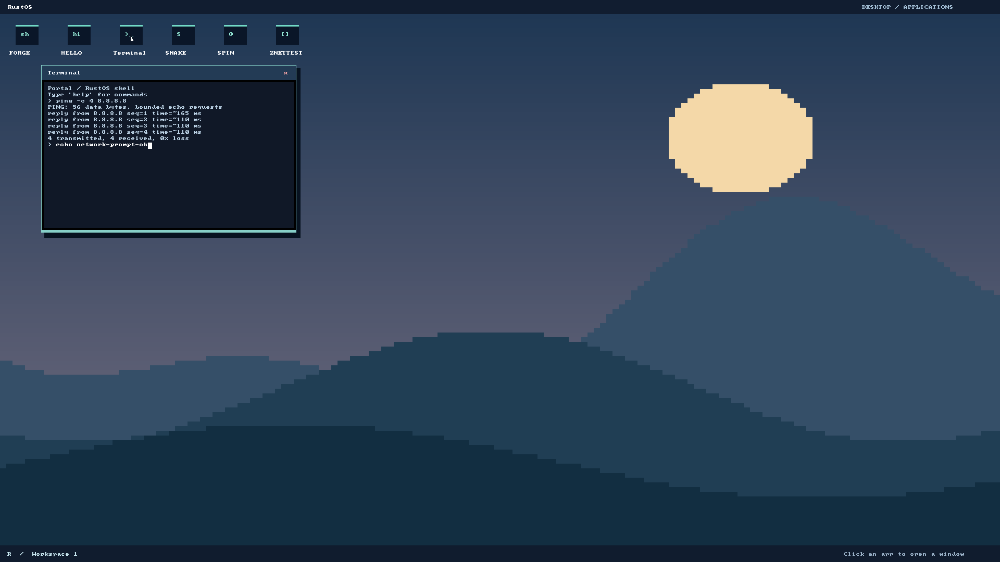

# Networking validation

Implementation worktree: `~/personal/os/space1.2.3.4....`, branch
`plan/qemu-ethernet-ping`, based on `c906002`. The original checkout's unrelated
UI work was not copied or modified. Toolchain remains `nightly-2025-01-30`;
smoltcp is pinned to `=0.12.0`. This report records commands run for this change,
not inherited assertions of success. See [architecture](networking.md).

## Red evidence

| Regression | Observed failure before implementation/fix |
| --- | --- |
| QEMU Ring 3 ping acceptance | `e2e/network.py` failed explicitly: `ping command is not implemented (unknown command)` |
| Hardware-independent socket/route tests | All first three stack cases failed at opening the missing endpoint service (`NoResources`) |
| PCI discovery and BAR decoding | Both standalone tests returned None for supported function and valid BAR |
| Atomic DMA frame reservation | Unit harness failed `failed reservation must preserve frames` |
| Mapping-aware user copy | Valid mapped range incorrectly rejected by the test-first scaffold |
| Userspace ping policy | All three tests failed while parser/client scaffolds rejected valid inputs |
| TCP pending state | Handshake incorrectly exposed EOF before connection completion |
| QEMU launch profile | All four host profile tests failed against an empty profile |
| Allocation failure | Injected socket allocation failure aborted with `memory allocation of 64 bytes failed` (status 134) |
| Loader with live socket buffers | Ring 3 lifecycle probe caused kernel OOM requesting a 29,343,744-byte staging buffer for a roughly 23 KiB program |
| File size mechanism | Unit regression returned FileNotFound for an existing empty file |
| Blocking waitpid | Real Ring 3 lifecycle assertion received `10` (syscall number), expected child exit code `0` |

The loader now queries file size, reserves exactly that size fallibly and checks
the complete read. The wait path now writes the child's code into the saved
return register and reaps after waking waiters. Neither fix claims complete
process memory reclamation.

## Checks and evidence

Baseline, before kernel edits: default/GRUB debug/GRUB release builds, full unit
harness, selected basic_boot/gfx/userspace/display_mapping/should_panic/
stack_overflow/keyboard_timer integration suites, and the complete desktop E2E
passed. The documentation checker and its original seven tests passed too.

During implementation, the following executed successfully:

- ABI host suite (2 cases), network service suite (4 cases), ping policy suite
  (3 cases), standalone PCI suite (2 cases) and mapping suite (2 cases).
- Allocation-failure executable: ICMP, UDP and TCP return NoResources, leave zero
  live endpoints and can subsequently reopen and close.
- Shared host tooling suite (11 cases) and desktop runner shell syntax check.
- QEMU local router: four application replies and four independently verified
  packet pairs, followed by prompt recovery.
- QEMU Internet: `ping 8.8.8.8` produced four verified Echo Replies, with the guest
  reporting `4 transmitted, 4 received, 0% loss`. No host sysctl was changed.
- QEMU missing-NIC boot: `ping: network unavailable`, followed by prompt recovery.
- Actual Ring 3 diagnostic: unmapped/supervisor/overflow/cross-page buffers,
  unaligned records, invalid arguments, foreign/stale handles, socket quotas,
  repeated close/reopen, normal exit, kill/reap, UDP empty/1024-byte datagrams and
  a TCP HTTP/1.0 GET to the independent host server all passed.

Serial logs, Ethernet libpcap traces and PPM screenshots are retained in the
worktree's ignored `target/network-*` directories. The final build was produced with `tools/build-grub-disk.sh`; it rebuilt all
application binaries/metadata and the GRUB release kernel. Checks were rerun
against that source/image after the implementation fixes:

| Final check | Result |
| --- | --- |
| `cargo build`, `cargo build --features grub`, GRUB release via disk builder | Pass; pinned nightly unchanged |
| `cargo test --no-run` | All kernel test executables compile (compilation check only) |
| `cargo test --lib` | 61 cases pass, including DMA rollback and file-size regression |
| basic_boot, gfx, userspace, display_mapping, should_panic, stack_overflow, keyboard_timer | All 14 cases across the seven complete selected suites pass |
| `e2e/ata.sh`, `e2e/fat32.sh` | Both complete fixture suites pass, two cases each |
| `cargo test --release --test heap_allocation` | All four cases pass |
| ABI / service / ping host suites | 2 / 4 / 3 cases pass; allocation fault-injection executable passes |
| Standalone PCI / user mapping tests | 2 / 2 cases pass |
| `python3 -B -m unittest discover -s tools/tests -p 'test_*.py'` | All 11 documentation/profile tooling tests pass |
| Internet `e2e/network.py --address 8.8.8.8` | Four application replies, four independently verified captured packet pairs, prompt recovered |
| No-NIC and Ring 3 diagnostic modes | Both pass; UDP empty/1024-byte datagrams and an HTTP/1.0 TCP exchange verified against host peers |
| `--count 16 --repeat 3 --minimum-replies 16` | 48 independently verified Echo Replies; both descriptor rings wrap repeatedly |
| `--address 10.0.2.99 --count 1 --minimum-replies 0` | Bounded timeout, 100% loss reported, prompt recovered |
| Complete `e2e/desktop.py` | All existing commands, concurrent apps, focus, drag/close and framebuffer assertions pass with networking enabled |
| Documentation checker, shell syntax, `git diff --check` | Pass |

The screenshot comes from the final tested GRUB image and shows the four replies,
zero reported packet loss and a subsequent command proving prompt recovery.
Serial and pcap evidence for it is in `target/network-8.8.8.8/`. Re-running the
network E2E regenerates that evidence; generated disk/log/pcap files are not
committed. Desktop E2E screenshots from the same tested build are retained alongside the
dedicated network evidence.

## Remaining limits

The unchanged debug heap stress suite times out at its existing 60-second limit
in `when_many_boxes_are_allocated_then_memory_is_allocated`. This was reproduced
both on the network implementation and on an untouched `git archive c906002`
checkout at `/tmp/rustos-network-baseline-c906002`; its timeout/assertion
was not changed. Existing general process frame/kernel-stack leaks remain. The
network probe verifies its own socket counters and cleanup, not physical process
reclamation. Legacy userspace constants tests are not evidence of Ring 3 execution;
the GRUB diagnostic supplies the real syscall evidence here.

The legacy bootloader dependency still emits its documented unused `rustc-abi`
target-field warning; the final project builds introduced no compiler warnings.

Manual host GUI interaction has not been checked; QMP interaction and screenshots
do not establish physical mouse/Wayland integration. Physical NIC hardware, SMP,
background networking, DHCP, DNS, a general HTTP command/library, TLS, server
sockets, graceful TCP close and comprehensive network security remain outside
this implementation. Live Internet success is host/network dependent; local
fixtures are the repeatable regression gate.
