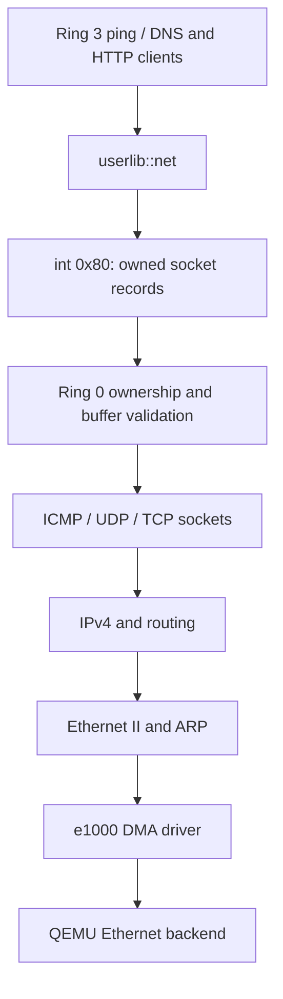

# Networking architecture and syscall interface

The OS supports a polled QEMU Intel 82540EM Ethernet interface, Ethernet II/ARP,
static IPv4 routing, ICMP Echo, connected UDP and outgoing TCP. Portal's Ring 3
`ping 8.8.8.8` command uses this path. There is no Linux socket ABI compatibility.

## Layer boundaries

| Layer | Implementation | Responsibility |
| --- | --- | --- |
| Device discovery | [PCI](../src/drivers/pci/mod.rs), Ring 0 | PCI configuration, supported device ID, BAR decoding and command bits |
| Ethernet transport | [e1000](../src/drivers/net/e1000.rs), Ring 0 | UC MMIO mapping, physical DMA ownership, RX/TX descriptors, link/MAC, Ethernet frame transport |
| Link protocols | `smoltcp = 0.12.0`, Ring 0 | Ethernet II framing, ARP neighbor resolution and cache |
| Internet | smoltcp, Ring 0 | IPv4 validation/checksums, local address, routing, ICMP encoding/validation |
| Transport | smoltcp plus [network service](../crates/net-stack/src/lib.rs), Ring 0 | ICMP echo endpoints, connected UDP datagrams, TCP handshake/retransmission/stream state |
| Resource and syscall boundary | [kernel facade](../src/net/mod.rs), [copy checks](../src/userspace/usercopy.rs), [shared ABI](../crates/net-abi/src/lib.rs) | PID ownership, quotas, generation handles, mapping/permission validation, owned copies and cleanup |
| Application SDK | [userlib::net](../user_programs/userlib/src/net.rs), Ring 3 | Typed nonblocking socket calls and errors |
| Applications | [ping policy](../crates/ping/src/lib.rs), [Forge adapter](../user_programs/forge/src/ping.rs), Ring 3 | Parsing, payload matching, timing, statistics, presentation, DNS and HTTP clients |



HTTP parsing, URLs, headers, body framing and redirects run in the reusable
[userspace HTTP library](http.md). Forge's hosted curl command and the standalone CURL
application both use `userlib::http`; DNS resolution uses connected UDP and GET
uses outgoing TCP. [TLS 1.3](tls.md) runs in userspace over the same TCP ABI,
with Rustls/WebPKI certificate verification and explicit entropy/UTC syscalls.
Existing TCP ISN seeding is not a cryptographic entropy source. TCP server listen/accept, explicit UDP bind,
graceful TCP shutdown, general socket waits, and background service remain future
interfaces; no placeholders for them are exposed.

## Execution and ownership

The driver is initialized once in shared boot after heap/input setup and before
the scheduler takes the frame allocator. A missing/unsupported device is nonfatal.
The BAR maps at `0xffffa00000000000`, supervisor-only and uncached, after rejecting
conflicting direct-map aliases. PCI bus mastering stays disabled during reset and
is enabled only after all DMA descriptors/buffers are ready. NIC interrupts stay
masked; timer and keyboard IRQs do not execute the network stack.

Each RX/TX ring has 32 legacy descriptors, in its own physical frame. Each buffer
has its own frame; heap virtual contiguity is never treated as physical contiguity.
The 66 frames (264 KiB) are a fixed boot lifetime reservation. Batch allocation
rolls back its cursor on failure. Frames and descriptors are reused per packet.
The driver advertises 31 usable receive descriptors to bound TCP receive bursts.
See [network performance](network-performance.md) for the receive-window fix and
measured HTTP throughput. Completed RX is copied to CPU-owned storage before returning the frame to DMA;
TX is reused only after completion. Malformed/incomplete frames are discarded.
Device reset polling is bounded. This is a single-CPU QEMU implementation, not
tested support for arbitrary physical Intel NICs or SMP.

Every socket syscall services at most eight received frames and a bounded egress
pass. smoltcp's unbounded ingress loop is not used. Only active callers drive
progress; clients should call `poll`/`recv` regularly and use `sleep_ticks(1)`
between attempts. No socket call busy-waits for a packet or handshake. Unsolicited
traffic is not serviced when no application is polling. Future servers will need
a separately tested worker/wakeup design.

There are at most 16 sockets globally and four per PID. The socket table reserves
capacity at boot. Socket buffers allocate fallibly: failure returns NoResources,
leaves no live endpoint, and permits a subsequent retry. ICMP has four packet
slots and 512-byte storage per direction; UDP has four packet slots and 4096-byte
storage per direction; TCP has a 32 KiB RX buffer and a 4096-byte TX buffer. New endpoints receive
fresh generation handles and automatically assigned local ports/identifiers.
Close/exit/kill discard queued data and release socket storage. Close is abortive
for TCP and does not promise a FIN or delivery of pending bytes.

Lock order is scheduler then network. The network service never calls the
scheduler; the syscall facade obtains PID before locking it. User records are
copied with every page and all paging-level permissions validated. No user
reference crosses a scheduling, mapping or protocol operation. Existing older
syscalls' numerical pointer checks are not retroactively hardened by this work.

## Socket ABI version 2

Integration preserves main's compositor message operations 20/21. This version
moves networking from the unmerged version 1 range 20–26 to 64–70, and platform
randomness/UTC from 27/28 to 80/81. Record layouts are unchanged. Rebuild every
app and the kernel together; old networking binaries cannot use the new dispatcher.
The lower range remains available for main's established and future core services.


All operations use the existing `int 0x80` register convention. The constants and
padding-free record definitions are shared by kernel and SDK. Main's established core syscall
numbers and control sentinels are preserved; the migration above is explicit. Version 2 is reported by `net::info()`;
packet record sizes must match exactly. These are socket handles, independent
of stdin and any future file descriptor interface.

| Number | Operation | Arguments (`rdi`, `rsi`, `rdx`) | Result |
| --- | --- | --- | --- |
| 64 | `net::open(kind)` | kind 1=ICMP Echo, 2=UDP, 3=TCP; zero; zero | Opaque PID-owned generation handle |
| 65 | `net::connect(handle, address, port)` | handle; packed IPv4/port; zero | Zero after association/handshake initiation |
| 66 | `net::send(handle, packet)` | handle; readable Packet pointer; 1032 | Accepted payload bytes; TCP may accept a short write |
| 67 | `net::recv(handle)` | handle; writable Packet pointer; 1032 | Received bytes; WouldBlock if no data; TCP zero means EOF |
| 68 | `net::close(handle)` | handle; zero; zero | Zero, resources released immediately |
| 69 | `net::poll(handle)` | handle; zero; zero | Readiness bitmask, after bounded protocol progress |
| 70 | `net::info()` | writable Info pointer; 32; zero | Zero; interface snapshot written even if NIC absent |

Connect packs `u32::from_be_bytes(address) << 16 | port` into a u64; high 16 bits
must be zero. ICMP uses port zero; UDP/TCP require a nonzero remote port. Numeric
unicast IPv4 only is supported; loopback, multicast, unspecified, broadcast,
the guest's own address and the local subnet address are rejected. A socket can
be connected only once. TCP connect starts asynchronously: await CONNECTED before
writing. TCP retries/timeouts are stack mechanisms; application deadlines remain
userspace policy.

`Packet` is exactly 1032 bytes: IPv4 octets at offset 0, native-endian u16 port at
4, native-endian u16 payload length at 6, and 1024 payload bytes at 8. On send,
address must be zero (connect selects the peer); port is the ICMP sequence or zero
for UDP/TCP. Echo payloads are limited to 64 bytes; UDP and stream chunks to 1024.
On receive, address/port identify the peer; ICMP port holds the sequence. Only
Echo Replies from that endpoint's peer/identifier are delivered. UDP packets from
other peers are discarded. Unused output bytes are zero. Oversized received UDP
datagrams are consumed and reported as MessageTooLarge, not silently truncated.
Byte copies permit unaligned records, but reject unmapped, supervisor, overflowing
and read-only output ranges before access.

`Info` is exactly 32 bytes: version u32, state u32 (present=1, link up=2), guest
IPv4[4], gateway[4], MAC[6], prefix u8, reserved-zero u8, IP MTU u32, global open
socket count u32. Readiness flags are READABLE=1, WRITABLE=2, CONNECTED=4, EOF=8.
A pending TCP handshake is neither CONNECTED nor EOF. Readiness is a snapshot,
not a promise of packet delivery. Zero-byte UDP datagrams are valid.

Networking errors encode as `u64::MAX - 255 + code`: Invalid=1, WouldBlock=2,
NoDevice=3, BadHandle=4, NoResources=5, NotConnected=6, MessageTooLarge=7, Closed=8.
SDK calls decode these to `Result`; this range does not collide with the existing
exit/block/error control sentinels. Unknown/stale/foreign socket handles return
BadHandle without exposing another process's socket. This ownership check is
not a full network permissions/capability or denial-of-service model.

## Running and testing

The pinned toolchain remains `nightly-2025-01-30`; smoltcp is pinned exactly at
`0.12.0` and dependency resolutions are recorded in Cargo.lock. The host launcher
profile is shared by runner and E2E tests:

```bash
cargo run
RUSTOS_NETWORK=none cargo run
```

The default profile is explicit `e1000`, user networking, guest `10.0.2.15/24`,
gateway `10.0.2.2`, MTU 1500. In Portal:

```text
ping 8.8.8.8
ping -c 16 10.0.2.2
```

The default count is four, maximum sixteen, with 56 data bytes, a 19-tick send
interval and a 55-tick per-probe timeout. Portal continues painting/reading input.
Replies must match source, sequence, per-command nonce and complete payload;
duplicates/late/foreign replies do not count. RTT reflects approximately 55 ms
PIT ticks and scheduling delay, not precise wire latency.

[QEMU's documentation](https://www.qemu.org/docs/master/system/devices/net.html)
explains that Internet Echo through user networking needs host Linux ping-socket
support and suitable `ping_group_range` permissions. Router-only success is not
proof that `8.8.8.8` works. No host sysctl changes are made by this implementation.

Build a fresh disk before runtime tests:

```bash
./tools/build-grub-disk.sh
python3 -B e2e/network.py
python3 -B e2e/network.py --address 8.8.8.8
python3 -B e2e/network.py --no-nic
python3 -B e2e/network.py --probe
python3 -B e2e/network.py --count 16 --repeat 3 --minimum-replies 16
python3 -B e2e/network.py --address 10.0.2.99 --count 1 --minimum-replies 0
python3 -B e2e/desktop.py
```

The networking harness copies the disk, uses private sockets, terminates/reaps
QEMU in `finally`, and preserves serial/pcap/screenshots under `target/network-*`.
Ping success requires application replies and independently validated captured
IPv4/ICMP checksums, identifiers, sequences and payloads. `--probe` provisions
local UDP and HTTP fixtures and drives the diagnostic `ZNETTEST` application in
Ring 3, including foreign/stale handles, bad pointers, quotas, normal exit,
kill/reap, repeated allocation/close, UDP boundary sizes, and TCP stream EOF.

Pure host suites must run outside the root's bare-metal Cargo configuration:

```bash
cd /tmp
cargo +nightly-2025-01-30 test --manifest-path "$REPO/crates/net-abi/Cargo.toml" --target x86_64-unknown-linux-gnu
cargo +nightly-2025-01-30 test --manifest-path "$REPO/crates/net-stack/Cargo.toml" --target x86_64-unknown-linux-gnu
cargo +nightly-2025-01-30 test --manifest-path "$REPO/crates/ping/Cargo.toml" --target x86_64-unknown-linux-gnu
cargo +nightly-2025-01-30 run --manifest-path "$REPO/crates/net-stack/Cargo.toml" --target x86_64-unknown-linux-gnu --example allocation_failure
rustc +nightly-2025-01-30 --edition=2021 --test "$REPO/src/drivers/pci/mod.rs" -o /tmp/rustos-pci-tests
/tmp/rustos-pci-tests
rustc +nightly-2025-01-30 --edition=2021 --test "$REPO/src/userspace/usercopy.rs" -o /tmp/rustos-usercopy-tests
/tmp/rustos-usercopy-tests
```

Set `REPO` to the absolute checkout path first. Follow the complete applicable
[testing matrix](testing.md) as well. The lifecycle probe additionally reproduced
and drove fixes for maximum-size loader staging allocations and blocked waitpid
return-register/reaping behavior. Existing process frame/stack leaks and the
debug heap stress timeout remain explicit limitations; socket cleanup tests do
not establish general process reclamation. Actual evidence is recorded in
[networking validation](networking-validation.md).
