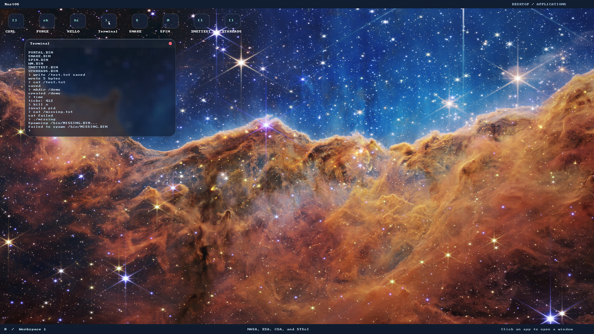

# Native threading and SMP validation

Recorded on 2026-10-30/31 against the implementation based on `beddaad`.
These are checks executed during this change, distinct from historical validation
documents. The [threading guide](threading.md) defines the supported platform,
API, ownership and limits; [testing](testing.md) defines the wider test matrix.

## Red tests and fixes

| Observable regression | Observed red | Resulting change |
| --- | --- | --- |
| CPU launcher accepts 1–32 | Host test raised `TypeError` for the missing `cpus` argument | Validated QEMU `-smp` selection; desktop default eight |
| Cargo runner rejects bad topology | Executable runner regression returned success and launched its QEMU stand-in for 0, 33 and invalid CPU counts | Propagate platform-validation failure before building or launching |
| Firmware topology | Valid 1–32 processor tables were rejected by the initial parser | Bounded, checksummed MADT parsing, sparse IDs and malformed-table rejection |
| Native Ring 3 threads | Fresh baseline boot reached unknown syscall 96; SDK consumer could not import `userlib::thread` | Shared ABI, kernel thread scheduling and typed Ring 3 runtime |
| User fault isolation | Guard-fault child caused a kernel double fault | Canonical error-code frames and process termination for user PF/GP |
| Repeated process cleanup | Kernel heap grew by 3456 bytes across the repeated-process assertion | Reusable bounded PCB slots, with monotonic PID identity |
| Yield return ABI | Real Ring 3 raw yield returned 102 instead of zero | Save/normalize deliberate block/yield frames before checking stopped service callers |
| Empty file writes | Empty SDK slice was rejected; pure mapping test failed | Zero-length copies do not inspect a pointer or page table |
| Filesystem progress on one CPU | Probe timed out while a worker repeatedly performed PIO; register capture showed kernel ATA polling | Preserve pending kernel-mode timer requests and reschedule at syscall return after releasing service locks |
| Desktop under SMP | Existing drag/reopen checks timed out while PIO held global entry | Owned syscall buffers and an independent filesystem service lock |
| Idle secondary CPU overhead | Snake launch/wait used 26% of one host core twice against the unchanged 25% budget; starting build used 23% | Mask idle AP scheduling timers; retain targeted work/deadline IPIs and unmask before user execution |
| Surface-copy throughput | Isolated desktop run still used 30% in Snake launch/wait after idle timer masking | Copy full words plus exact byte tails through assembly; validate the complete snapshot destination once and copy directly from stable owned surface frames |
| AP cache initialization | New QEMU control-register assertion failed after native-thread success: secondary `CR0` values were `0xe0000011` | Clear reset CD/NW bits during the protected-to-long-mode AP transition |
| Keyboard bursts and IRQ bounds | Framebuffer showed only `echo ` from the injected `echo speed` burst; controller unit drained 1 instead of 32 bytes | Bounded pending-byte drain, preserving AUX bytes for the mouse driver |
| Keyboard overflow recovery | Overflow regression observed drop count 0 instead of 1 | Atomic drop accounting without console locks in IRQ context; queue remains usable after draining |
| Native UI acknowledgement latency | Press reached and painted in Ring 3 but the unchanged pressed-pixel assertion failed; mailbox probe hit unknown syscall 108 | Generic thread wait for PID-owned mailbox readiness/deadline, chosen by the userspace window toolkit and compositor |
| Reap diagnostics | Existing desktop assertion did not see the reaped child | Restore the established reap diagnostic |
| Network fixture startup | Guest lifecycle checks outlasted the host fixture's request window; the new deferred-worker test failed because the helper was absent | Start fixture workers on guest transport readiness, within the existing overall deadline |
| Invalid-clock profile with SMP | QEMU rejected `smp.base`; host clock-override test raised `TypeError` | Select RTC by its named platform argument, preserving the eight-CPU argument |

No existing timeout, cleanup counter, packet assertion or expected error was
relaxed. The network fixtures bind/listen before boot; only their request-timeout
workers wait for transport readiness. Test programs and temporary-file policy
remain in Ring 3. The kernel has no special test executable or filename behavior.

The AP cache-state correction follows the reset/cache-control contract in
[Intel SDM Volume 3A, section 9.3](https://www.intel.com/content/dam/www/public/us/en/documents/manuals/64-ia-32-architectures-software-developer-vol-3a-part-1-manual.pdf#page=319).
Runtime CPU-register captures now accompany every successful SMP profile and
assert that all online processors have CD/NW clear. This checks startup state;
it does not establish cache performance on physical hardware.

## Executed build and kernel checks

All applications and generated flat binaries/metadata were rebuilt with
`tools/build-user.sh` through `tools/build-grub-disk.sh target/smp-current.img`.
Runtime tests boot independent writable copies of this image.

The release `kernel.elf` embedded in the tested `target/smp-current.img` has SHA-256
`efb2acd7f7fbf1f8b561b7b28d10b2937b091fd682800570c5937882487ce50e`;
the generated `zthreads.bin` SHA-256 is
`3cd2260a53d91536c7f3115586247181c6fd9f6f3a068dd021cea54e2f3497f5`.

Passed:

- `cargo build`, `cargo build --features grub`, and
  `cargo build --release --features grub`.
- `cargo test --no-run` (compilation only), followed by actual
  `cargo test --lib`: 78 kernel cases.
- `cargo test --test basic_boot --test gfx --test userspace --test display_mapping
  --test stdio --test threads --test keyboard_timer --test should_panic
  --test stack_overflow`: all nine selected executables completed successfully.
- `cargo test --release --test heap_allocation`: all five cases.
- `e2e/ata.sh` and `e2e/fat32.sh`: two real fixture cases each, including sector
  round trips and multi-cluster file write/read/delete. Disposable fixtures were
  used sequentially.
- `e2e/build_profile.sh`: the generated disk contains the release GRUB kernel.
  A subsequent comment-only rebuild has identical loadable bytes to the tested
  image kernel (`objcopy -O binary` followed by `cmp`).

The thread ownership harness covers foreign/stale/self joins, process-private
wait keys, failed frame-transaction rollback, frame recovery and constant heap
usage across repeated process creation. Display tests preserve cross-process
code/surface isolation, padded pitch and final partial-page boundaries.
The mailbox regression also forces a blocked waiter, delivers from another PID,
checks its saved readiness return register and verifies enqueue-before-park.

Host checks passed:

- Tooling: 31 Python cases; native SDK compile checks: one valid owned capture
  and three rejected transfers (`Rc`, borrowed local, mutex guard).
- MADT: two cases covering all counts 1–32 and malformed/sparse topology;
  threading ABI: two cases; mapping/copy validation: four cases, including all
  unaligned source/destination offsets and short word/tail boundaries.
- Native UI: damage 4, widgets 18, glass 6, terminal model 2.
- Pure network ABI 2, network stack 5, ping 3, HTTP 22, TLS 7;
  network allocation-failure example recovered ICMP/UDP/TCP resources.
- PCI 2, entropy 3, CMOS clock 4.

Host Rust suites were run with the pinned nightly and an explicit host target,
outside the root bare-metal Cargo configuration where necessary.

## CPU-count and resource-exhaustion execution

The following command completed successfully for **every CPU count from 1 to 32**:

```bash
RUSTOS_TEST_DISK=target/smp-current.img python3 -B e2e/smp.py \
  --cpus 1 2 3 4 5 6 7 8 9 10 11 12 13 14 15 16 \
         17 18 19 20 21 22 23 24 25 26 27 28 29 30 31 32
RUSTOS_TEST_DISK=target/smp-current.img python3 -B e2e/smp.py --cpus 8 --stress
```

Each boot asserted the discovered online count, pinned workers on every reported
CPU, checked distinct stack addresses and computed results, and required the full
`THREAD_TEST_PASS` probe. This covers contended mutex/Once/condition-variable
operations, wait mismatch/timeout/wake races, raw yield return, invalid requests,
join/detach recovery, process kill/wait, worker guard faults, remote unmap faults,
and a privileged-instruction fault confined to its child PID. Repeated filesystem
calls also exercise deferred kernel-mode timer requests and sibling progress.

The extra eight-CPU exhaustion run created 78 independent processes before physical
allocation failed. It verified exact frame-count rollback for that failed spawn,
killed/reaped all committed children and recovered the original frame count.

Actual output included:

```text
PASS: 1 CPUs; native threads and lifecycle assertions
PASS: 8 CPUs; native threads and lifecycle assertions
PASS: 32 CPUs; native threads and lifecycle assertions
[threads] allocation failure rollback PASS processes=78
THREAD_TEST_PASS
```

The runner's complete output is `/tmp/rustos-final-cpu-matrix.log`; per-boot
serial logs are `target/smp/1.log` through `target/smp/32.log`. The additional
exhaustion run updates `target/smp/8.log` and records its runner output in
`/tmp/rustos-final-stress.log`. These are generated local artifacts.

## Eight-CPU integration

With `RUSTOS_TEST_DISK=target/smp-current.img RUSTOS_CPUS=8`, the following
runtime checks passed:

- `e2e/network.py --probe`: actual Ring 3 user-buffer validation, socket ownership,
  cleanup, UDP boundaries and TCP HTTP requests.
- `e2e/network.py --no-nic`: missing hardware reported and prompt recovered.
- `e2e/network.py --count 16 --repeat 3 --minimum-replies 16`: 48 independently
  packet-verified router replies and prompt recovery across ring wrap.
- `e2e/network.py --address 10.0.2.99 --count 1 --minimum-replies 0`: no fabricated
  replies; timeout completed and prompt recovered.
- `e2e/http.py`: Portal curl, standalone CURL, Ring 3 DNS/HTTP and cleanup.
- `e2e/tls.py`, `--no-rng`, and `--bad-clock`: verified TLS/RSA, certificate
  rejection, redirect/streaming cleanup, absent entropy and invalid UTC handling.
- `e2e/desktop.py`: separate compositor/DE, exact wallpaper pixels, full 1080p
  display/pointer edges, file commands, hosted shell lifecycle, concurrent apps,
  focus, drag/close and compositor survival after DE exit.
- `e2e/glass_ui.py`: negotiated window size, rounded/glass pixels, sharp text,
  button capture, backdrop resampling, focus and lower-layer damage.
- `e2e/net_perf.py --label smp --assert-fast`: both 128 KiB streams had exact
  lengths/checksums and packet evidence, with no observed wire retransmissions.

After the final scheduler, copy and keyboard changes, an isolated
`e2e/desktop_perf.py` passed every unchanged eight-CPU budget. Measured results:

| Check | Actual |
| --- | --- |
| Empty desktop | 1.3% of one host core |
| Idle terminal | 11.5% |
| Snake launch/wait with terminal | 24.0% (25% budget) |
| Pointer maximum | 55 ms (200 ms budget) |
| Keyboard burst drain | 91 ms (150 ms budget) |
| Pointer under CPU-bound Spin | 19 ms (200 ms budget) |

Focused terminal input also completed under Spin load. Earlier one-CPU diagnostic
runs exposed keyboard timing failures, including a focused-input failure on the
starting image; those observations drove the bounded controller drain rather than
a relaxed timeout. The final eight-CPU performance log is
`/tmp/rustos-smp-desktop-perf-mailbox.log`.

Logs use `/tmp/rustos-smp-*.log`; packet captures and network diagnostics are
under `target/network-*`. External public Internet requests were not part of
these deterministic acceptance runs.



This screenshot was captured during the successful eight-CPU desktop test from
the tested build. It shows the Ring 3 terminal's file/error results, compositor
presentation and discovered `ZTHREADS` launcher. The CPU-count and concurrency
assertions come from executable tests, rather than the screenshot.

## Baseline failure and verification limits

The debug `cargo test --test heap_allocation` still times out at the unchanged
60-second limit in the existing 67,108,864-allocation stress case. It failed both
in this implementation and in an isolated checkout of starting commit `beddaad`.
The preceding four debug cases pass; the unchanged optimized suite passes all
five. Logs from this session are `/tmp/rustos-smp-heap-debug.log`,
`/tmp/rustos-smp-heap-baseline.log`, and `/tmp/rustos-smp-heap-release.log`.
This debug suite is an outstanding failure, not a green check.

An earlier isolated one-CPU `e2e/desktop_perf.py` run failed its 150 ms
keyboard-burst assertion (`/tmp/rustos-smp-one-desktop-perf-final.log`). After
generic mailbox waiting replaced userspace protocol polling, the final one-CPU
run passed every unchanged assertion: 0.3% empty-desktop CPU, 9.5% idle-terminal
CPU, 23% Snake launch/wait CPU, 64 ms maximum pointer response, 41 ms keyboard
burst and 20 ms pointer response under Spin load. Its log is
`/tmp/rustos-smp-one-desktop-perf-mailbox.log`.
The starting image's separate performance run passed the Snake CPU budget at 23%
but failed focused input under Spin load (`/tmp/rustos-baseline-desktop-perf.log`).
That historical failure is retained; the final implementation's pass comes from
the executed one- and eight-CPU checks above. No latency threshold was changed.

The interactive nonterminating `gfx_demo` is not an unattended test gate.
Physical hardware and manual host GUI pointer/capture behavior remain unverified.
The supported SMP boot platform is BIOS/GRUB QEMU `pc` with xAPIC; CPU hotplug,
NUMA, x2APIC, hardware FPU/SIMD context, compiler TLS and Rust `std` are outside
this implementation. Coarse kernel and device locking remains a scaling limit.
