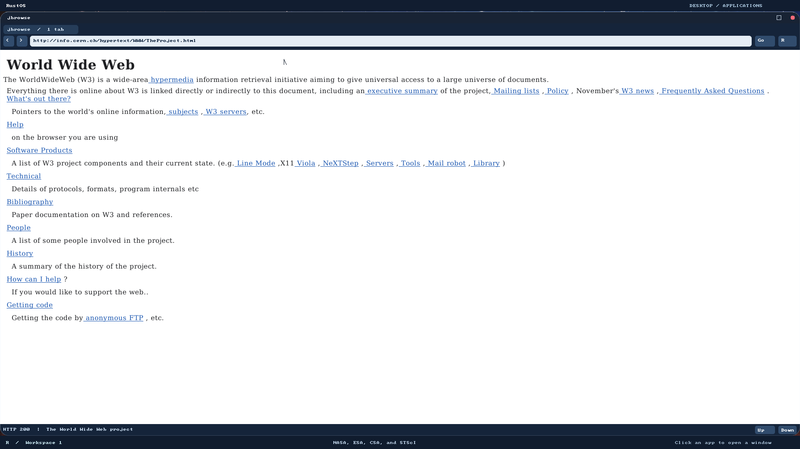
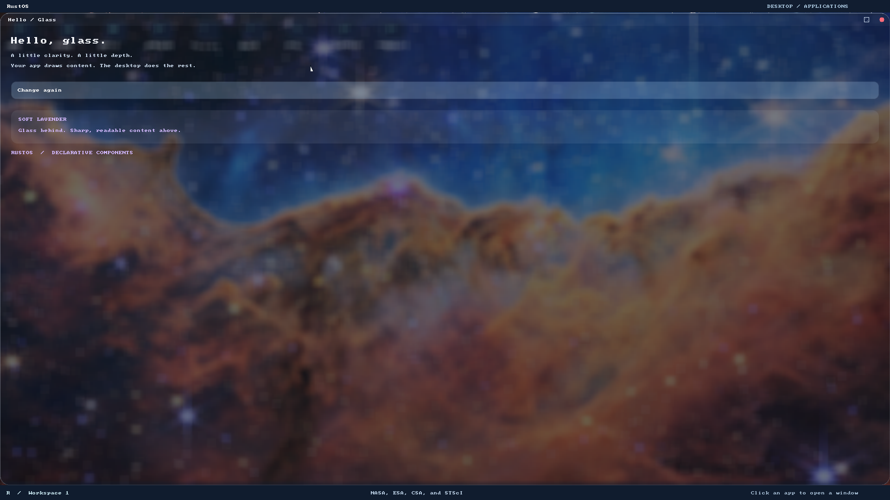

# Native window resize and expand/restore

Window resize and maximize policy live in `/BIN/WM.BIN`, an ordinary userspace
compositor. The DE supplies its panel reservations. The kernel continues to own
protected display-sized surfaces, snapshots and scalar IPC; no kernel/ABI change
was needed. This work precedes the next P4/P5 browser phases on their PR stack.

Drag a native window edge/corner to resize. Click the square immediately left of
Close to expand to the DE work area, then click it again to restore the old size
and position. With the default1920×1080 display,28-pixel top panel,32-pixel bottom
panel and28-pixel titlebar, maximum content is1920×992. Both panels remain visible.

The [SDK protocol](ui.md#window-protocol-version-2-and-resizing) negotiates version2
and includes actual dimensions with every immutable frame. The compositor owns
one active resize offer and one coalesced target. Old frames retain their old
geometry while an offer is pending; only a matching new frame can adopt it. New
12-bit signed pointer fields cover the complete display width. Older fixed-size
version-1/native and raw clients retain their existing formats.

Source boundaries: [geometry and frame invariants](../user_programs/wm/src/geometry.rs),
[owned caches](../user_programs/wm/src/cache.rs), [session/input policy](../user_programs/wm/src/session.rs),
[snapshots/composition](../user_programs/wm/src/display.rs),
[safe SDK](../user_programs/userlib/src/ui/mod.rs),
[browser relayout](../user_programs/jbrowse/src/main.rs).

Caches use fallibly allocated, geometry-checked owned buffers. Front and staging
buffers have separate lifetimes; no borrow crosses publication or scheduling.
Closing a window releases its cache slot. The heap may retain reusable high-water
pages. Full-display scratch and quarter-size blur arrays fit the supported display
and padded pitch envelope. Standard canvases continue to validate complete mapped
ranges, honor pitch and clip drawing. No new unsafe raw app pointer is introduced.

The browser retains its parsed document, decoded assets and edited form values,
relayouts at the new width with the painter's font metrics, clamps scroll, and
moves its URL/navigation/status controls with the canvas. Generic SDK component
loops redraw on resize; other custom apps own their content reflow. Terminal's
text grid currently stays fixed within its resized canvas. Maximization retains
window decorations and panels; borderless fullscreen, snapping and double-click
maximize are not implemented by this change.

## Red → green and verification

[Executed evidence](window-resize/README.md) includes the original960×600 protocol
rejection, fixed geometry returning640×400 instead of960×600, missing full-size
cache allocation, and the native expander failing to change wallpaper pixels.
The first native resize run passed maximize/restore, edge growth/shrink and pointer
input above1023. A stronger test then found a real input bug: after editing a form,
maximizing/restoring cleared its active field and Enter reloaded the form instead
of submitting. Decoration capture now stays in the WM through release, so a titlebar
click cannot become a client click as geometry changes. The original submission
assertion was retained.

Tests cover geometry edges/corners/minima/maximum workspace/overflow, old versus
offered frames, owned cache limits/initialization, protocol/reserved bits/pointer
ranges, pending resize events, raster clipping/pitch, glass/input/damage regressions,
actual QMP resize/maximize interactions and browser form state. Native glass tests
also exercise repeated maximize/restore while preserving declarative widget state.
Reproduction uses freshly rebuilt applications/metadata and a disposable disk:

```bash
./tools/build-user.sh
./tools/build-grub-disk.sh target/window-resize-final.img
RUSTOS_TEST_DISK=target/window-resize-final.img RUSTOS_JBROWSE_RESIZE=1 RUSTOS_JBROWSE_PUBLIC=1 RUSTOS_JBROWSE_NATIVE_SCRIPTS=1 RUSTOS_JBROWSE_SCRIPTS=1 RUSTOS_JBROWSE_IMAGES=1 RUSTOS_JBROWSE_TYPOGRAPHY=1 RUSTOS_JBROWSE_LIFECYCLE=1 python3 -B e2e/jbrowse.py
RUSTOS_TEST_DISK=target/window-resize-final.img RUSTOS_WINDOW_RESIZE=1 python3 -B e2e/glass_ui.py
RUSTOS_TEST_DISK=target/window-resize-final.img python3 -B e2e/desktop.py
RUSTOS_TEST_DISK=target/window-resize-final.img python3 -B e2e/desktop_perf.py
```

No manual host GUI/input-backend test was performed. Automated injection does not
verify host cursor capture or human interaction on Wayland/X11. Dynamic display
mode changes, complete layouts for every custom app, exhaustive low-memory fault
injection and a production display/resource security model remain outside this
change. Google results and authenticated Facebook browsing are still unverified;
resizing makes their viewport practical, not their unsupported APIs functional.

The full8-CPU browser/CERN/form/cancellation suite and the desktop regression
passed. The final pure mode-state refactor additionally separates desired,
offered and committed maximize state: allocation refusal preserves the last
committed mode/restore rectangle, and rapid toggles cannot change the mode of a
frame already in flight. Initial caches are reserved before publishing a new
window. Final-source repeated native glass checks pass on8 CPUs;5 geometry/mode,
27 UI,1 cache,5 blur,3 input,5 damage and45 tooling cases passed. The performance
runner's stale launcher bug was reproduced and fixed; its existing CPU/input
budgets pass. The known bootloader `rustc-abi` warning remains visible.




